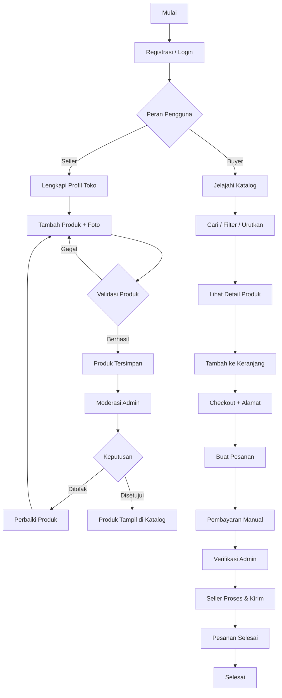
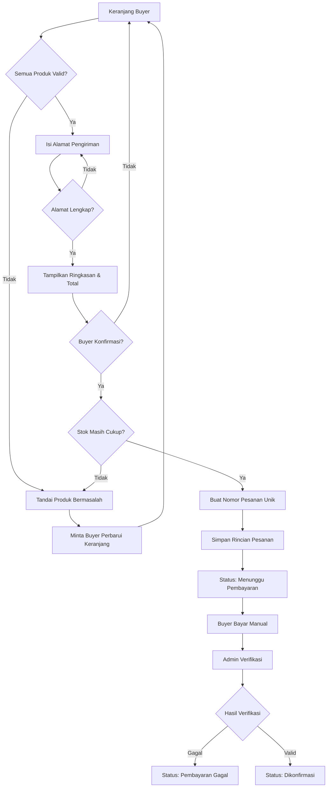
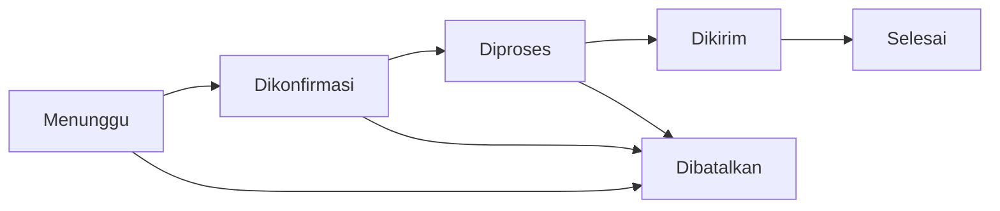
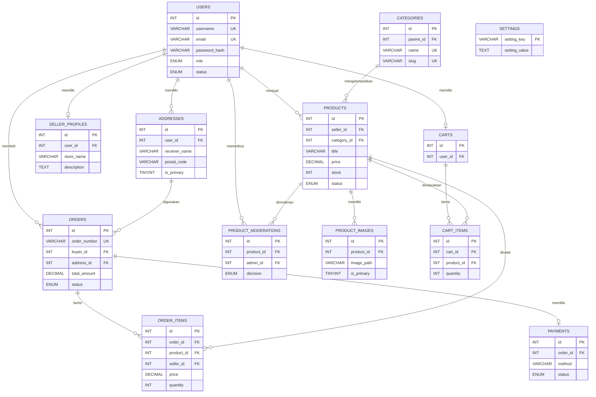
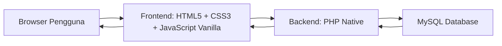

# BUSINESS REQUIREMENT DOCUMENT (BRD)

## RELOVA

### Relova Preloved Fashion Marketplace

**Jenis Dokumen:** Business Requirement Document (BRD)  
**Versi Dokumen:** 1.0  
**Tanggal Pembuatan:** 23 November 2026  
**Status Dokumen:** Draft — Menunggu Persetujuan  
**Nama Penyusun:** Tim Proyek Relova  

---

## 3.1 Cover Document

Halaman cover ini merupakan bagian depan dokumen yang memberikan identitas resmi BRD Relova. Informasi pada halaman ini menjadi acuan administratif dalam proses peninjauan, persetujuan, dan pengarsipan dokumen.

| Informasi | Keterangan |
|---|---|
| Judul Dokumen | Business Requirement Document (BRD) |
| Nama Proyek | Relova |
| Nama Sistem | Relova Preloved Fashion Marketplace |
| Jenis Dokumen | Business Requirement Document (BRD) |
| Versi Dokumen | 1.0 |
| Tanggal Pembuatan | 23 November 2026 |
| Status Dokumen | Draft — Menunggu Persetujuan |
| Nama Penyusun | Tim Proyek Relova |

---

## 3.2 Document Control

Tabel berikut berfungsi sebagai catatan pengendali dokumen, meliputi identitas dokumen dan riwayat revisi. Setiap perubahan pada dokumen wajib dicatat pada bagian Revision History agar jejak perubahan dapat ditelusuri.

| Document Title | Project Name | Document Version | Created Date | Author | Document Status | Revision History |
|---|---|---|---|---|---|---|
| Business Requirement Document (BRD) — Relova Preloved Fashion Marketplace | Relova | 1.0 | 23 November 2026 | Tim Proyek Relova | Draft — Menunggu Persetujuan | R0 — 23 November 2026: Penyusunan awal dokumen BRD oleh Tim Proyek Relova. |

**Riwayat Revisi Detail**

| Versi | Tanggal | Deskripsi Perubahan | Penyusun | Status |
|---|---|---|---|---|
| 1.0 / R0 | 23 November 2026 | Penyusunan awal seluruh bagian BRD sesuai struktur yang ditetapkan. | Tim Proyek Relova | Draft — Menunggu Persetujuan |

---

## 3.3 Table of Contents

Catatan: Bagian 3 (Struktur Dokumen) ditempatkan di awal dokumen karena berfungsi sebagai halaman cover, tabel kontrol dokumen, dan daftar isi. Penomoran bagian lainnya mengikuti struktur yang telah ditetapkan.

1. Identitas Proyek
2. Tujuan Pembuatan BRD
3. Struktur Dokumen BRD
   - 3.1 Cover Document
   - 3.2 Document Control
   - 3.3 Table of Contents
4. Executive Summary
5. Background
6. Business Overview
   - 6.1 Business Concept
   - 6.2 Business Model
   - 6.3 Target Market
   - 6.4 Value Proposition
   - 6.5 Business Goals
7. Business Objectives
8. Problem Statement
9. Project Scope
   - 9.1 In Scope
   - 9.2 Out of Scope
10. Stakeholder Identification
11. User / Actor Identification
    - 11.1 Buyer
    - 11.2 Seller
    - 11.3 Admin
12. Business Requirements
13. Functional Requirements
    - 13.1 Authentication & Authorization
    - 13.2 Buyer Management
    - 13.3 Seller Management
    - 13.4 Product Management
    - 13.5 Product Categories
    - 13.6 Product Discovery
    - 13.7 Product Detail
    - 13.8 Shopping Cart
    - 13.9 Checkout
    - 13.10 Payment Management
    - 13.11 Order Management
    - 13.12 Seller Dashboard
    - 13.13 Buyer Dashboard
    - 13.14 Admin Dashboard
    - 13.15 Product Moderation
14. Non-Functional Requirements
    - 14.1 Performance
    - 14.2 Security
    - 14.3 Usability
    - 14.4 Responsive Design
    - 14.5 Reliability
    - 14.6 Maintainability
    - 14.7 Compatibility
    - 14.8 Availability
15. Business Rules
    - 15.1 User Rules
    - 15.2 Product Rules
    - 15.3 Seller Rules
    - 15.4 Transaction Rules
    - 15.5 Admin Rules
16. Business Process
    - 16.1 Registration Process
    - 16.2 Login Process
    - 16.3 Seller Product Process
    - 16.4 Buyer Shopping Process
    - 16.5 Checkout Process
    - 16.6 Payment Process
    - 16.7 Order Processing Process
    - 16.8 Product Moderation Process
17. Data Requirements
18. Technology Requirements
    - 18.1 Frontend
    - 18.2 Backend
    - 18.3 Database
    - 18.4 Development Environment
    - 18.5 Architecture
19. System Limitations & Project Constraints
    - 19.1 Business Scope Limitations
    - 19.2 User Limitations
    - 19.3 Product Limitations
    - 19.4 Transaction Limitations
    - 19.5 Payment Limitations
    - 19.6 Shipping Limitations
    - 19.7 Communication Limitations
    - 19.8 Technology Limitations
    - 19.9 Browser & Device Limitations
    - 19.10 Security Limitations
    - 19.11 Data Limitations
    - 19.12 Admin Limitations
    - 19.13 Operational Limitations
    - 19.14 Development Limitations
20. Assumptions
21. Risks & Mitigation
22. Acceptance Criteria
23. Priority Requirements
24. Success Metrics
25. Future Development
26. Glossary
27. Conclusion
28. Ketentuan Teknis dan Format Dokumen

---

## 1. Identitas Proyek

| Atribut | Keterangan |
|---|---|
| Nama Proyek | Relova |
| Nama Sistem | Relova Preloved Fashion Marketplace |
| Jenis Sistem | Website Marketplace Preloved |
| Platform | Website responsif yang diakses melalui browser |
| Target Pengguna | Buyer, Seller, dan Admin |
| Kategori Produk Utama | Pakaian preloved dan sepatu preloved |
| Konsep Bisnis | Platform jual beli pakaian dan sepatu preloved yang mempertemukan penjual barang fashion bekas masih layak pakai dengan pembeli yang mencari produk fashion dengan harga lebih terjangkau |
| Fokus Sistem | Pengelolaan produk, katalog, pencarian, keranjang belanja, pemesanan, transaksi, serta dashboard berdasarkan peran pengguna |
| Karakteristik Desain | Modern, minimalis, responsif, mudah digunakan, serta memiliki struktur sistem sederhana yang dapat dikembangkan secara bertahap |

Relova dibangun sebagai marketplace khusus preloved dengan ruang lingkup yang sengaja dibatasi pada dua kategori utama, yaitu pakaian dan sepatu. Pembatasan ini bertujuan menjaga konsistensi data produk, menyederhanakan proses moderasi, dan memungkinkan pengembangan sistem dilakukan secara inkremental tanpa mengubah konsep bisnis utama.

---

## 2. Tujuan Pembuatan BRD

Dokumen BRD ini disusun untuk menjadi acuan bersama bagi seluruh pihak yang terlibat dalam proyek Relova. Secara spesifik, dokumen ini bertujuan untuk:

1. **Menjelaskan latar belakang pengembangan website Relova.** Menguraikan kondisi dan kebutuhan yang melatarbelakangi perlunya platform khusus jual beli preloved.
2. **Menentukan tujuan bisnis yang ingin dicapai.** Merumuskan arah bisnis dan hasil yang diharapkan dari keberadaan platform.
3. **Mengidentifikasi masalah yang ingin diselesaikan.** Memetakan permasalahan pada praktik jual beli preloved saat ini.
4. **Menentukan kebutuhan bisnis sistem.** Menyusun kebutuhan tingkat tinggi yang menjadi dasar penurunan kebutuhan fungsional.
5. **Menentukan aktor dan hak akses.** Mendefinisikan peran pengguna beserta batasan aksesnya secara tegas.
6. **Menentukan ruang lingkup proyek.** Membatasi fitur yang termasuk dan tidak termasuk dalam versi pertama.
7. **Menentukan functional requirements.** Menjabarkan perilaku sistem yang harus diimplementasikan.
8. **Menentukan non-functional requirements.** Menetapkan mutu, keamanan, kinerja, dan karakteristik sistem lainnya.
9. **Menentukan business rules.** Merumuskan aturan bisnis yang mengikat setiap proses.
10. **Menjelaskan alur proses bisnis.** Menggambarkan langkah proses dari sudut pandang aktor dan sistem.
11. **Menjelaskan kebutuhan data.** Mengidentifikasi entitas, field, dan relasi yang dibutuhkan.
12. **Menentukan batasan sistem.** Mengungkap keterbatasan yang disengaja maupun yang melekat pada teknologi.
13. **Menentukan risiko pengembangan.** Mengantisipasi risiko bisnis maupun teknis beserta penanganannya.
14. **Menentukan kriteria keberhasilan.** Menyediakan ukuran objektif untuk menilai keberhasilan proyek.
15. **Menjadi acuan untuk pengembangan SRS, UI/UX, database, coding, dan testing.** Menjadi sumber rujukan tunggal sebelum dokumen teknis lanjutan disusun.

Dengan terpenuhnya tujuan-tujuan tersebut, BRD ini berfungsi sebagai kontrak kebutuhan awal antara pemilik proyek, tim pengembang, dan pihak penguji. Setiap keputusan desain atau implementasi yang menyimpang dari dokumen ini harus melalui proses perubahan requirement yang terdokumentasi.

---

## 4. Executive Summary

Relova merupakan website marketplace preloved yang dikembangkan untuk memfasilitasi jual beli pakaian dan sepatu bekas yang masih layak digunakan. Platform ini beroperasi sebagai perantara berbasis web yang mempertemukan dua kelompok pengguna utama, yaitu **Seller** yang memiliki barang preloved untuk dijual dan **Buyer** yang mencari produk fashion dengan harga lebih terjangkau. Pengguna pendukung lainnya adalah **Admin** yang bertugas menjaga tertibnya ekosistem platform.

Platform yang dikembangkan berupa **website responsif** yang dapat diakses melalui browser pada komputer desktop, tablet, maupun smartphone. Konsep bisnisnya sederhana: barang fashion yang masih memiliki nilai guna tidak perlu berhenti digunakan ketika pemilik awalnya sudah tidak memakainya. Relova menyediakan wadah terstruktur agar barang tersebut dapat ditemukan pembeli baru dengan proses yang jelas, transparan, dan dapat dilacak.

Permasalahan utama yang ingin diselesaikan adalah tersebarnya informasi produk preloved di berbagai kanal, pencarian yang tidak terorganisir, informasi kondisi barang yang sering tidak lengkap, serta belum adanya pengelolaan pesanan dan transaksi yang terstruktur di satu tempat. Selama ini jual beli preloved kerap dilakukan melalui media sosial atau pesan pribadi, sehingga buyer kesulitan membandingkan produk dan seller kesulitan mengelola produk maupun pesanan yang masuk.

Solusi yang ditawarkan Relova adalah penyatuan seluruh proses tersebut dalam satu sistem: katalog produk dengan pencarian, filter, dan pengurutan; halaman detail yang menampilkan kondisi dan kekurangan barang; keranjang belanja; checkout dengan alamat pengiriman; pencatatan pesanan beserta statusnya; dashboard khusus untuk Buyer, Seller, dan Admin; serta mekanisme moderasi produk oleh Admin. Semua proses dirancang untuk dapat dikembangkan secara bertahap sesuai kebutuhan.

Manfaat sistem bagi **Buyer** adalah kemudahan menemukan produk sesuai kategori, harga, ukuran, kondisi, dan merek disertai informasi yang lebih transparan. Bagi **Seller**, manfaatnya berupa sarana mengelola produk, stok, dan pesanan masuk dalam satu dashboard. Bagi **Admin**, manfaatnya berupa alat untuk mengelola pengguna, kategori, produk, dan transaksi serta menjaga kualitas informasi di platform. Secara keseluruhan, Relova mendukung penggunaan kembali barang fashion dan memperpanjang siklus hidup pakaian serta sepatu preloved.

Secara teknologi, sistem dibangun dengan **HTML5, CSS3, JavaScript Vanilla, PHP Native, dan MySQL**. Pengembangan backend menggunakan PHP Native tanpa framework PHP, frontend menggunakan HTML, CSS, dan JavaScript Vanilla tanpa framework frontend, serta database MySQL yang dapat dikelola melalui phpMyAdmin. Pemilihan stack ini disengaja untuk menjaga kesederhanaan struktur, meminimalkan ketergantungan pustaka, dan memudahkan pemeliharaan oleh tim pengembang.

Gambaran umum proses bisnis Relova adalah sebagai berikut: Seller mendaftar dan masuk ke dashboard, menambahkan produk beserta foto dan informasi kondisi, produk ditampilkan pada katalog setelah memenuhi ketentuan dan proses moderasi, Buyer mencari dan memilih produk, memasukkan produk ke keranjang, melakukan checkout dengan mengisi alamat pengiriman, sistem membuat pesanan dan mencatat pembayaran sesuai metode yang ditentukan, Seller memproses dan mengirim pesanan, status pesanan diperbarui hingga pesanan dinyatakan selesai. Admin mengawasi seluruh proses melalui dashboard dan melakukan penanganan apabila ditemukan pelanggaran atau ketidaksesuaian.

---

## 5. Background

Latar belakang pengembangan Relova berangkat dari perubahan perilaku konsumsi fashion serta meningkatnya kesadaran terhadap penggunaan kembali barang. Penjelasan berikut disusun secara umum tanpa menyertakan angka statistik atau hasil penelitian yang tidak memiliki sumber valid.

1. **Perkembangan tren fashion preloved.** Produk fashion bekas yang masih layak pakai semakin diterima sebagai pilihan konsumsi. Pertimbangan harga, keunikan model, dan kesadaran lingkungan mendorong sebagian konsumen untuk mencari pakaian dan sepatu preloved.

2. **Meningkatnya kebutuhan terhadap produk fashion yang lebih terjangkau.** Harga produk fashion baru menjadi pertimbangan bagi banyak konsumen. Produk preloved menjadi alternatif untuk mendapatkan barang dengan kualitas masih baik pada rentang harga yang lebih rendah.

3. **Banyaknya pakaian dan sepatu yang masih layak digunakan tetapi tidak lagi dipakai.** Lemari pakaian pribadi umumnya menyimpan barang yang sudah tidak sesuai ukuran, model, atau preferensi pemiliknya, padahal barang tersebut masih dapat digunakan oleh pihak lain.

4. **Potensi barang preloved untuk dijual kembali.** Barang yang tidak lagi digunakan memiliki nilai ekonomi. Tanpa wadah yang tepat, potensi nilai tersebut tidak tersalurkan dan barang berisiko terbuang.

5. **Permasalahan jual beli melalui media sosial.** Praktik jual beli preloved yang mengandalkan media sosial atau pesan pribadi memiliki kelemahan, antara lain informasi yang tersebar, tidak adanya katalog terpusat, serta sulitnya memantau status produk dan pesanan.

6. **Kesulitan buyer menemukan produk berdasarkan atribut.** Buyer sering kesulitan menyaring produk berdasarkan kategori, harga, ukuran, kondisi, dan merek karena informasi tidak disajikan secara konsisten.

7. **Kesulitan seller mengelola produk dan pesanan.** Seller yang menjual melalui beberapa kanal harus mencatat produk, stok, dan pesanan secara manual. Hal ini rawan terjadi duplikasi data, keterlambatan respons, dan kehilangan catatan transaksi.

8. **Informasi produk yang tidak terorganisir.** Foto, deskripsi, kondisi barang, dan kekurangan produk sering tersebar di percakapan, sehingga buyer harus bertanya berulang kali untuk mendapatkan informasi yang sama.

9. **Kurangnya sistem pengelolaan transaksi yang terstruktur.** Tanpa pencatatan pesanan dan status yang jelas, buyer maupun seller sulit mengetahui posisi transaksi, misalnya apakah barang sedang diproses, dikirim, atau telah diterima.

10. **Pentingnya platform khusus untuk jual beli preloved.** Keberadaan platform khusus memberikan struktur yang konsisten bagi katalog produk, identitas seller, alur pemesanan, dan pengawasan platform. Hal ini menjadi dasar perlunya Relova dibangun.

Relova hadir sebagai solusi dengan menyediakan satu sistem terpusat yang mengatur katalog, pencarian, detail produk, keranjang, checkout, pesanan, serta dashboard peran. Pendekatan ini tidak menghilangkan peran komunikasi antara buyer dan seller, tetapi menyediakan kerangka kerja yang lebih tertib dibandingkan transaksi yang hanya bergantung pada pesan pribadi.

---

## 6. Business Overview

### 6.1 Business Concept

Relova mengusung konsep **marketplace preloved** dengan fokus pada pakaian dan sepatu. Marketplace dalam konteks ini berarti platform tidak bertindak sebagai penjual barang, melainkan sebagai fasilitator yang menyediakan tempat bagi Seller untuk menawarkan produk dan bagi Buyer untuk menemukan serta memesannya. Setiap produk tetap menjadi tanggung jawab Seller yang mempublikasikannya, termasuk keakuratan deskripsi, kondisi, foto, dan harga.

Konsep ini menempatkan transparansi informasi sebagai prinsip utama. Karena barang yang dijual adalah barang preloved, kondisi fisik menjadi atribut penting yang harus diungkapkan. Relova mewajibkan Seller menyampaikan kondisi produk dan informasi kekurangan secara jelas pada halaman detail produk. Admin berperan menjaga agar informasi tersebut tidak menyesatkan, meskipun Admin tidak dapat memeriksa barang secara fisik.

### 6.2 Business Model

Relova beroperasi dengan model platform yang mempertemukan Buyer dan Seller melalui katalog terpusat. Alur nilai bisnisnya adalah:

1. Seller mendaftar dan membangun etalase dengan mengunggah produk preloved.
2. Sistem menyajikan produk tersebut dalam katalog yang dapat diakses Buyer.
3. Buyer menemukan produk melalui pencarian, filter, dan pengurutan, lalu membuat pesanan melalui keranjang dan checkout.
4. Sistem mencatat pesanan beserta statusnya dan menyediakan informasi pembayaran sesuai metode yang ditetapkan platform.
5. Seller memproses pesanan dan memperbarui status hingga barang diterima Buyer.
6. Admin melakukan pengawasan terhadap pengguna, produk, kategori, dan transaksi.

Model ini menempatkan sistem sebagai pencatat proses dan penyedia informasi, bukan sebagai pihak yang mengambil alih kepemilikan barang atau menjamin hasil transaksi di luar kendali platform.

### 6.3 Target Market

Target pasar Relova meliputi:

| Segmen | Karakteristik | Kebutuhan Utama |
|---|---|---|
| Pembeli produk fashion terjangkau | Mencari pakaian dan sepatu dengan harga lebih rendah dari produk baru | Harga jelas, pilihan produk beragam, proses pemesanan mudah |
| Pembeli produk preloved | Tertarik pada barang bekas masih layak pakai | Informasi kondisi dan kekurangan yang transparan |
| Penjual pakaian preloved | Memiliki pakaian yang tidak lagi digunakan | Wadah untuk mempublikasikan produk dan mengelola pesanan |
| Penjual sepatu preloved | Memiliki sepatu yang masih layak dipakai | Kategori khusus sepatu agar produk mudah ditemukan |
| Penggemar fashion secondhand | Mencari model atau merek tertentu yang tidak selalu tersedia baru | Pencarian berdasarkan merek, ukuran, dan kategori |

### 6.4 Value Proposition

| Pihak | Nilai yang Ditawarkan |
|---|---|
| Buyer | Katalog terorganisir, pencarian dan filter yang memudahkan penemuan produk, informasi kondisi dan kekurangan yang transparan, perbandingan harga yang lebih mudah, serta riwayat pesanan yang dapat dipantau. |
| Seller | Etalase digital untuk menampilkan produk, alat pengelolaan produk dan stok, daftar pesanan masuk, riwayat penjualan, serta dashboard yang merangkum kondisi toko. |
| Admin | Kendali terpusat atas pengguna, kategori, produk, dan transaksi serta sarana moderasi untuk menjaga kualitas informasi platform. |
| Platform | Ekosistem jual beli preloved yang tertib, dapat dilacak, dan dapat dikembangkan secara bertahap sesuai kebutuhan pengguna. |

### 6.5 Business Goals

**Jangka pendek:**

1. Menghadirkan website Relova yang dapat diakses dan digunakan oleh Buyer, Seller, dan Admin.
2. Menyediakan katalog pakaian dan sepatu preloved dengan informasi yang seragam.
3. Mewujudkan alur pemesanan dari keranjang hingga pencatatan pesanan yang dapat diuji.
4. Menyediakan dashboard minimal bagi masing-masing peran untuk mendukung pengambilan keputusan.
5. Menetapkan aturan bisnis dan batasan sistem yang menjadi acuan pengembangan.

**Jangka panjang:**

1. Membangun basis pengguna Buyer dan Seller yang aktif menggunakan platform secara berkelanjutan.
2. Meningkatkan kualitas dan kelengkapan data produk melalui moderasi dan masukan pengguna.
3. Mengembangkan fitur pendukung yang memperkuat kepercayaan transaksi sesuai hasil evaluasi.
4. Menyiapkan arsitektur sistem yang memungkinkan penambahan fitur tanpa mengubah konsep dasar marketplace.
5. Menjadikan Relova sebagai rujukan proses jual beli preloved yang tertib dan transparan.

---

## 7. Business Objectives

| ID | Nama Tujuan | Deskripsi | Alasan | Target | Indikator Keberhasilan |
|---|---|---|---|---|---|
| BO-001 | Mempermudah jual beli pakaian dan sepatu preloved | Menyediakan alur.transaksi yang jelas mulai dari penemuan produk hingga pencatatan pesanan. | Proses manual melalui pesan pribadi tidak konsisten dan sulit dipantau. | Seluruh langkah inti transaksi tersedia dalam sistem versi pertama. | Pengujian alur end-to-end registrasi hingga pesanan berhasil tanpa perpindahan ke kanal eksternal. |
| BO-002 | Menyediakan katalog terorganisir | Menyusun produk ke dalam struktur kategori dan subkategori yang seragam. | Informasi produk yang tersebar menyulitkan penelusuran. | Kategori pakaian dan sepatu beserta subkategorinya tersedia dan dapat dikelola Admin. | Seluruh produk yang ditambahkan Seller memiliki kategori valid dan tampil pada katalog. |
| BO-003 | Mempermudah buyer menemukan produk | Menyediakan pencarian, filter, dan pengurutan produk. | Buyer membutuhkan penyaringan sesuai harga, ukuran, kondisi, dan merek. | Fitur pencarian, filter, dan sorting dapat digunakan pada halaman katalog. | Hasil pencarian dan filter sesuai kriteria yang dimasukkan pada pengujian. |
| BO-004 | Membantu seller mengelola produk | Menyediakan fungsi tambah, ubah, hapus, dan unggah gambar produk. | Seller memerlukan sarana pengelolaan etalase yang sederhana. | Seller dapat mengelola seluruh produknya sendiri melalui dashboard. | Seluruh operasi CRUD produk oleh Seller berhasil dan perubahan tampil pada katalog. |
| BO-005 | Membantu seller mengelola pesanan | Menyediakan daftar pesanan masuk dan pembaruan status. | Seller sulit memantau pesanan jika dicatat manual. | Pesanan masuk tampil pada dashboard Seller dan status dapat diperbarui sesuai aturan. | Perubahan status oleh Seller tercatat dan dapat dilihat Buyer. |
| BO-006 | Meningkatkan transparansi informasi produk | Mewajibkan pencantuman harga, kondisi, deskripsi, dan kekurangan produk. | Ketidaksesuaian kondisi barang menjadi sumber ketidakpuasan Buyer. | Field kondisi dan kekurangan menjadi bagian wajib pada detail produk. | Produk tanpa informasi wajib tidak dapat disimpan atau ditampilkan. |
| BO-007 | Mengelola transaksi secara terstruktur | Mencatat pesanan, rincian produk, alamat, dan status dalam satu sistem. | Transaksi yang tidak tercatat menimbulkan ketidakjelasan. | Setiap checkout menghasilkan nomor pesanan dan rincian transaksi. | Nomor pesanan unik terbentuk dan data transaksi dapat ditelusuri. |
| BO-008 | Mendukung penggunaan kembali barang fashion | Menyediakan wadah bagi barang preloved untuk dipakai kembali. | Barang masih layak pakai sering tidak tersalurkan. | Katalog menampilkan produk preloved dari berbagai Seller. | Jumlah produk aktif bertambah seiring aktivitas Seller pada data uji. |
| BO-009 | Meningkatkan kemudahan penggunaan platform | Menyediakan antarmuka yang konsisten, responsif, dan mudah dipahami. | Pengguna dengan latar belakang teknis beragam harus dapat menggunakan sistem. | Tampilan responsif pada desktop, tablet, dan smartphone. | Pengujian usability menunjukkan pengguna dapat menyelesaikan tugas utama tanpa bantuan. |
| BO-010 | Membangun sistem yang dapat dikembangkan | Menyusun struktur sistem sederhana yang memungkinkan penambahan fitur bertahap. | Kebutuhan pengguna dapat berkembang seiring waktu. | Pemisahan modul yang jelas antara frontend, backend, dan database. | Fitur baru dapat ditambahkan tanpa mengubah alur inti yang telah disetujui. |

---

## 8. Problem Statement

| ID | Problem | Description | Impact | Affected Stakeholder | Proposed Solution |
|---|---|---|---|---|---|
| PRB-001 | Produk preloved tersebar di berbagai platform | Informasi produk berada di banyak kanal tanpa satu titik pusat. | Buyer harus membuka beberapa sumber untuk membandingkan produk. | Buyer, Seller | Katalog terpusat Relova menampilkan seluruh produk aktif dalam satu tempat. |
| PRB-002 | Pencarian produk kurang terorganisir | Produk tidak memiliki kategori dan atribut yang seragam. | Produk yang relevan sulit ditemukan. | Buyer, Seller | Struktur kategori, subkategori, pencarian, filter, dan pengurutan. |
| PRB-003 | Informasi produk kurang lengkap | Foto, deskripsi, kondisi, dan kekurangan tidak selalu disampaikan. | Buyer ragu membeli dan sering bertanya ulang. | Buyer, Seller | Field wajib pada produk ditambah halaman detail yang informatif. |
| PRB-004 | Seller kesulitan mengelola produk | Produk dikelola secara manual tanpa daftar yang rapi. | Waktu terbuang dan risiko data tidak konsisten. | Seller | Dashboard Seller dengan fungsi tambah, ubah, dan hapus produk. |
| PRB-005 | Seller kesulitan mengelola stok | Jumlah barang tidak tercatat dengan baik. | Produk habis tetap tampil atau stok tidak sesuai. | Seller, Buyer | Field stok wajib dan validasi stok saat checkout. |
| PRB-006 | Seller kesulitan mengelola pesanan | Pesanan masuk tidak tercatat dan sulit dipantau. | Respons terlambat dan status tidak jelas. | Seller, Buyer | Daftar pesanan masuk dan pembaruan status di dashboard Seller. |
| PRB-007 | Buyer kesulitan membandingkan produk | Harga, ukuran, dan kondisi tidak disajikan seragam. | Keputusan pembelian menjadi lambat. | Buyer | Kartu produk dan halaman detail dengan atribut konsisten. |
| PRB-008 | Transaksi tidak terorganisir | Catatan pesanan dan pembayaran tersebar. | Sulit dilakukan penelusuran saat ada pertanyaan. | Buyer, Seller, Admin | Pencatatan pesanan, rincian produk, dan status transaksi dalam sistem. |
| PRB-009 | Status pesanan tidak jelas | Buyer tidak mengetahui posisi pesanannya. | Ketidakpastian dan potensi keluhan. | Buyer, Seller | Status pesanan yang terdefinisi dan dapat diperbarui sesuai aturan. |
| PRB-010 | Produk terjual masih dapat ditawarkan | Produk tidak segera dinonaktifkan setelah habis atau terjual. | Buyer memesan barang yang tidak tersedia. | Buyer, Seller | Validasi stok dan status produk saat tampil dan saat checkout. |
| PRB-011 | Informasi kondisi barang tidak transparan | Kondisi dan kekurangan produk tidak diungkapkan dengan jelas. | Ketidaksesuaian antara ekspektasi dan barang diterima. | Buyer, Seller, Admin | Kondisi dan kekurangan menjadi field wajib serta menjadi perhatian moderasi. |

---

## 9. Project Scope

### 9.1 In Scope

Berikut adalah fitur yang **termasuk** dalam pengembangan versi pertama Relova. Status "In Scope" berarti fitur tersebut wajib direncanakan, dikembangkan, dan diuji pada versi pertama.

| ID | Scope | Description | Status | Reason |
|---|---|---|---|---|
| SC-001 | Website responsif | Antarmuka website yang dapat diakses pada desktop, tablet, dan smartphone. | In Scope | Platform ditetapkan sebagai website responsif. |
| SC-002 | Registrasi dan autentikasi | Pendaftaran, login, logout, serta pengelolaan session pengguna. | In Scope | Transaksi mensyaratkan identitas pengguna. |
| SC-003 | Peran pengguna | Tiga peran: Buyer, Seller, dan Admin dengan hak akses berbeda. | In Scope | Sesuai identitas proyek dan target pengguna. |
| SC-004 | Pengelolaan profil dan password | Pembaruan data diri dan penggantian password oleh pengguna. | In Scope | Mendukung akurasi data pengguna. |
| SC-005 | Kategori pakaian dan sepatu | Struktur kategori utama dan subkategori sesuai ketentuan platform. | In Scope | Kategori produk utama telah ditetapkan. |
| SC-006 | Pengelolaan produk | Tambah, ubah, hapus, dan lihat produk oleh Seller. | In Scope | Fitur inti etalase Seller. |
| SC-007 | Unggah gambar produk | Unggah beberapa foto produk beserta validasi jenis dan ukuran berkas. | In Scope | Produk preloved memerlukan bukti visual. |
| SC-008 | Katalog dan penemuan produk | Tampilan katalog, pencarian, filter, pengurutan, dan pagination. | In Scope | Menjawab masalah pencarian produk tidak terorganisir. |
| SC-009 | Detail produk | Halaman dengan foto, harga, kondisi, kekurangan, dan informasi Seller. | In Scope | Menjawab kebutuhan transparansi informasi. |
| SC-010 | Keranjang belanja | Tambah, lihat, hapus, perbarui jumlah, dan hitung total sementara. | In Scope | Bagian dari alur pemesanan. |
| SC-011 | Checkout dan alamat pengiriman | Pemilihan produk, pengisian alamat, ringkasan, dan konfirmasi pesanan. | In Scope | Mencatat niat pembelian secara formal. |
| SC-012 | Pembayaran manual dan statusnya | Instruksi pembayaran, pencatatan status, dan verifikasi oleh Admin. | In Scope | Payment gateway tidak termasuk scope versi awal. |
| SC-013 | Pesanan dan status pesanan | Pembuatan nomor pesanan, detail, riwayat, pembatalan, dan status. | In Scope | Menjawab ketidakjelasan status transaksi. |
| SC-014 | Dashboard Buyer | Ringkasan profil, keranjang, pesanan aktif, dan riwayat pesanan. | In Scope | Sesuai kebutuhan aktor Buyer. |
| SC-015 | Dashboard Seller | Ringkasan produk, stok, pesanan masuk, dan riwayat penjualan. | In Scope | Sesuai kebutuhan aktor Seller. |
| SC-016 | Dashboard Admin | Ringkasan pengguna, produk, pesanan, dan transaksi. | In Scope | Sesuai peran pengawas platform. |
| SC-017 | Moderasi produk | Pemeriksaan, persetujuan, penolakan, dan penonaktifan produk. | In Scope | Menjaga kualitas informasi katalog. |
| SC-018 | Pengelolaan pengguna Admin | Melihat pengguna dan mengubah status akun. | In Scope | Mendukung pengawasan akun platform. |
| SC-019 | Pengelolaan kategori Admin | Tambah dan ubah kategori atau subkategori. | In Scope | Kategori harus dapat dikelola Admin. |
| SC-020 | Validasi dan keamanan dasar | Validasi input, pencegahan SQL injection, XSS, CSRF, dan unggah berkas. | In Scope | Keamanan merupakan kebutuhan sistem. |
| SC-021 | Penanganan error dan pesan pengguna | Pesan kesalahan dan umpan balik yang jelas pada setiap proses. | In Scope | Mendukung kemudahan penggunaan. |

### 9.2 Out of Scope

Berikut adalah fitur yang **tidak termasuk** dalam pengembangan versi pertama Relova. Penjelasan ini bersifat membatasi ruang lingkup agar pengembangan tetap realistis dengan stack teknologi yang ditetapkan.

| ID | Scope | Description | Status | Reason |
|---|---|---|---|---|
| OC-001 | Payment gateway otomatis | Integrasi dengan penyedia pembayaran otomatis. | Out of Scope | Tidak termasuk scope versi awal; pembayaran menggunakan metode manual. |
| OC-002 | Integrasi bank langsung | Koneksi langsung ke sistem bank untuk verifikasi transfer. | Out of Scope | Membutuhkan layanan eksternal dan persetujuan khusus. |
| OC-003 | Real-time chat | Percakapan langsung antar buyer dan seller secara real-time. | Out of Scope | Termasuk pengembangan lanjutan, bukan kebutuhan inti transaksi. |
| OC-004 | Wishlist / favorit | Penyimpanan produk yang diminati pengguna. | Out of Scope | Fitur pendukung, bukan bagian dari alur transaksi wajib. |
| OC-005 | Rating dan review | Penilaian produk dan ulasan pembeli. | Out of Scope | Direncanakan pada pengembangan berikutnya. |
| OC-006 | Notifikasi push / email | Pengiriman notifikasi otomatis ke perangkat atau email. | Out of Scope | Membutuhkan layanan tambahan di luar stack. |
| OC-007 | Integrasi ekspedisi dan tracking otomatis | Pengambilan resi dan pelacakan pengiriman otomatis. | Out of Scope | Bergantung pada API eksternal yang belum disetujui. |
| OC-008 | Voucher dan diskon | Kupon, promo, dan mekanisme potongan harga. | Out of Scope | Tidak termasuk kebutuhan inti versi pertama. |
| OC-009 | Aplikasi mobile native | Aplikasi Android atau iOS terpisah. | Out of Scope | Platform yang ditetapkan adalah website responsif. |
| OC-010 | OAuth / Google Login / Facebook Login | Login menggunakan akun pihak ketiga. | Out of Scope | Autentikasi dibangun dengan PHP Native. |
| OC-011 | Verifikasi identitas / KYC | Pemeriksaan identitas resmi pengguna. | Out of Scope | Membutuhkan proses dan data sensitif di luar scope. |
| OC-012 | Lelang, barter, rental, dan grosir | Model transaksi alternatif selain jual beli langsung. | Out of Scope | Berada di luar konsep marketplace preloved yang ditetapkan. |
| OC-013 | Produk digital dan jasa | Penjualan barang digital atau layanan. | Out of Scope | Kategori produk dibatasi pada pakaian dan sepatu. |
| OC-014 | Marketplace internasional | Multi-mata uang, multi-bahasa, dan pengiriman lintas negara. | Out of Scope | Fokus versi pertama adalah pasar lokal. |
| OC-015 | Sistem rekomendasi | Rekomendasi produk otomatis berdasarkan perilaku pengguna. | Out of Scope | Membutuhkan analitik lanjutan. |
| OC-016 | Microservices dan API eksternal | Pemisahan layanan atau konsumsi API pihak ketiga. | Out of Scope | Arsitektur ditetapkan sebagai aplikasi web terpusat. |

---

## 10. Stakeholder Identification

| Stakeholder | Role | Responsibility | Interest | Influence |
|---|---|---|---|---|
| Project Owner | Pemilik proyek | Menetapkan tujuan bisnis, menyetujui scope, dan menerima hasil akhir. | Memastikan Relova sesuai konsep dan memberi manfaat bisnis. | Tinggi — memiliki wewenang persetujuan requirement dan perubahan scope. |
| Developer | Tim pengembangan | Menganalisis, merancang, mengimplementasikan, dan memelihara sistem. | Memiliki spesifikasi yang jelas agar implementasi sesuai target. | Tinggi — menentukan kelayakan teknis dan kualitas implementasi. |
| UI/UX Designer | Perancang antarmuka | Merancang tampilan, navigasi, dan pengalaman pengguna. | Konsistensi visual, kemudahan penggunaan, dan responsivitas. | Sedang — memengaruhi kenyamanan dan adopsi pengguna. |
| Buyer | Pengguna pembeli | Mencari, memesan, dan menerima produk preloved. | Ketersediaan produk, harga, kejelasan kondisi, dan kemudahan pemesanan. | Sedang — perilaku pembelian menentukan keberhasilan transaksi. |
| Seller | Pengguna penjual | Mengelola produk, stok, dan pesanan masuk. | Kemudahan mengelola etalase dan memantau penjualan. | Sedang — ketersediaan produk menentukan jumlah katalog. |
| Admin | Pengelola platform | Mengelola pengguna, kategori, produk, dan transaksi. | Ketertiban platform, kualitas data, dan penanganan pelanggaran. | Tinggi — memiliki hak pengelolaan atas data platform. |

---

## 11. User / Actor Identification

Relova hanya mengenal tiga aktor utama, yaitu Buyer, Seller, dan Admin. Tidak ada aktor tambahan dalam versi pertama. Setiap aktor memiliki definisi, tujuan, kebutuhan, aktivitas, hak akses, batasan, serta fitur yang berbeda.

### 11.1 Buyer

| Aspek | Keterangan |
|---|---|
| Definisi | Pengguna yang memiliki akun dengan peran pembeli dan menggunakan Relova untuk mencari serta memesan produk preloved. |
| Tujuan Penggunaan | Menemukan pakaian atau sepatu preloved sesuai kebutuhan dan melakukan pemesanan melalui sistem. |
| Kebutuhan | Katalog yang mudah dicari, informasi kondisi yang jelas, keranjang, checkout dengan alamat, serta riwayat pesanan. |
| Aktivitas | Mendaftar dan login, memperbarui profil, menjelajahi katalog, mencari dan memfilter produk, melihat detail, menambah produk ke keranjang, checkout, melihat pesanan, dan membatalkan pesanan sesuai aturan. |
| Hak Akses | Mengakses fitur publik, fitur pembeli, profil sendiri, keranjang sendiri, pesanan sendiri, dan pembayaran untuk pesanannya. |
| Batasan Akses | Tidak dapat menambah, mengubah, atau menghapus produk; tidak dapat mengakses dashboard Seller; tidak dapat mengakses dashboard Admin; tidak dapat mengubah peran akun menjadi Seller atau Admin secara mandiri; tidak dapat melihat pesanan pengguna lain. |
| Fitur yang Dapat Digunakan | Registrasi, login, logout, profil, katalog, pencarian, filter, sorting, detail produk, keranjang, checkout, pembayaran, pesanan, riwayat pesanan, dan pembatalan pesanan. |

### 11.2 Seller

| Aspek | Keterangan |
|---|---|
| Definisi | Pengguna yang memiliki akun dengan peran penjual dan menggunakan Relova untuk menawarkan produk pakaian atau sepatu preloved. |
| Tujuan Penggunaan | Mengelola etalase produk dan memproses pesanan yang masuk dari Buyer. |
| Kebutuhan | Form produk yang jelas, unggah gambar, pengelolaan stok, daftar pesanan, dan ringkasan penjualan. |
| Aktivitas | Mendaftar dan login, melengkapi profil toko, menambah dan mengubah produk, mengunggah gambar, mengelola stok, melihat pesanan masuk, memperbarui status pesanan, dan melihat riwayat penjualan. |
| Hak Akses | Mengakses fitur publik, fitur pembeli sebagaimana pengguna umum, serta seluruh fitur dashboard Seller untuk produk dan pesanannya sendiri. |
| Batasan Akses | Hanya dapat mengelola produk dan pesanan miliknya sendiri; tidak dapat mengubah produk Seller lain; tidak dapat mengakses dashboard Admin; tidak dapat mengubah status akun atau peran pengguna lain; tidak dapat memodifikasi data transaksi secara bebas di luar status pesanan yang diizinkan. |
| Fitur yang Dapat Digunakan | Seluruh fitur Buyer ditambah profil toko, pengelolaan produk, unggah gambar, stok, pesanan masuk, pembaruan status pesanan, dan dashboard Seller. |

### 11.3 Admin

| Aspek | Keterangan |
|---|---|
| Definisi | Pengguna dengan peran pengelola platform yang bertugas menjaga ketertiban dan kualitas data Relova. |
| Tujuan Penggunaan | Mengawasi aktivitas platform dan melakukan tindakan pengelolaan terhadap pengguna, kategori, produk, dan transaksi. |
| Kebutuhan | Dashboard ringkasan, daftar pengguna, daftar produk, alat moderasi, pengelolaan kategori, dan akses transaksi. |
| Aktivitas | Melihat metrik platform, mengubah status akun pengguna, menambah dan mengubah kategori, memeriksa dan memoderasi produk, melihat transaksi, memperbarui status transaksi, serta menangani laporan jika tersedia. |
| Hak Akses | Mengakses seluruh fitur Admin, termasuk pengelolaan pengguna, kategori, produk, dan transaksi sesuai kewenangannya. |
| Batasan Akses | Tidak dapat memeriksa kondisi fisik barang; tidak dapat mengubah data pribadi pengguna secara bebas; tidak dapat menangguhkan akun dirinya sendiri; tidak dapat melakukan tindakan di luar fitur yang tersedia; tidak dapat menjamin kebenaran data yang diberikan pengguna. |
| Fitur yang Dapat Digunakan | Dashboard Admin, pengelolaan pengguna, pengelolaan kategori, moderasi produk, pengelolaan transaksi, dan penanganan laporan. |

### Perbandingan Role dan Hak Akses

| Fitur / Hak Akses | Buyer | Seller | Admin |
|---|:---:|:---:|:---:|
| Mendaftar dan login | Ya | Ya | Ya |
| Melihat katalog dan detail produk | Ya | Ya | Ya |
| Mencari, memfilter, dan mengurutkan produk | Ya | Ya | Ya |
| Menambah produk ke keranjang | Ya | Ya | Ya |
| Checkout dan melihat pesanan sendiri | Ya | Ya | Ya |
| Mengelola profil sendiri | Ya | Ya | Ya |
| Mengubah password sendiri | Ya | Ya | Ya |
| Menambah, mengubah, menghapus produk | Tidak | Ya (produk sendiri) | Ya (moderasi) |
| Mengelola stok produk | Tidak | Ya (produk sendiri) | Tidak langsung |
| Melihat pesanan masuk | Tidak | Ya (milik sendiri) | Ya (semua) |
| Memperbarui status pesanan | Tidak | Ya (sesuai aturan) | Ya |
| Mengakses dashboard Buyer | Ya | Ya | Tidak |
| Mengakses dashboard Seller | Tidak | Ya | Tidak |
| Mengakses dashboard Admin | Tidak | Tidak | Ya |
| Mengelola pengguna | Tidak | Tidak | Ya |
| Mengelola kategori | Tidak | Tidak | Ya |
| Memoderasi produk | Tidak | Tidak | Ya |
| Mengubah peran menjadi Admin | Tidak | Tidak | Tidak |

---

## 12. Business Requirements

Business Requirements berikut merupakan kebutuhan bisnis tingkat tinggi. Detail implementasi dijabarkan lebih lanjut pada bagian Functional Requirements.

| ID | Requirement Name | Requirement Description | Business Objective | Related Actor | Priority | Acceptance Criteria |
|---|---|---|---|---|---|---|
| BR-001 | Akses dan autentikasi pengguna | Sistem harus menyediakan pendaftaran, login, logout, dan pengelolaan session agar pengguna dapat dikenali. | BO-001 | Buyer, Seller, Admin | High | Pengguna dapat mendaftar, masuk, keluar, dan sesi berhenti setelah logout. |
| BR-002 | Identitas dan profil pengguna | Sistem harus menyimpan serta memungkinkan pembaruan data diri dan password pengguna. | BO-009 | Buyer, Seller, Admin | High | Perubahan profil dan password tersimpan dan dapat digunakan untuk login berikutnya. |
| BR-003 | Pemisahan peran dan hak akses | Sistem harus membedakan hak akses Buyer, Seller, dan Admin secara tegas. | BO-001, BO-010 | Buyer, Seller, Admin | High | Pengguna tidak dapat mengakses halaman di luar perannya. |
| BR-004 | Katalog produk terstruktur | Sistem harus menyajikan produk dalam kategori dan atribut yang konsisten. | BO-002 | Buyer, Seller, Admin | High | Setiap produk memiliki kategori dan atribut wajib sebelum ditampilkan. |
| BR-005 | Penemuan produk | Sistem harus menyediakan pencarian, filter, dan pengurutan produk. | BO-003 | Buyer | High | Hasil pencarian, filter, dan sorting sesuai input pengguna. |
| BR-006 | Transparansi informasi produk | Sistem harus menampilkan kondisi, kekurangan, harga, dan informasi Seller secara jelas. | BO-006 | Buyer, Seller | High | Detail produk menampilkan seluruh informasi wajib tanpa field kosong. |
| BR-007 | Pengelolaan etalase Seller | Sistem harus memungkinkan Seller mengelola produk miliknya sendiri. | BO-004 | Seller | High | Seller dapat menambah, mengubah, dan menghapus produknya sendiri. |
| BR-008 | Pengelolaan stok | Sistem harus mencatat stok dan mencegah pemesanan produk yang tidak tersedia. | BO-004, BO-007 | Seller, Buyer | High | Produk dengan stok nol tidak dapat dipesan. |
| BR-009 | Keranjang belanja | Sistem harus menyediakan keranjang untuk mengumpulkan produk sebelum checkout. | BO-001, BO-007 | Buyer | High | Produk dapat ditambah, diubah jumlahnya, dihapus, dan dihitung totalnya. |
| BR-010 | Checkout dan alamat pengiriman | Sistem harus memproses checkout dengan alamat dan ringkasan pesanan yang jelas. | BO-007 | Buyer | High | Checkout menghasilkan ringkasan dan data alamat yang lengkap. |
| BR-011 | Pembayaran tercatat | Sistem harus menyediakan metode pembayaran manual serta pencatatan statusnya. | BO-007 | Buyer, Admin | High | Status pembayaran tercatat dan dapat diverifikasi Admin. |
| BR-012 | Pesanan dan status pesanan | Sistem harus mencatat pesanan dengan nomor unik dan status yang dapat dipantau. | BO-007 | Buyer, Seller, Admin | High | Setiap pesanan memiliki nomor unik dan riwayat status. |
| BR-013 | Dashboard per peran | Sistem harus menyediakan ringkasan informasi yang sesuai dengan peran pengguna. | BO-004, BO-005, BO-009 | Buyer, Seller, Admin | High | Dashboard menampilkan data yang relevan dan tidak menampilkan data terlarang. |
| BR-014 | Moderasi dan pengawasan | Sistem harus memungkinkan Admin menjaga kualitas produk dan tertibnya pengguna. | BO-006, BO-010 | Admin | High | Admin dapat memoderasi produk dan mengelola status pengguna. |
| BR-015 | Keamanan dan integritas data | Sistem harus melindungi data pengguna dan menjaga konsistensi transaksi. | BO-007, BO-010 | Seluruh aktor | High | Pengujian keamanan dasar tidak menemukan kerentanan pada alur utama. |
| BR-016 | Dukungan pengembangan bertahap | Sistem harus dibangun dengan struktur yang memungkinkan penambahan fitur tanpa mengubah konsep dasar. | BO-010 | Developer, Project Owner | Medium | Fitur baru dapat ditambahkan melalui modul tambahan tanpa mengubah alur inti. |

---

## 13. Functional Requirements

Functional Requirements menjabarkan perilaku sistem yang harus diimplementasikan. Setiap requirement memiliki ID unik, nama fitur, deskripsi, aktor, input, proses, output, validasi, penanganan kesalahan, dan prioritas. Prioritas menggunakan nilai **High** untuk kebutuhan wajib versi pertama, **Medium** untuk kebutuhan penting yang dapat menyusul, dan **Low** untuk kebutuhan pendukung.

### 13.1 Authentication & Authorization

#### FR-001 — Registrasi Pengguna

| Field | Keterangan |
|---|---|
| Requirement ID | FR-001 |
| Feature Name | Registrasi Pengguna |
| Description | Menyediakan halaman dan proses pendaftaran akun baru bagi calon Buyer atau Seller. Akun yang dibuat diberi peran awal sesuai pilihan pendaftaran, kecuali peran Admin yang tidak dapat dipilih sendiri. |
| Actor | Calon Buyer, Calon Seller |
| Input | Nama lengkap, username, email, nomor telepon, password, konfirmasi password, dan pilihan peran awal. |
| Process | Pengguna mengisi formulir registrasi → sistem memeriksa kelengkapan input → sistem memeriksa keunikan email dan username → sistem mengenkripsi password → sistem menyimpan data akun → sistem mengarahkan pengguna ke halaman login dengan pesan keberhasilan. |
| Output | Akun pengguna aktif tersimpan di database dan pesan konfirmasi registrasi ditampilkan. |
| Validation | Email wajib unik dan berformat valid; username wajib unik; password minimal 8 karakter serta mengandung huruf dan angka; konfirmasi password harus sama; seluruh field wajib tidak boleh kosong. |
| Error Handling | Jika email atau username sudah terdaftar, sistem menampilkan pesan spesifik pada field terkait. Jika validasi gagal, formulir ditampilkan kembali dengan data yang telah diisi dan pesan kesalahan tanpa membuat akun. |
| Priority | High |

#### FR-002 — Login

| Field | Keterangan |
|---|---|
| Requirement ID | FR-002 |
| Feature Name | Login |
| Description | Memverifikasi kredensial pengguna dan membuka sesi kerja sesuai identitas akun. |
| Actor | Buyer, Seller, Admin |
| Input | Email atau username dan password. |
| Process | Pengguna mengisi kredensial → sistem mencari akun → sistem membandingkan password dengan data tersimpan → sistem memeriksa status akun → sistem membuat session → sistem mengarahkan pengguna ke dashboard sesuai peran. |
| Output | Session aktif dan halaman tujuan sesuai peran pengguna. |
| Validation | Kredensial wajib diisi; akun harus aktif; perbandingan password dilakukan terhadap nilai tersimpan yang telah dienkripsi. |
| Error Handling | Kredensial salah atau akun tidak ditemukan menampilkan pesan umum yang tidak membocorkan keberadaan akun. Akun ditangguhkan menampilkan pesan bahwa akun tidak dapat digunakan sementara. |
| Priority | High |

#### FR-003 — Logout

| Field | Keterangan |
|---|---|
| Requirement ID | FR-003 |
| Feature Name | Logout |
| Description | Mengakhiri sesi pengguna secara aman dan mengembalikan akses ke halaman publik. |
| Actor | Buyer, Seller, Admin |
| Input | Konfirmasi aksi logout. |
| Process | Pengguna mengirim permintaan logout → sistem menghapus data sesi → sistem mengarahkan ke halaman utama. |
| Output | Session berakhir dan pengguna tidak dapat mengakses halaman terproteksi tanpa login kembali. |
| Validation | Permintaan logout hanya diproses untuk sesi yang aktif. |
| Error Handling | Jika sesi sudah berakhir, sistem tetap mengarahkan ke halaman utama tanpa pesan kesalahan. |
| Priority | High |

#### FR-004 — Pengelolaan Session

| Field | Keterangan |
|---|---|
| Requirement ID | FR-004 |
| Feature Name | Pengelolaan Session |
| Description | Menjaga status login pengguna selama sesi berlangsung dan membersihkan data sesi ketika sesi berakhir. |
| Actor | Seluruh aktor |
| Input | Data identitas pengguna setelah login berhasil. |
| Process | Sistem menyimpan identitas dasar pengguna pada session → setiap permintaan memeriksa session aktif → data session diperbarui setelah perubahan identitas penting → session dihancurkan saat logout. |
| Output | Status login yang konsisten pada seluruh halaman. |
| Validation | Session harus berisi identitas pengguna yang masih aktif dan role yang valid. |
| Error Handling | Session tidak valid atau pengguna telah dinonaktifkan memicu penghapusan session dan pengalihan ke halaman login. |
| Priority | High |

#### FR-005 — Role-Based Access Control

| Field | Keterangan |
|---|---|
| Requirement ID | FR-005 |
| Feature Name | Role-Based Access Control |
| Description | Membatasi akses halaman dan aksi sesuai peran Buyer, Seller, atau Admin. |
| Actor | Buyer, Seller, Admin |
| Input | Role pengguna dari session dan identitas halaman atau aksi yang diminta. |
| Process | Sistem menerima permintaan → sistem memeriksa status login → sistem membandingkan role dengan aturan akses halaman → sistem mengizinkan atau menolak akses. |
| Output | Halaman ditampilkan jika diizinkan, atau halaman penolakan akses jika tidak diizinkan. |
| Validation | Role harus salah satu dari Buyer, Seller, atau Admin; aturan akses mengikuti tabel perbandingan hak akses pada bagian 11. |
| Error Handling | Pengguna belum login diarahkan ke halaman login. Pengguna dengan role tidak sesuai mendapatkan pesan akses ditolak dan tidak dapat melihat data terlarang. |
| Priority | High |

#### FR-006 — Pengelolaan Profil Akun

| Field | Keterangan |
|---|---|
| Requirement ID | FR-006 |
| Feature Name | Pengelolaan Profil Akun |
| Description | Memungkinkan pengguna melihat dan memperbarui data profil dasar miliknya. |
| Actor | Buyer, Seller, Admin |
| Input | Nama, email, nomor telepon, kota, dan alamat. |
| Process | Pengguna membuka halaman profil → sistem menampilkan data saat ini → pengguna mengubah data → sistem memvalidasi → sistem menyimpan perubahan. |
| Output | Data profil terbaru tampil pada halaman profil dan digunakan pada proses terkait. |
| Validation | Email tetap unik di seluruh akun; field wajib tidak kosong; nomor telepon mengikuti format yang ditentukan. |
| Error Handling | Validasi gagal menampilkan pesan pada field terkait dan perubahan tidak disimpan. |
| Priority | High |

#### FR-007 — Pengubahan Password

| Field | Keterangan |
|---|---|
| Requirement ID | FR-007 |
| Feature Name | Pengubahan Password |
| Description | Memungkinkan pengguna mengganti password dengan memverifikasi password lama. |
| Actor | Buyer, Seller, Admin |
| Input | Password lama, password baru, dan konfirmasi password baru. |
| Process | Pengguna mengisi formulir → sistem memverifikasi password lama → sistem memvalidasi password baru → sistem mengenkripsi password baru → sistem menyimpan perubahan. |
| Output | Password baru berlaku untuk login berikutnya. |
| Validation | Password lama harus benar; password baru minimal 8 karakter dan mengandung huruf serta angka; konfirmasi harus sama; password baru tidak sama dengan password lama. |
| Error Handling | Password lama salah atau validasi gagal menampilkan pesan dan perubahan dibatalkan. |
| Priority | High |

#### FR-008 — Status Akun

| Field | Keterangan |
|---|---|
| Requirement ID | FR-008 |
| Feature Name | Status Akun |
| Description | Mengelola status aktif atau ditangguhkan pada akun pengguna. |
| Actor | Admin |
| Input | Pengguna target dan status yang akan ditetapkan. |
| Process | Admin memilih pengguna → admin mengubah status → sistem menyimpan perubahan → sistem memblokir akses jika status ditangguhkan. |
| Output | Status akun terbaru tercatat dan diterapkan pada proses login. |
| Validation | Admin tidak dapat menangguhkan akun dirinya sendiri; status harus aktif atau ditangguhkan. |
| Error Handling | Percobaan mengubah akun sendiri ditolak dengan pesan bahwa tindakan tidak diizinkan. |
| Priority | High |

#### FR-009 — Penanganan Error Autentikasi

| Field | Keterangan |
|---|---|
| Requirement ID | FR-009 |
| Feature Name | Penanganan Error Autentikasi |
| Description | Menyediakan pesan kesalahan yang jelas dan aman pada seluruh proses autentikasi. |
| Actor | Buyer, Seller, Admin |
| Input | Hasil validasi atau kegagalan proses autentikasi. |
| Process | Sistem mendeteksi kegagalan → sistem memilih pesan yang sesuai → sistem menampilkan pesan pada lokasi yang relevan → sistem menjaga data input yang tidak sensitif tetap terisi. |
| Output | Pesan kesalahan yang informatif tanpa membocorkan data sensitif. |
| Validation | Pesan tidak boleh mengungkap apakah email terdaftar atau tidak pada konteks login. |
| Error Handling | Seluruh kegagalan autentikasi ditangani melalui mekanisme pesan ini, termasuk sesi kedaluwarsa dan akses ditolak. |
| Priority | High |

### 13.2 Buyer Management

#### FR-010 — Profil Buyer

| Field | Keterangan |
|---|---|
| Requirement ID | FR-010 |
| Feature Name | Profil Buyer |
| Description | Menyediakan tampilan profil khusus Buyer yang merangkum identitas dan aktivitas akun. |
| Actor | Buyer |
| Input | Data profil dari akun Buyer. |
| Process | Buyer membuka halaman profil → sistem mengambil data akun → sistem menampilkan identitas, kontak, dan ringkasan aktivitas. |
| Output | Halaman profil Buyer yang menampilkan data diri dan tautan ke fitur terkait. |
| Validation | Hanya data akun milik sendiri yang ditampilkan. |
| Error Handling | Jika data profil belum lengkap, sistem menampilkan field kosong dengan anjuran melengkapi data. |
| Priority | High |

#### FR-011 — Alamat Pengiriman dan Alamat Utama

| Field | Keterangan |
|---|---|
| Requirement ID | FR-011 |
| Feature Name | Alamat Pengiriman dan Alamat Utama |
| Description | Mengelola alamat pengiriman Buyer dan menetapkan satu alamat utama yang digunakan sebagai nilai awal saat checkout. |
| Actor | Buyer |
| Input | Nama penerima, nomor telepon, alamat lengkap, kota, kecamatan, dan kode pos. |
| Process | Buyer menambah atau mengubah alamat → sistem memvalidasi → sistem menyimpan alamat → Buyer menetapkan alamat utama → sistem menggunakan alamat utama sebagai nilai awal checkout. |
| Output | Daftar alamat tersimpan dan satu alamat ditandai sebagai utama. |
| Validation | Seluruh field alamat wajib diisi; kode pos mengikuti format numerik yang ditentukan; hanya satu alamat yang dapat menjadi utama. |
| Error Handling | Alamat tidak lengkap tidak disimpan dan pesan ditampilkan pada field terkait. |
| Priority | High |

#### FR-012 — Riwayat Pesanan dan Transaksi

| Field | Keterangan |
|---|---|
| Requirement ID | FR-012 |
| Feature Name | Riwayat Pesanan dan Transaksi |
| Description | Menampilkan seluruh pesanan milik Buyer beserta rincian dan statusnya. |
| Actor | Buyer |
| Input | Identitas Buyer dari session. |
| Process | Buyer membuka halaman pesanan → sistem mengambil pesanan milik Buyer → sistem menampilkan daftar beserta status → Buyer membuka detail pesanan tertentu. |
| Output | Daftar riwayat pesanan dan halaman detail pesanan. |
| Validation | Sistem hanya menampilkan pesanan dengan buyer yang sesuai dengan session. |
| Error Handling | Jika tidak ada pesanan, sistem menampilkan pesan bahwa belum ada riwayat pesanan. |
| Priority | High |

#### FR-013 — Pengelolaan Akun Buyer

| Field | Keterangan |
|---|---|
| Requirement ID | FR-013 |
| Feature Name | Pengelolaan Akun Buyer |
| Description | Menyatukan pengelolaan profil, alamat, keamanan akun, dan riwayat dalam satu area Buyer. |
| Actor | Buyer |
| Input | Pilihan menu akun dan data terkait. |
| Process | Buyer membuka area akun → sistem menampilkan ringkasan → Buyer memilih profil, alamat, pesanan, atau pengubahan password. |
| Output | Area akun Buyer yang terintegrasi dengan fitur terkait. |
| Validation | Seluruh subfitur harus berada di bawah identitas Buyer yang sama. |
| Error Handling | Akses ke data akun lain ditolak melalui FR-005. |
| Priority | High |

### 13.3 Seller Management

#### FR-014 — Profil Seller

| Field | Keterangan |
|---|---|
| Requirement ID | FR-014 |
| Feature Name | Profil Seller |
| Description | Menyediakan identitas toko yang ditampilkan pada etalase dan halaman detail produk. |
| Actor | Seller |
| Input | Nama toko, deskripsi toko, kota, dan informasi kontak. |
| Process | Seller melengkapi profil toko → sistem memvalidasi → sistem menyimpan → informasi ditampilkan pada produk Seller. |
| Output | Profil toko yang tampil pada katalog dan detail produk. |
| Validation | Nama toko wajib diisi dan tidak kosong; deskripsi toko tidak boleh melebihi batas yang ditentukan. |
| Error Handling | Data tidak lengkap disimpan sebagai draft profil dengan anjuran pelengkapan, tetapi nama toko tetap wajib sebelum produk ditambahkan. |
| Priority | High |

#### FR-015 — Informasi Kontak Toko

| Field | Keterangan |
|---|---|
| Requirement ID | FR-015 |
| Feature Name | Informasi Kontak Toko |
| Description | Menampilkan informasi kontak Seller agar Buyer dapat melakukan komunikasi pendukung melalui kanal yang tersedia. |
| Actor | Seller, Buyer |
| Input | Nomor telepon dan email kontak toko. |
| Process | Seller mengisi kontak toko → sistem menampilkan pada profil toko dan detail produk → Buyer dapat melihat informasi tersebut. |
| Output | Informasi kontak yang tampil pada halaman produk. |
| Validation | Kontak harus berasal dari data Seller yang telah divalidasi formatnya. |
| Error Handling | Jika Seller belum mengisi kontak, sistem menampilkan pesan bahwa informasi kontak belum tersedia. |
| Priority | Medium |

#### FR-016 — Daftar Produk Seller

| Field | Keterangan |
|---|---|
| Requirement ID | FR-016 |
| Feature Name | Daftar Produk Seller |
| Description | Menampilkan seluruh produk milik Seller dalam satu daftar yang dapat dikelola. |
| Actor | Seller |
| Input | Identitas Seller dari session. |
| Process | Seller membuka halaman produk → sistem mengambil produk milik Seller → sistem menampilkan daftar beserta status dan stok. |
| Output | Daftar produk Seller beserta aksi ubah dan hapus. |
| Validation | Hanya produk dengan seller_id sesuai session yang ditampilkan. |
| Error Handling | Jika belum ada produk, sistem menampilkan pesan dan tautan untuk menambah produk pertama. |
| Priority | High |

#### FR-017 — Pengelolaan Stok Seller

| Field | Keterangan |
|---|---|
| Requirement ID | FR-017 |
| Feature Name | Pengelolaan Stok Seller |
| Description | Mengelola jumlah stok setiap produk dan menjaga agar stok tidak bernilai negatif. |
| Actor | Seller |
| Input | Jumlah stok baru untuk produk tertentu. |
| Process | Seller memperbarui stok → sistem memvalidasi → sistem menyimpan → status produk disesuaikan jika stok habis. |
| Output | Stok terbaru tampil pada daftar produk dan katalog. |
| Validation | Stok berupa bilangan bulat lebih besar atau sama dengan nol. |
| Error Handling | Input stok negatif atau bukan angka ditolak dengan pesan kesalahan. |
| Priority | High |

#### FR-018 — Pesanan Masuk Seller

| Field | Keterangan |
|---|---|
| Requirement ID | FR-018 |
| Feature Name | Pesanan Masuk Seller |
| Description | Menampilkan pesanan yang ditujukan kepada Seller beserta rincian produk dan statusnya. |
| Actor | Seller |
| Input | Identitas Seller dari session. |
| Process | Seller membuka halaman pesanan → sistem mengambil pesanan dengan seller yang bersangkutan → sistem menampilkan daftar dan detail. |
| Output | Daftar pesanan masuk dan halaman detail pesanan. |
| Validation | Hanya pesanan milik Seller sendiri yang ditampilkan. |
| Error Handling | Jika belum ada pesanan, sistem menampilkan pesan bahwa belum ada pesanan masuk. |
| Priority | High |

#### FR-019 — Riwayat Penjualan Seller

| Field | Keterangan |
|---|---|
| Requirement ID | FR-019 |
| Feature Name | Riwayat Penjualan Seller |
| Description | Menyajikan catatan transaksi yang telah selesai atau sedang berjalan bagi Seller. |
| Actor | Seller |
| Input | Data pesanan Seller. |
| Process | Sistem mengumpulkan pesanan Seller → sistem mengelompokkan berdasarkan status → sistem menampilkan ringkasan jumlah dan nilai transaksi. |
| Output | Ringkasan riwayat penjualan pada dashboard Seller. |
| Validation | Ringkasan hanya menghitung pesanan Seller yang bersangkutan. |
| Error Handling | Jika tidak ada transaksi, ringkasan menampilkan nilai nol tanpa pesan kesalahan. |
| Priority | Medium |

### 13.4 Product Management

#### FR-020 — Tambah Produk (Add Product)

| Field | Keterangan |
|---|---|
| Requirement ID | FR-020 |
| Feature Name | Tambah Produk (Add Product) |
| Description | Memungkinkan Seller membuat produk preloved baru pada etalase dengan informasi lengkap sesuai ketentuan platform. |
| Actor | Seller |
| Input | Nama produk, kategori dan subkategori, jenis, ukuran, harga, kondisi, merek, warna, deskripsi, informasi kekurangan, stok, dan foto produk. |
| Process | Seller membuka form tambah produk → sistem menampilkan field wajib → Seller mengisi data dan mengunggah foto → sistem memvalidasi → sistem menyimpan produk beserta gambar → status awal produk ditetapkan → produk tampil pada daftar Seller dan katalog sesuai statusnya. |
| Output | Data produk baru tersimpan dan dapat dilihat pada etalase Seller serta katalog. |
| Validation | Nama produk 5–100 karakter; harga antara Rp10.000 hingga Rp100.000.000; deskripsi 30–2.000 karakter; kategori, jenis, ukuran, kondisi, dan informasi kekurangan wajib diisi; stok minimal 1; minimal satu foto diunggah. |
| Error Handling | Field yang tidak valid menampilkan pesan spesifik. Produk tidak disimpan jika field wajib kosong. Data yang telah diisi tetap dipertahankan pada formulir. |
| Priority | High |

#### FR-021 — Ubah Produk (Edit Product)

| Field | Keterangan |
|---|---|
| Requirement ID | FR-021 |
| Feature Name | Ubah Produk (Edit Product) |
| Description | Memungkinkan Seller memperbarui informasi produk miliknya, termasuk harga, stok, deskripsi, dan gambar. |
| Actor | Seller |
| Input | Identitas produk dan data yang akan diubah. |
| Process | Seller memilih produk → sistem memuat data saat ini → Seller mengubah data → sistem memvalidasi → sistem menyimpan perubahan → katalog menampilkan data terbaru. |
| Output | Perubahan produk tersimpan dan tampil pada katalog serta detail produk. |
| Validation | Perubahan harga dan stok mengikuti aturan yang sama dengan penambahan produk; Seller hanya dapat mengubah produknya sendiri. |
| Error Handling | Percobaan mengubah produk Seller lain ditolak. Validasi gagal membatalkan penyimpanan dan menampilkan pesan. |
| Priority | High |

#### FR-022 — Hapus Produk (Delete Product)

| Field | Keterangan |
|---|---|
| Requirement ID | FR-022 |
| Feature Name | Hapus Produk (Delete Product) |
| Description | Memungkinkan Seller menghapus produk yang tidak lagi dijual, dengan memperhatikan riwayat pesanan yang sudah ada. |
| Actor | Seller |
| Input | Identitas produk dan konfirmasi penghapusan. |
| Process | Seller memilih hapus produk → sistem meminta konfirmasi → sistem memeriksa apakah produk memiliki pesanan aktif → sistem menghapus atau menonaktifkan produk → produk tidak tampil lagi pada katalog. |
| Output | Produk tidak lagi tersedia untuk dipesan dan tidak tampil pada katalog aktif. |
| Validation | Produk dengan pesanan aktif tidak boleh dihapus langsung; riwayat pesanan tetap menyimpan nama dan gambar produk. |
| Error Handling | Jika produk masih memiliki pesanan aktif, sistem menampilkan pesan bahwa penghapusan tidak dapat dilakukan dan menyarankan penonaktifan produk. |
| Priority | High |

#### FR-023 — Unggah Gambar Produk

| Field | Keterangan |
|---|---|
| Requirement ID | FR-023 |
| Feature Name | Unggah Gambar Produk |
| Description | Menyediakan fasilitas unggah beberapa foto produk dengan validasi jenis, ukuran, dan jumlah berkas. |
| Actor | Seller |
| Input | Berkas gambar produk dari perangkat Seller. |
| Process | Seller memilih berkas → sistem memeriksa jenis dan ukuran berkas → sistem menyimpan berkas → sistem menghubungkan berkas dengan produk → sistem menampilkan galeri pada detail produk. |
| Output | Galeri foto produk yang tampil pada halaman detail dan kartu katalog. |
| Validation | Format yang diterima adalah JPG, JPEG, PNG, atau WebP; jumlah maksimal 5 foto per produk; ukuran maksimal sekitar 4 MB per berkas; satu foto ditetapkan sebagai foto utama. |
| Error Handling | Berkas dengan format atau ukuran tidak sesuai ditolak dengan pesan yang jelas. Proses unggah gagal tidak merusak data produk yang telah tersimpan. |
| Priority | High |

#### FR-024 — Validasi Data Produk

| Field | Keterangan |
|---|---|
| Requirement ID | FR-024 |
| Feature Name | Validasi Data Produk |
| Description | Menjamin bahwa setiap produk yang dipublikasikan memenuhi ketentuan kelengkapan dan batasan nilai sebelum ditampilkan. |
| Actor | Seller, Admin (moderasi lanjutan) |
| Input | Seluruh field produk yang diisi Seller. |
| Process | Sistem menerima data produk → sistem memeriksa field wajib → sistem memeriksa batas panjang, rentang harga, dan stok → sistem memeriksa kecocokan kategori dan jenis → sistem menentukan apakah produk dapat disimpan. |
| Output | Produk yang valid tersimpan; produk yang tidak valid ditolak beserta daftar kesalahan. |
| Validation | Harga tidak negatif; stok tidak negatif; kategori harus sesuai dengan jenis produk; kondisi dan kekurangan wajib diisi; deskripsi tidak kosong. |
| Error Handling | Sistem menampilkan ringkasan kesalahan pada bagian atas formulir dan penanda pada field terkait. |
| Priority | High |

#### FR-025 — Status dan Informasi Seller pada Produk

| Field | Keterangan |
|---|---|
| Requirement ID | FR-025 |
| Feature Name | Status dan Informasi Seller pada Produk |
| Description | Menampilkan status produk serta identitas Seller yang bersangkutan pada data produk. |
| Actor | Seller, Buyer, Admin |
| Input | Status produk dan data Seller. |
| Process | Sistem menyimpan status produk → sistem menghubungkan produk dengan Seller → sistem menampilkan status dan nama toko pada katalog serta detail produk. |
| Output | Produk memiliki status yang jelas dan informasi Seller yang dapat dilihat Buyer. |
| Validation | Status harus salah satu dari nilai yang ditetapkan platform, misalnya aktif, ditinjau, terjual, atau tidak aktif. |
| Error Handling | Jika data Seller belum lengkap, sistem menampilkan nama akun sebagai pengganti sementara. |
| Priority | High |

### 13.5 Product Categories

#### FR-026 — Struktur Kategori Produk

| Field | Keterangan |
|---|---|
| Requirement ID | FR-026 |
| Feature Name | Struktur Kategori Produk |
| Description | Menyediakan struktur kategori utama dan subkategori sesuai ketentuan platform. |
| Actor | Buyer, Seller, Admin |
| Input | Daftar kategori utama dan subkategori. |
| Process | Sistem menyimpan struktur kategori → Seller memilih kategori saat menambah produk → Buyer menggunakan kategori sebagai filter → Admin mengelola struktur kategori. |
| Output | Kategori dan subkategori yang konsisten di seluruh sistem. |
| Validation | Kategori utama meliputi Clothing dan Shoes. Subkategori Clothing: T-Shirt, Shirt, Hoodie, Sweater, Jacket, Pants, Skirt, Dress. Subkategori Shoes: Sneakers, Boots, Sandals, Flats. |
| Error Handling | Kategori yang tidak terdaftar tidak dapat dipilih pada form produk dan tidak muncul pada filter. |
| Priority | High |

#### FR-027 — Pengelolaan Kategori oleh Admin

| Field | Keterangan |
|---|---|
| Requirement ID | FR-027 |
| Feature Name | Pengelolaan Kategori oleh Admin |
| Description | Memungkinkan Admin menambah dan mengubah kategori atau subkategori sesuai kebutuhan platform. |
| Actor | Admin |
| Input | Nama kategori, slug atau identitas unik, deskripsi, dan status aktif. |
| Process | Admin membuka halaman kategori → admin menambah atau mengubah kategori → sistem memvalidasi → sistem menyimpan → kategori tampil pada form produk dan filter katalog. |
| Output | Daftar kategori terbaru yang digunakan seluruh modul. |
| Validation | Nama kategori wajib unik; slug unik; kategori yang digunakan produk tidak boleh dihapus langsung tanpa penanganan. |
| Error Handling | Kategori duplikat ditolak. Penghapusan kategori yang masih dipakai produk dicegah dengan pesan bahwa kategori tersebut masih digunakan. |
| Priority | High |

#### FR-028 — Batasan Kategori

| Field | Keterangan |
|---|---|
| Requirement ID | FR-028 |
| Feature Name | Batasan Kategori |
| Description | Menegaskan bahwa kategori hanya mencakup pakaian dan sepatu preloved serta tidak mencakup barang baru secara umum. |
| Actor | Seller, Admin |
| Input | Pilihan kategori pada produk dan pengelolaan kategori. |
| Process | Sistem membatasi pilihan kategori pada struktur yang ditetapkan → Admin dapat mengubah struktur melalui proses yang terkendali → perubahan tidak boleh mengubah konsep marketplace preloved. |
| Output | Katalog tetap berfokus pada pakaian dan sepatu preloved. |
| Validation | Kategori di luar ketentuan platform tidak dapat ditambahkan tanpa persetujuan perubahan requirement. |
| Error Handling | Percobaan menggunakan kategori di luar daftar ditolak dengan pesan bahwa kategori tidak tersedia. |
| Priority | High |

### 13.6 Product Discovery

#### FR-029 — Katalog Produk

| Field | Keterangan |
|---|---|
| Requirement ID | FR-029 |
| Feature Name | Katalog Produk |
| Description | Menampilkan daftar produk yang tersedia dalam bentuk kartu produk yang seragam. |
| Actor | Buyer, Seller, Admin |
| Input | Data produk aktif dari database. |
| Process | Pengguna membuka halaman jelajahi → sistem mengambil produk aktif → sistem menampilkan kartu produk dengan foto utama, nama, harga, kondisi, dan informasi Seller. |
| Output | Halaman katalog dengan daftar produk. |
| Validation | Hanya produk dengan status aktif dan stok tersedia yang ditampilkan pada katalog publik. |
| Error Handling | Jika tidak ada produk, sistem menampilkan pesan bahwa katalog belum tersedia dan anjuran untuk mencoba kriteria lain. |
| Priority | High |

#### FR-030 — Pencarian Produk

| Field | Keterangan |
|---|---|
| Requirement ID | FR-030 |
| Feature Name | Pencarian Produk |
| Description | Memungkinkan Buyer mencari produk berdasarkan kata kunci pada nama, merek, atau deskripsi. |
| Actor | Buyer |
| Input | Kata kunci pencarian. |
| Process | Buyer memasukkan kata kunci → sistem mencocokkan dengan data produk → sistem menampilkan hasil yang relevan → hasil dapat dikombinasikan dengan filter dan sorting. |
| Output | Daftar produk yang sesuai dengan kata kunci. |
| Validation | Kata kunci dibersihkan dari karakter berbahaya sebelum diproses; pencarian kosong mengembalikan seluruh produk aktif. |
| Error Handling | Jika tidak ada hasil, sistem menampilkan pesan tidak ditemukan beserta saran menggunakan kata kunci lain. |
| Priority | High |

#### FR-031 — Filter Produk

| Field | Keterangan |
|---|---|
| Requirement ID | FR-031 |
| Feature Name | Filter Produk |
| Description | Menyaring produk berdasarkan kategori, rentang harga, ukuran, merek, kondisi, dan warna jika tersedia. |
| Actor | Buyer |
| Input | Satu atau kombinasi kriteria filter. |
| Process | Buyer memilih filter → sistem menggabungkan kriteria dengan kata kunci pencarian → sistem mengambil produk yang memenuhi → sistem menampilkan hasil. |
| Output | Daftar produk yang sesuai dengan seluruh kriteria filter aktif. |
| Validation | Rentang harga harus valid dengan nilai minimum tidak lebih besar dari maksimum; nilai filter harus berada dalam daftar yang tersedia. |
| Error Handling | Filter dengan nilai tidak valid diabaikan atau ditampilkan kembali dengan pesan, tanpa mengganggu hasil lainnya. |
| Priority | High |

#### FR-032 — Pengurutan Produk

| Field | Keterangan |
|---|---|
| Requirement ID | FR-032 |
| Feature Name | Pengurutan Produk |
| Description | Mengurutkan hasil katalog berdasarkan kriteria tertentu. |
| Actor | Buyer |
| Input | Pilihan urutan: terbaru, harga terendah, atau harga tertinggi. |
| Process | Buyer memilih urutan → sistem menyusun hasil sesuai kriteria → sistem menampilkan daftar dengan urutan terbaru. |
| Output | Daftar produk yang diurutkan sesuai pilihan. |
| Validation | Nilai urutan harus salah satu dari tiga pilihan yang ditetapkan. |
| Error Handling | Urutan tidak dikenal diganti dengan urutan default terbaru. |
| Priority | High |

#### FR-033 — Pagination dan Kondisi Tanpa Hasil

| Field | Keterangan |
|---|---|
| Requirement ID | FR-033 |
| Feature Name | Pagination dan Kondisi Tanpa Hasil |
| Description | Membagi hasil katalog menjadi beberapa halaman dan menangani kondisi ketika tidak ada produk yang cocok. |
| Actor | Buyer |
| Input | Nomor halaman dan jumlah produk per halaman. |
| Process | Sistem menghitung jumlah hasil → sistem membatasi jumlah produk per halaman → sistem menampilkan navigasi halaman → sistem menampilkan pesan khusus jika hasil kosong. |
| Output | Navigasi halaman dan pesan kondisi tanpa hasil. |
| Validation | Nomor halaman harus bilangan bulat positif dan berada dalam rentang hasil. |
| Error Handling | Halaman di luar rentang diarahkan ke halaman pertama atau menampilkan pesan bahwa tidak ada data pada halaman tersebut. |
| Priority | Medium |

### 13.7 Product Detail

#### FR-034 — Tampilan Detail Produk

| Field | Keterangan |
|---|---|
| Requirement ID | FR-034 |
| Feature Name | Tampilan Detail Produk |
| Description | Menampilkan informasi lengkap mengenai satu produk agar Buyer dapat membuat keputusan. |
| Actor | Buyer |
| Input | Identitas produk. |
| Process | Buyer membuka produk dari katalog → sistem mengambil data produk, gambar, dan Seller → sistem menampilkan galeri serta atribut produk → sistem menampilkan aksi pembelian. |
| Output | Halaman detail produk dengan foto, nama, harga, merek, kategori, ukuran, warna, kondisi, deskripsi, stok, dan nama toko. |
| Validation | Produk harus aktif dan tersedia; data yang ditampilkan berasal dari data produk tersimpan. |
| Error Handling | Produk tidak ditemukan atau tidak aktif menampilkan halaman produk tidak tersedia. |
| Priority | High |

#### FR-035 — Informasi Kondisi dan Kekurangan

| Field | Keterangan |
|---|---|
| Requirement ID | FR-035 |
| Feature Name | Informasi Kondisi dan Kekurangan |
| Description | Menampilkan kondisi barang dan keterangan kekurangan secara menonjol pada halaman detail. |
| Actor | Buyer, Seller |
| Input | Data kondisi dan kekurangan yang diisi Seller. |
| Process | Seller mengisi kondisi dan kekurangan saat membuat produk → sistem menyimpannya → sistem menampilkan pada area khusus detail produk. |
| Output | Informasi kondisi dan kekurangan yang mudah dilihat Buyer sebelum membeli. |
| Validation | Field kondisi dan kekurangan wajib diisi dengan keterangan yang bermakna. |
| Error Handling | Jika kekurangan tidak diisi, produk gagal divalidasi pada proses penambahan atau perubahan produk. |
| Priority | High |

#### FR-036 — Aksi Pembelian pada Detail Produk

| Field | Keterangan |
|---|---|
| Requirement ID | FR-036 |
| Feature Name | Aksi Pembelian pada Detail Produk |
| Description | Menyediakan tombol untuk menambah produk ke keranjang dari halaman detail. |
| Actor | Buyer |
| Input | Identitas produk dan jumlah yang diinginkan. |
| Process | Buyer memilih jumlah → Buyer menekan tombol tambah ke keranjang → sistem memvalidasi stok → sistem menambahkan produk ke keranjang → sistem menampilkan konfirmasi. |
| Output | Produk masuk ke keranjang Buyer. |
| Validation | Jumlah tidak boleh melebihi stok tersedia; Buyer harus login sebelum menambah ke keranjang. |
| Error Handling | Tombol pembelian langsung (Buy Now) tidak termasuk scope versi pertama. Jika Buyer belum login, sistem mengarahkan ke halaman login dengan tujuan kembali ke produk. |
| Priority | High |

### 13.8 Shopping Cart

Catatan umum: BRD ini menyatakan bahwa keranjang bersifat sementara dan terkait dengan sesi Buyer. Keputusan teknis mengenai media penyimpanan keranjang menjadi bagian dari perancangan sistem, bukan ketentuan bisnis.

#### FR-037 — Tambah ke Keranjang (Add to Cart)

| Field | Keterangan |
|---|---|
| Requirement ID | FR-037 |
| Feature Name | Tambah ke Keranjang (Add to Cart) |
| Description | Memasukkan produk yang tersedia ke dalam keranjang Buyer. |
| Actor | Buyer |
| Input | Identitas produk dan jumlah. |
| Process | Buyer memilih tambah ke keranjang → sistem memeriksa status login → sistem memeriksa stok → sistem menambahkan atau menggabungkan jumlah produk → sistem menampilkan konfirmasi. |
| Output | Produk tercantum pada keranjang Buyer dengan jumlah tertentu. |
| Validation | Produk harus aktif; jumlah minimal 1 dan tidak melebihi stok; Buyer wajib login. |
| Error Handling | Produk tidak tersedia atau stok habis menampilkan pesan dan produk tidak ditambahkan. Produk yang sudah ada di keranjang digabung jumlahnya selama masih dalam batas stok. |
| Priority | High |

#### FR-038 — Lihat Keranjang (View Cart)

| Field | Keterangan |
|---|---|
| Requirement ID | FR-038 |
| Feature Name | Lihat Keranjang (View Cart) |
| Description | Menampilkan seluruh produk yang sedang dipilih Buyer beserta jumlah dan harga. |
| Actor | Buyer |
| Input | Data keranjang Buyer. |
| Process | Buyer membuka halaman keranjang → sistem mengambil isi keranjang → sistem mengambil data produk terkini → sistem menampilkan daftar dan ringkasan harga. |
| Output | Halaman keranjang dengan daftar produk, jumlah, subtotal, dan total sementara. |
| Validation | Harga dan status produk yang ditampilkan harus berasal dari data produk terkini. |
| Error Handling | Produk yang sudah tidak tersedia tetap ditampilkan sebagai item bermasalah dengan penanda dan tidak dihitung dalam total aktif. |
| Priority | High |

#### FR-039 — Hapus Item Keranjang (Remove Item)

| Field | Keterangan |
|---|---|
| Requirement ID | FR-039 |
| Feature Name | Hapus Item Keranjang (Remove Item) |
| Description | Mengeluarkan satu produk dari keranjang Buyer. |
| Actor | Buyer |
| Input | Identitas produk pada keranjang. |
| Process | Buyer memilih hapus item → sistem menghapus item → sistem menghitung ulang subtotal dan total → sistem menampilkan keranjang terbaru. |
| Output | Keranjang diperbarui tanpa produk tersebut. |
| Validation | Item harus merupakan bagian dari keranjang Buyer yang bersangkutan. |
| Error Handling | Item tidak ditemukan menampilkan pesan bahwa produk sudah tidak berada di keranjang. |
| Priority | High |

#### FR-040 — Perbarui Jumlah Produk (Update Quantity)

| Field | Keterangan |
|---|---|
| Requirement ID | FR-040 |
| Feature Name | Perbarui Jumlah Produk (Update Quantity) |
| Description | Mengubah jumlah produk pada keranjang sebelum checkout. |
| Actor | Buyer |
| Input | Identitas produk dan jumlah baru. |
| Process | Buyer mengubah jumlah → sistem memvalidasi terhadap stok → sistem menyimpan jumlah baru → sistem menghitung ulang subtotal dan total. |
| Output | Jumlah produk dan total keranjang diperbarui. |
| Validation | Jumlah minimal 1 dan maksimal stok tersedia; jumlah harus bilangan bulat. |
| Error Handling | Jumlah melebihi stok ditolak dan nilai dikembalikan ke jumlah maksimal yang diizinkan dengan pesan penjelas. |
| Priority | High |

#### FR-041 — Perhitungan Subtotal dan Total

| Field | Keterangan |
|---|---|
| Requirement ID | FR-041 |
| Feature Name | Perhitungan Subtotal dan Total |
| Description | Menghitung nilai keranjang secara otomatis berdasarkan harga dan jumlah produk. |
| Actor | Buyer |
| Input | Harga produk dan jumlah tiap item. |
| Process | Sistem mengalikan harga dengan jumlah per item → sistem menjumlahkan seluruh subtotal → sistem menampilkan total sementara → total akhir dihitung ulang pada checkout setelah ongkir dan biaya lain ditetapkan. |
| Output | Subtotal per item dan total keranjang. |
| Validation | Perhitungan menggunakan harga produk terkini, bukan harga yang tersimpan lama di keranjang. |
| Error Handling | Jika harga produk berubah, sistem menampilkan penyesuaian total sebelum Buyer melanjutkan checkout. |
| Priority | High |

#### FR-042 — Validasi Produk dan Penanganan Ketidaktersediaan

| Field | Keterangan |
|---|---|
| Requirement ID | FR-042 |
| Feature Name | Validasi Produk dan Penanganan Ketidaktersediaan |
| Description | Memastikan keranjang hanya berisi produk yang masih dapat dipesan. |
| Actor | Buyer |
| Input | Isi keranjang dan data produk terkini. |
| Process | Sistem memeriksa setiap item keranjang → sistem menandai produk yang dihapus, ditinjau, atau habis → sistem menonaktifkan item tersebut dari proses checkout → sistem menampilkan penjelasannya. |
| Output | Keranjang yang telah dibersihkan secara logis dari produk tidak tersedia. |
| Validation | Produk harus aktif dan stok lebih dari nol untuk dapat di-checkout. |
| Error Handling | Buyer diberi opsi menghapus item bermasalah dan melanjutkan checkout dengan item yang tersisa. |
| Priority | High |

### 13.9 Checkout

#### FR-043 — Pemilihan Produk Checkout

| Field | Keterangan |
|---|---|
| Requirement ID | FR-043 |
| Feature Name | Pemilihan Produk Checkout |
| Description | Menentukan produk dari keranjang yang akan dipesan pada satu transaksi checkout. |
| Actor | Buyer |
| Input | Produk yang dipilih dari keranjang. |
| Process | Buyer membuka checkout → sistem menampilkan item yang memenuhi syarat → Buyer dapat melanjutkan dengan seluruh atau sebagian item → sistem memvalidasi kembali stok. |
| Output | Daftar produk yang akan dipesan. |
| Validation | Seluruh produk harus aktif dan memiliki stok cukup. |
| Error Handling | Produk yang gagal validasi dikembalikan ke keranjang dengan penanda dan tidak dimasukkan ke pesanan. |
| Priority | High |

#### FR-044 — Form Alamat Pengiriman

| Field | Keterangan |
|---|---|
| Requirement ID | FR-044 |
| Feature Name | Form Alamat Pengiriman |
| Description | Mengumpulkan data penerima dan alamat pengiriman pada proses checkout. |
| Actor | Buyer |
| Input | Nama penerima, nomor telepon, alamat lengkap, kota, kecamatan, dan kode pos. |
| Process | Sistem mengisi otomatis dari alamat utama Buyer → Buyer dapat mengubah data → sistem memvalidasi → data alamat disimpan bersama pesanan. |
| Output | Alamat pengiriman yang tercantum pada pesanan. |
| Validation | Seluruh field wajib diisi; kode pos numerik; nomor telepon mengikuti format yang ditentukan. |
| Error Handling | Data tidak lengkap mencegah konfirmasi pesanan dan menampilkan pesan pada field terkait. |
| Priority | High |

#### FR-045 — Ringkasan Pesanan

| Field | Keterangan |
|---|---|
| Requirement ID | FR-045 |
| Feature Name | Ringkasan Pesanan |
| Description | Menampilkan ringkasan sebelum Buyer mengonfirmasi pesanan. |
| Actor | Buyer |
| Input | Produk, jumlah, harga, alamat, dan biaya pengiriman yang ditetapkan. |
| Process | Sistem menghitung subtotal → sistem menambahkan biaya pengiriman sesuai ketentuan → sistem menampilkan total pembayaran → sistem menampilkan alamat dan daftar produk. |
| Output | Halaman ringkasan pesanan dengan total akhir yang harus dibayar. |
| Validation | Total dihitung oleh sistem dan tidak dapat diubah oleh Buyer. |
| Error Handling | Jika data produk berubah antara keranjang dan ringkasan, sistem memperbarui ringkasan dan meminta konfirmasi ulang. |
| Priority | High |

#### FR-046 — Konfirmasi Pesanan

| Field | Keterangan |
|---|---|
| Requirement ID | FR-046 |
| Feature Name | Konfirmasi Pesanan |
| Description | Mengubah niat pembelian menjadi pesanan resmi yang tercatat dalam sistem. |
| Actor | Buyer |
| Input | Konfirmasi Buyer terhadap ringkasan pesanan. |
| Process | Buyer menekan konfirmasi → sistem memeriksa login dan CSRF → sistem memeriksa stok terakhir → sistem membuat pesanan beserta nomor unik → sistem mencatat rincian produk dan alamat → sistem membersihkan item yang dipesan dari keranjang → sistem mengarahkan ke halaman pesanan. |
| Output | Pesanan baru dengan status awal dan nomor pesanan unik. |
| Validation | Seluruh validasi keranjang, alamat, dan stok harus lulus sebelum pesanan dibuat. |
| Error Handling | Jika stok berubah saat konfirmasi, pesanan tidak dibuat dan Buyer diminta memperbarui keranjang. |
| Priority | High |

### 13.10 Payment Management

#### FR-047 — Metode dan Instruksi Pembayaran

| Field | Keterangan |
|---|---|
| Requirement ID | FR-047 |
| Feature Name | Metode dan Instruksi Pembayaran |
| Description | Menyediakan metode pembayaran manual yang ditetapkan platform beserta instruksi pembayaran. |
| Actor | Buyer, Admin |
| Input | Metode pembayaran yang tersedia dan instruksi terkait. |
| Process | Admin menetapkan metode dan instruksi → sistem menampilkan pada halaman pembayaran pesanan → Buyer melakukan pembayaran di luar sistem sesuai instruksi. |
| Output | Informasi pembayaran yang jelas pada detail pesanan. |
| Validation | Metode pembayaran hanya berasal dari daftar yang ditetapkan platform. |
| Error Handling | Jika instruksi belum tersedia, sistem menampilkan pesan bahwa Admin belum menetapkan instruksi pembayaran. |
| Priority | High |

#### FR-048 — Status Pembayaran

| Field | Keterangan |
|---|---|
| Requirement ID | FR-048 |
| Feature Name | Status Pembayaran |
| Description | Mencatat status pembayaran pesanan sepanjang siklus transaksi. |
| Actor | Buyer, Seller, Admin |
| Input | Perubahan status pembayaran dari proses verifikasi. |
| Process | Pesanan dibuat dengan status menunggu pembayaran → Admin melakukan verifikasi → sistem memperbarui status menjadi terverifikasi atau gagal → status dapat berubah menjadi dibatalkan jika pesanan dibatalkan. |
| Output | Status pembayaran yang tampil pada detail pesanan. |
| Validation | Status harus salah satu dari menunggu, terverifikasi, gagal, atau dibatalkan. |
| Error Handling | Perubahan status tanpa bukti atau dasar yang sah ditolak oleh aturan admin. |
| Priority | High |

#### FR-049 — Unggah Bukti Pembayaran

| Field | Keterangan |
|---|---|
| Requirement ID | FR-049 |
| Feature Name | Unggah Bukti Pembayaran |
| Description | Memungkinkan Buyer mengunggah bukti transfer sebagai bahan verifikasi Admin. |
| Actor | Buyer, Admin |
| Input | Berkas bukti pembayaran. |
| Process | Buyer mengunggah bukti → sistem memvalidasi berkas → sistem menyimpan dan melampirkan pada pesanan → Admin melihat bukti saat verifikasi. |
| Output | Bukti pembayaran yang dapat ditinjau Admin. |
| Validation | Format berkas mengikuti ketentuan unggah gambar; ukuran dibatasi; berkas hanya dapat diunggah pada pesanan milik Buyer sendiri. |
| Error Handling | Format atau ukuran tidak sesuai ditolak dengan pesan jelas. Fitur ini dapat ditunda implementasinya apabila Admin menetapkan verifikasi tanpa bukti unggahan. |
| Priority | Medium |

#### FR-050 — Verifikasi Pembayaran oleh Admin

| Field | Keterangan |
|---|---|
| Requirement ID | FR-050 |
| Feature Name | Verifikasi Pembayaran oleh Admin |
| Description | Memberikan wewenang kepada Admin untuk menyatakan pembayaran valid atau tidak. |
| Actor | Admin |
| Input | Pesanan dan bukti atau keterangan pembayaran. |
| Process | Admin membuka detail pesanan → admin meninjau bukti atau keterangan → admin menetapkan hasil verifikasi → sistem memperbarui status pembayaran → status pesanan disesuaikan. |
| Output | Status pembayaran terverifikasi atau gagal beserta catatan verifikasi. |
| Validation | Hanya Admin yang dapat melakukan verifikasi; perubahan status tercatat. |
| Error Handling | Verifikasi tanpa bukti atau keterangan meminta konfirmasi tambahan sebelum disimpan. |
| Priority | High |

#### FR-051 — Batasan Pembayaran

| Field | Keterangan |
|---|---|
| Requirement ID | FR-051 |
| Feature Name | Batasan Pembayaran |
| Description | Menegaskan bahwa sistem tidak melakukan verifikasi transfer otomatis dan tidak terhubung langsung ke bank. |
| Actor | Buyer, Admin |
| Input | Proses pembayaran manual. |
| Process | Sistem menyediakan catatan dan instruksi → Buyer membayar secara manual → Admin memverifikasi → sistem memperbarui status berdasarkan keputusan Admin. |
| Output | Transaksi pembayaran yang tetap tercatat meskipun diverifikasi secara manual. |
| Validation | Sistem tidak boleh menyatakan pembayaran berhasil tanpa tindakan verifikasi. |
| Error Handling | Kegagalan pembayaran ditangani sebagai status gagal atau pembatalan pesanan sesuai aturan. |
| Priority | High |

### 13.11 Order Management

#### FR-052 — Pembuatan Pesanan dan Nomor Pesanan

| Field | Keterangan |
|---|---|
| Requirement ID | FR-052 |
| Feature Name | Pembuatan Pesanan dan Nomor Pesanan |
| Description | Mencatat pesanan baru dengan identitas unik yang dapat digunakan untuk penelusuran. |
| Actor | Buyer |
| Input | Data checkout yang telah dikonfirmasi. |
| Process | Sistem membuat nomor pesanan unik → sistem menyimpan data buyer, alamat, total, dan status awal → sistem menyimpan rincian produk → sistem mengurangi stok atau menandai produk sesuai aturan. |
| Output | Pesanan baru dengan nomor unik dan rincian lengkap. |
| Validation | Nomor pesanan harus unik; total sesuai ringkasan; stok mencukupi. |
| Error Handling | Jika penyimpanan rincian gagal, proses pesanan dibatalkan seluruhnya agar tidak ada pesanan tanpa rincian. |
| Priority | High |

#### FR-053 — Detail Pesanan

| Field | Keterangan |
|---|---|
| Requirement ID | FR-053 |
| Feature Name | Detail Pesanan |
| Description | Menampilkan rincian pesanan bagi Buyer, Seller, dan Admin sesuai hak akses masing-masing. |
| Actor | Buyer, Seller, Admin |
| Input | Nomor atau identitas pesanan. |
| Process | Pengguna membuka pesanan → sistem memeriksa hak akses → sistem menampilkan rincian produk, alamat, total, pembayaran, dan status. |
| Output | Halaman detail pesanan. |
| Validation | Buyer hanya melihat pesanannya, Seller hanya pesanan yang ditujukan kepadanya, Admin dapat melihat seluruh pesanan. |
| Error Handling | Pesanan tidak ditemukan atau akses ditolak menampilkan pesan yang sesuai tanpa membocorkan data. |
| Priority | High |

#### FR-054 — Status Pesanan

| Field | Keterangan |
|---|---|
| Requirement ID | FR-054 |
| Feature Name | Status Pesanan |
| Description | Mengelola siklus status pesanan sejak dibuat hingga selesai atau dibatalkan. |
| Actor | Buyer, Seller, Admin |
| Input | Perubahan status oleh pihak yang berwenang. |
| Process | Pesanan dibuat dengan status menunggu → setelah pembayaran valid status menjadi dikonfirmasi → Seller memproses → status menjadi diproses → status menjadi dikirim → Buyer menerima barang → status menjadi selesai. |
| Output | Riwayat status pesanan yang dapat dilihat pihak terkait. |
| Validation | Status meliputi menunggu, dikonfirmasi, diproses, dikirim, selesai, dan dibatalkan. Perubahan mengikuti urutan yang ditetapkan. |
| Error Handling | Perubahan status yang melompati tahapan atau tidak sesuai wewenang ditolak dengan pesan. |
| Priority | High |

#### FR-055 — Riwayat Pesanan Buyer

| Field | Keterangan |
|---|---|
| Requirement ID | FR-055 |
| Feature Name | Riwayat Pesanan Buyer |
| Description | Menyediakan daftar seluruh pesanan yang pernah dibuat Buyer. |
| Actor | Buyer |
| Input | Identitas Buyer dari session. |
| Process | Buyer membuka halaman pesanan → sistem mengambil pesanan milik Buyer → sistem menampilkan daftar beserta status dan total. |
| Output | Daftar riwayat pesanan Buyer. |
| Validation | Hanya pesanan milik Buyer yang ditampilkan. |
| Error Handling | Jika kosong, sistem menampilkan pesan bahwa belum ada pesanan. |
| Priority | High |

#### FR-056 — Pembatalan Pesanan

| Field | Keterangan |
|---|---|
| Requirement ID | FR-056 |
| Feature Name | Pembatalan Pesanan |
| Description | Menghentikan pesanan sebelum tahapan tertentu sesuai ketentuan. |
| Actor | Buyer, Admin |
| Input | Identitas pesanan dan alasan pembatalan. |
| Process | Buyer atau Admin mengajukan pembatalan → sistem memeriksa status pesanan → sistem mencatat alasan → sistem mengubah status menjadi dibatalkan → stok dikembalikan jika sesuai ketentuan. |
| Output | Pesanan berstatus dibatalkan dan stok diperbarui. |
| Validation | Pembatalan hanya diperbolehkan pada status yang ditentukan, misalnya sebelum pesanan dikirim. |
| Error Handling | Pembatalan pada status yang tidak diizinkan ditolak dengan pesan bahwa pesanan tidak dapat dibatalkan. |
| Priority | High |

#### FR-057 — Pengelolaan Pesanan oleh Seller

| Field | Keterangan |
|---|---|
| Requirement ID | FR-057 |
| Feature Name | Pengelolaan Pesanan oleh Seller |
| Description | Memungkinkan Seller melihat pesanan masuk dan memperbarui status dalam batas wewenangnya. |
| Actor | Seller |
| Input | Identitas pesanan dan status baru. |
| Process | Seller membuka pesanan masuk → seller memilih pesanan → seller memperbarui status sesuai transisi yang diizinkan → sistem menyimpan perubahan. |
| Output | Status pesanan terbaru yang tampil pada Buyer dan Admin. |
| Validation | Seller hanya dapat mengubah pesanannya sendiri dan hanya ke status yang diizinkan pada tahap tersebut. |
| Error Handling | Percobaan mengubah pesanan Seller lain atau melompati status ditolak. |
| Priority | High |

#### FR-058 — Validasi Stok dan Transaksi

| Field | Keterangan |
|---|---|
| Requirement ID | FR-058 |
| Feature Name | Validasi Stok dan Transaksi |
| Description | Menjaga konsistensi antara stok produk, isi keranjang, dan pesanan yang dibuat. |
| Actor | Buyer, Seller, Admin |
| Input | Data stok dan pesanan. |
| Process | Sistem memeriksa stok saat tambah keranjang, saat checkout, dan saat konfirmasi pesanan → sistem mengurangi stok setelah pesanan valid → sistem mengembalikan stok saat pembatalan yang memenuhi syarat. |
| Output | Stok yang selalu sesuai dengan kondisi produk. |
| Validation | Stok tidak boleh negatif; jumlah pesanan tidak boleh melebihi stok tersedia. |
| Error Handling | Ketidaksesuaian stok menghentikan proses dan menampilkan pesan agar Buyer memperbarui keranjang. |
| Priority | High |

### 13.12 Seller Dashboard

#### FR-059 — Ringkasan Metrik Seller

| Field | Keterangan |
|---|---|
| Requirement ID | FR-059 |
| Feature Name | Ringkasan Metrik Seller |
| Description | Menampilkan angka ringkasan yang menggambarkan kondisi etalase Seller. |
| Actor | Seller |
| Input | Data produk dan pesanan Seller. |
| Process | Seller membuka dashboard → sistem menghitung metrik → sistem menampilkan kartu ringkasan. |
| Output | Ringkasan Total Products, Active Products, Sold Products, Out of Stock, Incoming Orders, Processing Orders, dan Sales Summary. |
| Validation | Metrik hanya dihitung dari data Seller yang sedang login. |
| Error Handling | Jika belum ada data, metrik ditampilkan dengan nilai nol. |
| Priority | High |

#### FR-060 — Daftar Produk dan Pesanan pada Dashboard Seller

| Field | Keterangan |
|---|---|
| Requirement ID | FR-060 |
| Feature Name | Daftar Produk dan Pesanan pada Dashboard Seller |
| Description | Menyediakan akses cepat ke daftar produk, daftar pesanan, riwayat penjualan, dan profil toko. |
| Actor | Seller |
| Input | Data produk dan pesanan Seller. |
| Process | Sistem menampilkan tabel ringkas pada dashboard → Seller memilih item untuk membuka detail atau melakukan aksi lanjutan. |
| Output | Tautan ke Product List, Order List, Sales History, dan Store Profile. |
| Validation | Seluruh tautan mengarah pada data milik Seller bersangkutan. |
| Error Handling | Jika daftar kosong, sistem menampilkan pesan dan tautan untuk menambah produk pertama. |
| Priority | High |

### 13.13 Buyer Dashboard

#### FR-061 — Ringkasan Area Buyer

| Field | Keterangan |
|---|---|
| Requirement ID | FR-061 |
| Feature Name | Ringkasan Area Buyer |
| Description | Menyediakan ringkasan profil, keranjang, dan pesanan aktif Buyer pada satu halaman. |
| Actor | Buyer |
| Input | Data profil, keranjang, dan pesanan Buyer. |
| Process | Buyer membuka halaman akun → sistem mengambil data terkait → sistem menampilkan ringkasan dan status pesanan terbaru. |
| Output | Dashboard Buyer dengan ringkasan profil, jumlah item keranjang, pesanan aktif, dan riwayat pesanan. |
| Validation | Hanya data Buyer yang bersangkutan yang ditampilkan. |
| Error Handling | Jika belum ada aktivitas, sistem menampilkan anjuran untuk menjelajahi katalog. |
| Priority | High |

#### FR-062 — Akses Cepat Fitur Buyer

| Field | Keterangan |
|---|---|
| Requirement ID | FR-062 |
| Feature Name | Akses Cepat Fitur Buyer |
| Description | Menyediakan tautan langsung ke profil, alamat, pesanan, detail pesanan, dan pengelolaan akun. |
| Actor | Buyer |
| Input | Pilihan menu pada dashboard Buyer. |
| Process | Buyer memilih menu → sistem mengarahkan ke fitur terkait → sistem menerapkan pemeriksaan hak akses. |
| Output | Navigasi yang mempermudah Buyer mengelola aktivitasnya. |
| Validation | Menu yang ditampilkan hanya yang tersedia bagi Buyer. |
| Error Handling | Menu yang tidak tersedia tidak ditampilkan atau ditampilkan dalam kondisi nonaktif. |
| Priority | Medium |

### 13.14 Admin Dashboard

#### FR-063 — Ringkasan Metrik Admin

| Field | Keterangan |
|---|---|
| Requirement ID | FR-063 |
| Feature Name | Ringkasan Metrik Admin |
| Description | Menampilkan ringkasan kondisi keseluruhan platform. |
| Actor | Admin |
| Input | Data pengguna, produk, pesanan, dan transaksi. |
| Process | Admin membuka dashboard → sistem menghitung total pengguna, total Buyer, total Seller, total produk, total pesanan, dan total transaksi → sistem menampilkan ringkasan. |
| Output | Dashboard Admin dengan metrik platform. |
| Validation | Metrik dihitung dari seluruh data platform tanpa membedakan Seller tertentu. |
| Error Handling | Jika data kosong, metrik ditampilkan dengan nilai nol. |
| Priority | High |

#### FR-064 — Pengelolaan Pengguna Admin

| Field | Keterangan |
|---|---|
| Requirement ID | FR-064 |
| Feature Name | Pengelolaan Pengguna Admin |
| Description | Memungkinkan Admin melihat daftar pengguna dan mengubah status akun. |
| Actor | Admin |
| Input | Data pengguna dan status yang akan ditetapkan. |
| Process | Admin membuka halaman pengguna → sistem menampilkan daftar → admin memilih pengguna → admin mengubah status → sistem menyimpan perubahan. |
| Output | Daftar pengguna dengan status terbaru. |
| Validation | Admin tidak dapat menangguhkan akun dirinya sendiri; peran Admin tidak dapat diubah melalui fitur ini. |
| Error Handling | Percobaan mengubah akun sendiri ditolak dengan pesan yang jelas. |
| Priority | High |

#### FR-065 — Pengelolaan Kategori pada Dashboard Admin

| Field | Keterangan |
|---|---|
| Requirement ID | FR-065 |
| Feature Name | Pengelolaan Kategori pada Dashboard Admin |
| Description | Menyediakan akses dari dashboard Admin ke pengelolaan kategori sebagaimana diatur pada FR-027. |
| Actor | Admin |
| Input | Pilihan menu kategori. |
| Process | Admin memilih menu kategori → sistem menampilkan halaman pengelolaan kategori → admin melakukan perubahan sesuai FR-027. |
| Output | Struktur kategori terbaru. |
| Validation | Perubahan kategori tidak boleh menghilangkan kategori yang masih digunakan produk tanpa penanganan. |
| Error Handling | Kategori yang masih digunakan tidak dapat dihapus langsung. |
| Priority | High |

#### FR-066 — Pengelolaan Transaksi Admin

| Field | Keterangan |
|---|---|
| Requirement ID | FR-066 |
| Feature Name | Pengelolaan Transaksi Admin |
| Description | Memungkinkan Admin melihat transaksi lintas Seller dan memperbarui status sesuai kewenangan. |
| Actor | Admin |
| Input | Daftar transaksi dan status yang akan diubah. |
| Process | Admin membuka halaman transaksi → sistem menampilkan seluruh transaksi → admin membuka detail → admin memperbarui status → sistem mencatat perubahan. |
| Output | Status transaksi terbaru yang tampil pada Buyer dan Seller. |
| Validation | Perubahan status harus sesuai aturan transisi status pesanan. |
| Error Handling | Status yang tidak valid ditolak dengan pesan kesalahan. |
| Priority | High |

#### FR-067 — Laporan Admin

| Field | Keterangan |
|---|---|
| Requirement ID | FR-067 |
| Feature Name | Laporan Admin |
| Description | Menyediakan daftar laporan atau pelanggaran yang masuk untuk ditindaklanjuti Admin. |
| Actor | Admin |
| Input | Data laporan dari pengguna, jika tersedia. |
| Process | Admin membuka halaman laporan → sistem menampilkan daftar → admin menetapkan tindak lanjut → sistem menyimpan hasil penanganan. |
| Output | Laporan dengan status penanganan. |
| Validation | Penanganan laporan hanya dilakukan oleh Admin. |
| Error Handling | Jika fitur pelaporan belum diimplementasikan pada versi pertama, menu laporan tidak ditampilkan dan kebutuhan ini menjadi bagian pengembangan lanjutan. |
| Priority | Medium |

### 13.15 Product Moderation

#### FR-068 — Pemeriksaan Produk oleh Admin

| Field | Keterangan |
|---|---|
| Requirement ID | FR-068 |
| Feature Name | Pemeriksaan Produk oleh Admin |
| Description | Memberikan Admin sarana untuk meninjau produk berdasarkan informasi yang tersedia di sistem. |
| Actor | Admin |
| Input | Daftar produk yang memerlukan tinjauan. |
| Process | Admin membuka daftar produk → sistem menampilkan foto, deskripsi, harga, kondisi, dan data Seller → admin menilai kesesuaian dengan ketentuan platform. |
| Output | Product yang telah ditinjau dengan keputusan tertentu. |
| Validation | Moderasi didasarkan pada data yang tersedia; Admin tidak dapat memeriksa kondisi fisik barang. |
| Error Handling | Jika informasi produk kurang jelas, Admin dapat meminta Seller melengkapi data sebelum keputusan diambil. |
| Priority | High |

#### FR-069 — Persetujuan dan Penolakan Produk

| Field | Keterangan |
|---|---|
| Requirement ID | FR-069 |
| Feature Name | Persetujuan dan Penolakan Produk |
| Description | Menetapkan hasil moderasi berupa persetujuan atau penolakan beserta alasannya. |
| Actor | Admin |
| Input | Keputusan moderasi dan alasan penolakan jika ditolak. |
| Process | Admin memilih setuju atau tolak → sistem memvalidasi keputusan → sistem menyimpan alasan penolakan → sistem memperbarui status produk → status tampil pada etalase Seller dan katalog. |
| Output | Produk berstatus aktif atau ditolak/ditinjau dengan alasan yang tercatat. |
| Validation | Penolakan wajib disertai alasan; status produk harus berubah sesuai keputusan. |
| Error Handling | Penolakan tanpa alasan ditolak sistem dengan pesan bahwa alasan wajib diisi. |
| Priority | High |

#### FR-070 — Penonaktifan dan Penghapusan Produk oleh Admin

| Field | Keterangan |
|---|---|
| Requirement ID | FR-070 |
| Feature Name | Penonaktifan dan Penghapusan Produk oleh Admin |
| Description | Menghentikan penayangan produk yang melanggar ketentuan atau tidak lagi sesuai dipajang. |
| Actor | Admin |
| Input | Identitas produk dan alasan tindakan. |
| Process | Admin memilih produk → admin menetapkan tindakan penonaktifan atau penghapusan → sistem memeriksa apakah produk memiliki pesanan aktif → sistem menerapkan tindakan → produk tidak tampil pada katalog. |
| Output | Produk tidak tersedia untuk dipesan dan riwayat tindakan tercatat. |
| Validation | Produk dengan pesanan aktif sebaiknya dinonaktifkan, bukan dihapus, agar riwayat pesanan tetap utuh. |
| Error Handling | Penghapusan produk dengan pesanan aktif ditolak dengan pesan bahwa riwayat transaksi harus dipertahankan. |
| Priority | High |

---

## 14. Non-Functional Requirements

Seluruh angka pada bagian ini merupakan **target proyek**, bukan data aktual hasil pengukuran. Target digunakan sebagai acuan pengujian dan evaluasi.

### 14.1 Performance

| ID | Category | Requirement | Description | Priority | Acceptance Criteria |
|---|---|---|---|---|---|
| NFR-001 | Performance | Loading halaman | Halaman utama, katalog, dan detail produk ditargetkan tampil dalam waktu maksimal sekitar 2 detik pada koneksi lokal yang stabil. | High | Pengujian pada lingkungan pengembangan menunjukkan halaman utama dan katalog termuat sesuai target. |
| NFR-002 | Performance | Pencarian | Proses pencarian dan filter produk harus memberikan hasil tanpa penundaan yang mengganggu pengguna. | High | Pencarian dengan kata kunci dan kombinasi filter mengembalikan hasil dalam satu kali permintaan halaman. |
| NFR-003 | Performance | Proses transaksi | Checkout, pembuatan pesanan, dan pembaruan status harus selesai dalam waktu yang wajar. | High | Konfirmasi checkout menghasilkan pesanan tanpa timeout pada data uji. |
| NFR-004 | Performance | Optimasi gambar | Gambar produk harus dikompresi atau diunggah dalam ukuran yang proporsional agar tidak memperlambat katalog. | High | Foto produk yang ditampilkan memiliki resolusi cukup dengan ukuran berkas terkendali. |
| NFR-005 | Performance | Respons server | Server harus merespons permintaan secara konsisten selama periode pengujian. | Medium | Tidak ditemukan kegagalan respons berulang pada pengujian alur utama. |

### 14.2 Security

| ID | Category | Requirement | Description | Priority | Acceptance Criteria |
|---|---|---|---|---|---|
| NFR-006 | Security | Password Hashing | Password tidak boleh disimpan dalam bentuk teks biasa dan harus dienkripsi menggunakan fungsi hashing yang aman yang tersedia di PHP. | High | Pemeriksaan database tidak menemukan password plaintext. |
| NFR-007 | Security | Session Security | Session login harus dijaga dari pencurian dan diperbarui setelah perubahan hak akses yang penting. | High | Session tidak dapat digunakan ulang setelah logout dan tidak diterima jika sudah kedaluwarsa. |
| NFR-008 | Security | Authentication | Seluruh halaman transaksi hanya dapat diakses setelah autentikasi berhasil. | High | Permintaan langsung ke halaman terproteksi tanpa login diarahkan ke halaman login. |
| NFR-009 | Security | Authorization | Setiap aksi harus diperiksa terhadap peran pengguna. | High | Pengujian menggunakan tiga peran menunjukkan tidak ada akses lintas peran. |
| NFR-010 | Security | Input Validation | Seluruh input pengguna divalidasi di sisi server meskipun sudah ada validasi di browser. | High | Input kosong, terlalu panjang, atau bertipe salah ditolak oleh server. |
| NFR-011 | Security | SQL Injection Prevention | Akses database menggunakan prepared statement melalui PDO atau MySQLi. | High | Pengujian dengan karakter khusus pada input tidak merusak query atau struktur database. |
| NFR-012 | Security | XSS Prevention | Data yang ditampilkan kembali ke halaman harus diamankan agar skrip tidak dieksekusi. | High | Input mengandung tag skrip tampil sebagai teks, bukan dieksekusi browser. |
| NFR-013 | Security | CSRF Prevention | Seluruh formulir dan aksi perubahan data dilengkapi mekanisme pengecekan token CSRF. | High | Permintaan perubahan data tanpa token ditolak. |
| NFR-014 | Security | File Upload Validation | Unggah gambar dibatasi berdasarkan jenis MIME, ekstensi, ukuran, dan jumlah berkas. | High | Berkas bukan gambar atau melebihi batas ditolak. |
| NFR-015 | Security | Role-Based Access Control | Penerapan hak akses mengikuti tabel perbandingan peran pada bagian 11. | High | Seller tidak dapat mengakses halaman Admin dan sebaliknya. |
| NFR-016 | Security | Data Privacy | Data pribadi pengguna tidak ditampilkan kepada pengguna lain selain yang diizinkan. | High | Buyer tidak dapat melihat alamat atau data kontak Buyer lain melalui halaman pesanan. |

### 14.3 Usability

| ID | Category | Requirement | Description | Priority | Acceptance Criteria |
|---|---|---|---|---|---|
| NFR-017 | Usability | Navigasi | Menu utama mudah dipahami dan konsisten di seluruh halaman. | High | Pengguna dapat menemukan katalog, keranjang, dan pesanan dalam maksimal dua langkah navigasi. |
| NFR-018 | Usability | Konsistensi UI | Gaya visual, tombol, label, dan format pesan seragam di seluruh modul. | High | Tidak ditemukan inkonsistensi penamaan tombol pada alur yang sejenis. |
| NFR-019 | Usability | Validasi dan Error Message | Pesan kesalahan menggunakan bahasa yang jelas dan menunjukkan field yang bermasalah. | High | Setiap validasi gagal menampilkan pesan yang dapat dipahami pengguna awam. |
| NFR-020 | Usability | User Feedback | Setiap aksi penting memberikan umpan balik berupa pesan keberhasilan, konfirmasi, atau pemberitahuan. | High | Tambah produk, checkout, dan perubahan status menampilkan konfirmasi. |

### 14.4 Responsive Design

| ID | Category | Requirement | Description | Priority | Acceptance Criteria |
|---|---|---|---|---|---|
| NFR-021 | Responsive Design | Desktop, tablet, smartphone | Tampilan harus menyesuaikan lebar layar dan tetap dapat digunakan pada ketiga kategori perangkat. | High | Pengujian pada tiga ukuran layar menunjukkan tidak ada konten yang terpotong atau tombol yang tidak dapat diklik. |

### 14.5 Reliability

| ID | Category | Requirement | Description | Priority | Acceptance Criteria |
|---|---|---|---|---|---|
| NFR-022 | Reliability | Error Handling | Kesalahan aplikasi ditangani tanpa menampilkan detail teknis kepada pengguna umum. | High | Kesalahan database tidak menampilkan stack trace di layar pengguna. |
| NFR-023 | Reliability | Data Integrity | Data terkait seperti pesanan dan rincian produk harus konsisten. | High | Setiap pesanan memiliki minimal satu rincian produk. |
| NFR-024 | Reliability | Backup | Database perlu dicadangkan secara berkala sesuai prosedur operasional. | Medium | Prosedur backup tersedia dan dapat dipulihkan saat diuji. |
| NFR-025 | Reliability | Database Consistency | Perubahan stok dan status pesanan harus diterapkan secara konsisten. | High | Tidak ditemukan produk dengan stok negatif setelah pengujian transaksi. |

### 14.6 Maintainability

| ID | Category | Requirement | Description | Priority | Acceptance Criteria |
|---|---|---|---|---|---|
| NFR-026 | Maintainability | Struktur folder | Kode dibagi ke dalam folder yang jelas untuk core, model, controller, view, konfigurasi, dan aset. | High | Pengembang baru dapat menemukan file sesuai perannya tanpa bantuan. |
| NFR-027 | Maintainability | Pemisahan file | Logika bisnis, tampilan, dan konfigurasi tidak digabung dalam satu file besar. | Medium | Perubahan tampilan tidak memerlukan perubahan logika database. |
| NFR-028 | Maintainability | Dokumentasi | Dokumen BRD, SRS, dan catatan pengembangan tersedia dan mengikuti perubahan requirement. | Medium | Setiap perubahan fitur dicatat pada dokumen kontrol. |

### 14.7 Compatibility

| ID | Category | Requirement | Description | Priority | Acceptance Criteria |
|---|---|---|---|---|---|
| NFR-029 | Compatibility | Browser modern | Website dapat diakses pada versi terbaru browser utama seperti Chrome, Edge, Firefox, dan Safari. | High | Pengujian smoke test berhasil pada minimal dua browser modern. |
| NFR-030 | Compatibility | Perangkat pengguna | Website tidak bergantung pada perangkat keras khusus selain browser dan koneksi internet. | Medium | Aplikasi berjalan pada komputer dan perangkat mobile standar. |

### 14.8 Availability

| ID | Category | Requirement | Description | Priority | Acceptance Criteria |
|---|---|---|---|---|---|
| NFR-031 | Availability | Ketersediaan server | Sistem ditargetkan dapat diakses selama periode operasional dengan target availability sekitar 99% di luar jadwal maintenance. | Medium | Selama pengujian, tidak terjadi downtime yang tidak dijelaskan. |
| NFR-032 | Availability | Maintenance dan gangguan | Gangguan layanan perlu diinformasikan dan dicatat dalam prosedur operasional. | Medium | Tersedia prosedur pencatatan gangguan dan pemulihan. |

---

## 15. Business Rules

Business Rules berikut mengikat seluruh proses bisnis Relova dan menjadi dasar validasi pada Functional Requirements.

### 15.1 User Rules

| ID | Rule | Description | Related Requirement |
|---|---|---|---|
| RULE-001 | Email unik | Setiap alamat email hanya dapat digunakan oleh satu akun. | FR-001, FR-006 |
| RULE-002 | Akun untuk transaksi | Pengguna wajib memiliki akun dan login untuk melakukan pemesanan. | FR-002, FR-037, FR-046 |
| RULE-003 | Setiap akun memiliki peran | Setiap pengguna memiliki salah satu peran: Buyer, Seller, atau Admin. | FR-001, FR-005 |
| RULE-004 | Peran Admin tidak dapat diubah sendiri | Pengguna tidak dapat mengubah perannya menjadi Admin melalui fitur profil. | FR-001, FR-005 |
| RULE-005 | Akses sesuai peran | Pengguna hanya dapat mengakses fitur sesuai perannya. | FR-005 |
| RULE-006 | Status akun berlaku | Akun berstatus ditangguhkan tidak dapat digunakan untuk login dan transaksi. | FR-002, FR-008 |

### 15.2 Product Rules

| ID | Rule | Description | Related Requirement |
|---|---|---|---|
| RULE-007 | Nama produk wajib | Produk harus memiliki nama dengan panjang sesuai ketentuan. | FR-020, FR-024 |
| RULE-008 | Kategori wajib | Produk harus memiliki kategori dan subkategori yang valid. | FR-020, FR-026 |
| RULE-009 | Harga wajib dan positif | Produk harus memiliki harga dalam rentang yang ditetapkan dan tidak boleh negatif. | FR-020, FR-024 |
| RULE-010 | Foto wajib | Produk harus memiliki minimal satu foto utama. | FR-023 |
| RULE-011 | Deskripsi wajib | Produk harus memiliki deskripsi dengan panjang minimum dan maksimum yang ditetapkan. | FR-020, FR-024 |
| RULE-012 | Kondisi wajib | Produk harus mencantumkan kondisi barang. | FR-020, FR-035 |
| RULE-013 | Stok wajib dan tidak negatif | Produk harus memiliki stok minimal 1 saat ditambahkan dan tidak boleh bernilai negatif. | FR-017, FR-020 |
| RULE-014 | Produk terjual tidak dapat dibeli | Produk dengan status terjual, ditinjau, atau stok habis tidak dapat dipesan. | FR-029, FR-037, FR-042 |
| RULE-015 | Sesuai ketentuan platform | Produk harus berupa pakaian atau sepatu preloved dan tidak termasuk barang baru secara umum. | FR-028 |

### 15.3 Seller Rules

| ID | Rule | Description | Related Requirement |
|---|---|---|---|
| RULE-016 | Seller mengelola produk sendiri | Seller hanya dapat mengelola produk yang dimilikinya. | FR-016, FR-021, FR-022 |
| RULE-017 | Seller tidak mengubah produk lain | Seller tidak dapat mengubah atau menghapus produk Seller lain. | FR-021, FR-022 |
| RULE-018 | Seller bertanggung jawab atas kondisi produk | Seller wajib memberikan informasi kondisi dan kekurangan yang sesuai. | FR-020, FR-035 |
| RULE-019 | Seller wajib akurat | Seller tidak boleh memberikan informasi yang menyesatkan mengenai harga, merek, ukuran, atau kondisi. | FR-024, FR-069 |

### 15.4 Transaction Rules

| ID | Rule | Description | Related Requirement |
|---|---|---|---|
| RULE-020 | Buyer harus login | Pemesanan hanya dapat dibuat oleh Buyer yang telah login. | FR-002, FR-046 |
| RULE-021 | Produk harus tersedia | Produk harus aktif dan stok mencukupi saat checkout. | FR-042, FR-043, FR-058 |
| RULE-022 | Stok valid | Jumlah pesanan tidak boleh melebihi stok yang tersedia. | FR-040, FR-058 |
| RULE-023 | Alamat wajib | Setiap pesanan harus memiliki nama penerima, telepon, dan alamat lengkap. | FR-044 |
| RULE-024 | Total dihitung sistem | Total pembayaran dihitung oleh sistem dan tidak dapat diubah pengguna. | FR-041, FR-045 |
| RULE-025 | Pesanan memiliki status | Setiap pesanan memiliki status yang mengikuti transisi yang ditetapkan. | FR-054 |
| RULE-026 | Transaksi tersimpan | Setiap pesanan harus memiliki nomor unik dan rincian produk. | FR-052, FR-053 |
| RULE-027 | Pembayaran valid sebelum tahap tertentu | Status pesanan lanjutan hanya dapat dicapai setelah pembayaran dinyatakan valid oleh Admin. | FR-048, FR-050, FR-054 |
| RULE-028 | Pembatalan terbatas | Pembatalan hanya diperbolehkan pada status yang ditentukan. | FR-056 |

### 15.5 Admin Rules

| ID | Rule | Description | Related Requirement |
|---|---|---|---|
| RULE-029 | Admin mengelola pengguna | Admin dapat melihat daftar pengguna dan mengubah statusnya, kecuali akun dirinya sendiri. | FR-008, FR-064 |
| RULE-030 | Admin mengelola kategori | Admin dapat menambah dan mengubah kategori sesuai ketentuan platform. | FR-027, FR-065 |
| RULE-031 | Admin memoderasi produk | Admin dapat menyetujui, menolak, menonaktifkan, atau menghapus produk sesuai aturan. | FR-068, FR-069, FR-070 |
| RULE-032 | Admin mengelola transaksi | Admin dapat melihat dan memperbarui status transaksi sesuai transisi yang ditetapkan. | FR-050, FR-066 |
| RULE-033 | Admin tidak menyalahgunakan akses | Admin tidak boleh mengubah data di luar kewenangannya atau mengambil tindakan tanpa dasar. | FR-005, NFR-016 |

---

## 16. Business Process

Setiap proses bisnis dijabarkan secara lengkap dengan tujuan, aktor, pemicu, input, langkah, output, kondisi berhasil, kondisi gagal, dan pengecualian.

### 16.1 Registration Process

| Atribut | Keterangan |
|---|---|
| Process Name | Registration Process |
| Process Objective | Membuat akun pengguna baru yang dapat digunakan untuk mengakses Relova. |
| Actor | Calon Buyer atau Calon Seller |
| Trigger | Pengguna membuka halaman registrasi dan mengirim formulir. |
| Input | Nama, username, email, telepon, password, konfirmasi password, dan peran awal. |
| Process Steps | 1) Buka halaman registrasi. 2) Isi formulir. 3) Sistem memvalidasi kelengkapan dan keunikan data. 4) Sistem mengenkripsi password. 5) Sistem menyimpan akun. 6) Sistem menampilkan pesan berhasil dan mengarahkan ke halaman login. |
| Output | Akun aktif dengan peran awal yang ditetapkan. |
| Success Condition | Data valid, email dan username unik, akun tersimpan. |
| Failure Condition | Validasi gagal atau email/username sudah digunakan. |
| Exception | Pengguna mencoba memilih peran Admin; sistem menolak dan menetapkan peran awal yang diizinkan. |

### 16.2 Login Process

| Atribut | Keterangan |
|---|---|
| Process Name | Login Process |
| Process Objective | Memverifikasi identitas pengguna dan membuka akses sesuai peran. |
| Actor | Buyer, Seller, Admin |
| Trigger | Pengguna mengirim formulir login. |
| Input | Email atau username dan password. |
| Process Steps | 1) Buka halaman login. 2) Masukkan kredensial. 3) Sistem memverifikasi akun dan password. 4) Sistem memeriksa status akun. 5) Sistem membuat session. 6) Sistem mengarahkan ke dashboard sesuai peran. |
| Output | Session aktif dan halaman tujuan sesuai peran. |
| Success Condition | Kredensial benar dan akun aktif. |
| Failure Condition | Kredensial salah atau akun ditangguhkan. |
| Exception | Sesi kedaluwarsa saat pengguna sedang bekerja; sistem mengarahkan kembali ke login. |

### 16.3 Seller Product Process

| Atribut | Keterangan |
|---|---|
| Process Name | Seller Product Process |
| Process Objective | Memungkinkan Seller mempublikasikan produk preloved ke dalam katalog. |
| Actor | Seller |
| Trigger | Seller memilih menu tambah produk. |
| Input | Data produk dan foto produk. |
| Process Steps | 1) Seller login dan membuka dashboard. 2) Seller memilih tambah produk. 3) Seller mengisi data wajib. 4) Seller mengunggah foto. 5) Sistem memvalidasi data dan berkas. 6) Sistem menyimpan produk. 7) Produk tampil pada etalase dan katalog sesuai statusnya. |
| Output | Produk baru yang tersimpan dan dapat ditemukan Buyer. |
| Success Condition | Seluruh field wajib valid dan foto berhasil diunggah. |
| Failure Condition | Validasi gagal atau unggah berkas ditolak. |
| Exception | Produk memerlukan tinjauan Admin; produk tidak langsung tampil pada katalog publik. |

### 16.4 Buyer Shopping Process

| Atribut | Keterangan |
|---|---|
| Process Name | Buyer Shopping Process |
| Process Objective | Membantu Buyer menemukan produk yang sesuai kebutuhan. |
| Actor | Buyer |
| Trigger | Buyer membuka halaman katalog. |
| Input | Kata kunci, filter, dan pilihan urutan. |
| Process Steps | 1) Buka katalog. 2) Masukkan kata kunci atau pilih filter. 3) Pilih urutan hasil. 4) Buka detail produk. 5) Periksa kondisi, kekurangan, harga, dan stok. 6) Tambahkan produk ke keranjang. |
| Output | Produk pilihan berada di keranjang Buyer. |
| Success Condition | Produk ditemukan dan valid untuk ditambahkan ke keranjang. |
| Failure Condition | Tidak ada hasil atau produk tidak tersedia. |
| Exception | Buyer belum login; sistem mengarahkan ke halaman login sebelum produk ditambahkan. |

### 16.5 Checkout Process

| Atribut | Keterangan |
|---|---|
| Process Name | Checkout Process |
| Process Objective | Mengubah isi keranjang menjadi pesanan resmi. |
| Actor | Buyer |
| Trigger | Buyer menekan tombol checkout dari keranjang. |
| Input | Produk pilihan, alamat pengiriman, dan konfirmasi Buyer. |
| Process Steps | 1) Sistem menampilkan item yang valid. 2) Buyer mengisi atau mengonfirmasi alamat. 3) Sistem menampilkan ringkasan dan total. 4) Buyer mengonfirmasi. 5) Sistem memeriksa stok terakhir. 6) Sistem membuat pesanan dan rinciannya. 7) Sistem mengarahkan ke halaman pesanan. |
| Output | Pesanan baru dengan nomor unik dan status awal. |
| Success Condition | Validasi alamat, stok, dan data seluruhnya lulus. |
| Failure Condition | Alamat tidak lengkap, stok berubah, atau konfirmasi dibatalkan. |
| Exception | Produk di keranjang tidak lagi tersedia; sistem mengembalikan item tersebut ke kondisi ditandai dan meminta Buyer memperbarui keranjang. |

### 16.6 Payment Process

| Atribut | Keterangan |
|---|---|
| Process Name | Payment Process |
| Process Objective | Mencatat pembayaran pesanan dan memperbarui statusnya secara terkendali. |
| Actor | Buyer, Admin |
| Trigger | Pesanan berhasil dibuat dan menunggu pembayaran. |
| Input | Instruksi pembayaran, bukti pembayaran jika tersedia, dan keputusan verifikasi Admin. |
| Process Steps | 1) Sistem menampilkan instruksi pembayaran. 2) Buyer melakukan pembayaran secara manual. 3) Buyer mengunggah bukti jika fitur tersedia. 4) Admin meninjau bukti atau keterangan. 5) Admin menetapkan hasil verifikasi. 6) Sistem memperbarui status pembayaran. 7) Status pesanan disesuaikan. |
| Output | Status pembayaran terverifikasi, gagal, atau dibatalkan. |
| Success Condition | Admin menyatakan pembayaran valid. |
| Failure Condition | Pembayaran gagal diverifikasi atau pesanan dibatalkan. |
| Exception | Admin belum menetapkan instruksi pembayaran; sistem menampilkan pesan bahwa instruksi belum tersedia. |

### 16.7 Order Processing Process

| Atribut | Keterangan |
|---|---|
| Process Name | Order Processing Process |
| Process Objective | Mengawasi pesanan sejak pembayaran valid hingga barang diterima. |
| Actor | Buyer, Seller, Admin |
| Trigger | Status pembayaran dinyatakan terverifikasi. |
| Input | Pesanan dan perubahan status dari Seller atau Admin. |
| Process Steps | 1) Status menjadi dikonfirmasi. 2) Seller memproses pesanan. 3) Status menjadi diproses. 4) Seller mengirim barang. 5) Status menjadi dikirim. 6) Buyer menerima barang. 7) Status menjadi selesai. |
| Output | Pesanan dengan riwayat status lengkap. |
| Success Condition | Pesanan mencapai status selesai. |
| Failure Condition | Pesanan dibatalkan pada tahap yang diizinkan. |
| Exception | Pembatalan setelah barang dikirim tidak diizinkan dan harus ditangani melalui prosedur manual di luar sistem. |

### 16.8 Product Moderation Process

| Atribut | Keterangan |
|---|---|
| Process Name | Product Moderation Process |
| Process Objective | Menjaga kualitas dan kesesuaian informasi produk yang tampil di katalog. |
| Actor | Admin, Seller |
| Trigger | Produk baru dibuat atau produk dilaporkan memerlukan tinjauan. |
| Input | Foto, deskripsi, harga, kondisi, kekurangan, dan data Seller. |
| Process Steps | 1) Sistem menandai produk untuk ditinjau. 2) Admin membuka daftar produk. 3) Admin memeriksa informasi yang tersedia. 4) Admin menyetujui atau menolak disertai alasan. 5) Sistem memperbarui status produk. 6) Status tampil pada etalase Seller dan katalog. |
| Output | Produk berstatus aktif atau ditolak/ditinjau. |
| Success Condition | Keputusan moderasi dicatat dan status produk berubah. |
| Failure Condition | Informasi produk tidak lengkap sehingga keputusan ditunda. |
| Exception | Admin tidak dapat memeriksa kondisi fisik barang; penilaian didasarkan pada data yang tersedia. |

### Flowchart Proses Utama

Diagram berikut menggambarkan alur tinggi marketplace Relova dari sisi Seller dan Buyer.

Diagram berikut menggambarkan alur checkout dan pembayaran secara lebih rinci.

Diagram berikut menggambarkan transisi status pesanan.

---

## 17. Data Requirements

Berikut adalah entitas data yang dibutuhkan Relova. Tipe data dituliskan dalam konteks MySQL. Field audit seperti `created_at` dan `updated_at` disarankan pada tabel utama kecuali dinyatakan lain.

### 17.1 Users

| Field | Data Type | Description | Constraint |
|---|---|---|---|
| id | INT | Identitas unik pengguna. | PRIMARY KEY, AUTO_INCREMENT |
| name | VARCHAR(100) | Nama lengkap pengguna. | NOT NULL |
| username | VARCHAR(50) | Nama akun unik. | NOT NULL, UNIQUE |
| email | VARCHAR(150) | Alamat email unik. | NOT NULL, UNIQUE |
| phone | VARCHAR(20) | Nomor telepon pengguna. | NULL |
| password_hash | VARCHAR(255) | Hasil enkripsi password. | NOT NULL |
| role | ENUM('buyer','seller','admin') | Peran pengguna. | NOT NULL, DEFAULT 'buyer' |
| status | ENUM('aktif','ditangguhkan') | Status akun. | NOT NULL, DEFAULT 'aktif' |
| city | VARCHAR(100) | Kota domisili. | NULL |
| address | TEXT | Alamat domisili. | NULL |
| created_at | DATETIME | Waktu pembuatan akun. | NOT NULL |
| updated_at | DATETIME | Waktu pembaruan terakhir. | NULL |

### 17.2 Seller Profiles

| Field | Data Type | Description | Constraint |
|---|---|---|---|
| id | INT | Identitas unik profil toko. | PRIMARY KEY, AUTO_INCREMENT |
| user_id | INT | Pemilik toko. | NOT NULL, UNIQUE, FOREIGN KEY → users.id |
| store_name | VARCHAR(100) | Nama toko yang ditampilkan. | NOT NULL |
| description | TEXT | Deskripsi toko. | NULL |
| contact_phone | VARCHAR(20) | Kontak toko. | NULL |
| contact_email | VARCHAR(150) | Email kontak toko. | NULL |
| created_at | DATETIME | Waktu pembuatan profil. | NOT NULL |
| updated_at | DATETIME | Waktu pembaruan terakhir. | NULL |

### 17.3 Categories

| Field | Data Type | Description | Constraint |
|---|---|---|---|
| id | INT | Identitas unik kategori. | PRIMARY KEY, AUTO_INCREMENT |
| parent_id | INT | Kategori induk; NULL untuk kategori utama. | NULL, FOREIGN KEY → categories.id |
| name | VARCHAR(100) | Nama kategori atau subkategori. | NOT NULL, UNIQUE |
| slug | VARCHAR(100) | Identitas ramah URL. | NOT NULL, UNIQUE |
| description | TEXT | Keterangan kategori. | NULL |
| is_active | TINYINT(1) | Menandakan kategori aktif. | NOT NULL, DEFAULT 1 |
| created_at | DATETIME | Waktu pembuatan. | NOT NULL |

### 17.4 Products

| Field | Data Type | Description | Constraint |
|---|---|---|---|
| id | INT | Identitas unik produk. | PRIMARY KEY, AUTO_INCREMENT |
| seller_id | INT | Seller pemilik produk. | NOT NULL, FOREIGN KEY → users.id |
| category_id | INT | Kategori produk. | NOT NULL, FOREIGN KEY → categories.id |
| title | VARCHAR(100) | Nama produk. | NOT NULL |
| slug | VARCHAR(150) | Identitas ramah URL. | NOT NULL, UNIQUE |
| type | VARCHAR(50) | Jenis produk, misalnya T-Shirt atau Sneakers. | NOT NULL |
| brand | VARCHAR(100) | Merek produk. | NULL |
| size | VARCHAR(20) | Ukuran produk. | NOT NULL |
| color | VARCHAR(50) | Warna produk. | NULL |
| condition | ENUM('baru','sangat_baik','baik','cukup') | Kondisi barang preloved. | NOT NULL |
| defect | TEXT | Keterangan kekurangan barang. | NOT NULL |
| description | TEXT | Deskripsi produk. | NOT NULL |
| price | DECIMAL(12,2) | Harga jual. | NOT NULL, CHECK price >= 0 |
| stock | INT | Jumlah stok tersedia. | NOT NULL, DEFAULT 0, CHECK stock >= 0 |
| status | ENUM('aktif','ditinjau','terjual','tidak_aktif') | Status produk. | NOT NULL, DEFAULT 'ditinjau' |
| created_at | DATETIME | Waktu pembuatan produk. | NOT NULL |
| updated_at | DATETIME | Waktu pembaruan terakhir. | NULL |

### 17.5 Product Images

| Field | Data Type | Description | Constraint |
|---|---|---|---|
| id | INT | Identitas unik gambar. | PRIMARY KEY, AUTO_INCREMENT |
| product_id | INT | Produk yang memiliki gambar. | NOT NULL, FOREIGN KEY → products.id ON DELETE CASCADE |
| image_path | VARCHAR(255) | Lokasi berkas gambar. | NOT NULL |
| is_primary | TINYINT(1) | Menandakan foto utama. | NOT NULL, DEFAULT 0 |
| sort_order | INT | Urutan tampil galeri. | NOT NULL, DEFAULT 0 |

### 17.6 Carts

| Field | Data Type | Description | Constraint |
|---|---|---|---|
| id | INT | Identitas unik keranjang. | PRIMARY KEY, AUTO_INCREMENT |
| user_id | INT | Pemilik keranjang. | NOT NULL, UNIQUE, FOREIGN KEY → users.id |
| created_at | DATETIME | Waktu pembuatan keranjang. | NOT NULL |
| updated_at | DATETIME | Waktu pembaruan terakhir. | NULL |

Catatan: Apabila implementasi memilih keranjang berbasis session, tabel ini tetap menjadi representasi logis dalam ERD dan dapat disesuaikan pada perancangan teknis.

### 17.7 Cart Items

| Field | Data Type | Description | Constraint |
|---|---|---|---|
| id | INT | Identitas unik item keranjang. | PRIMARY KEY, AUTO_INCREMENT |
| cart_id | INT | Keranjang pemilik. | NOT NULL, FOREIGN KEY → carts.id ON DELETE CASCADE |
| product_id | INT | Produk yang dipilih. | NOT NULL, FOREIGN KEY → products.id |
| quantity | INT | Jumlah produk. | NOT NULL, CHECK quantity > 0 |
| created_at | DATETIME | Waktu penambahan. | NOT NULL |

### 17.8 Addresses

| Field | Data Type | Description | Constraint |
|---|---|---|---|
| id | INT | Identitas unik alamat. | PRIMARY KEY, AUTO_INCREMENT |
| user_id | INT | Pemilik alamat. | NOT NULL, FOREIGN KEY → users.id |
| receiver_name | VARCHAR(100) | Nama penerima. | NOT NULL |
| phone | VARCHAR(20) | Nomor telepon penerima. | NOT NULL |
| address_line | TEXT | Alamat lengkap. | NOT NULL |
| city | VARCHAR(100) | Kota. | NOT NULL |
| district | VARCHAR(100) | Kecamatan. | NOT NULL |
| postal_code | VARCHAR(10) | Kode pos. | NOT NULL |
| is_primary | TINYINT(1) | Menandakan alamat utama. | NOT NULL, DEFAULT 0 |

### 17.9 Orders

| Field | Data Type | Description | Constraint |
|---|---|---|---|
| id | INT | Identitas unik pesanan. | PRIMARY KEY, AUTO_INCREMENT |
| order_number | VARCHAR(50) | Nomor pesanan unik. | NOT NULL, UNIQUE |
| buyer_id | INT | Pembeli. | NOT NULL, FOREIGN KEY → users.id |
| address_id | INT | Alamat yang digunakan. | NOT NULL, FOREIGN KEY → addresses.id |
| total_amount | DECIMAL(12,2) | Total nilai pesanan. | NOT NULL, CHECK total_amount >= 0 |
| shipping_cost | DECIMAL(12,2) | Biaya pengiriman. | NOT NULL, DEFAULT 0 |
| notes | TEXT | Catatan pembeli. | NULL |
| status | ENUM('menunggu','dikonfirmasi','diproses','dikirim','selesai','dibatalkan') | Status pesanan. | NOT NULL, DEFAULT 'menunggu' |
| created_at | DATETIME | Waktu pesanan dibuat. | NOT NULL |
| updated_at | DATETIME | Waktu pembaruan terakhir. | NULL |

### 17.10 Order Items

| Field | Data Type | Description | Constraint |
|---|---|---|---|
| id | INT | Identitas unik rincian pesanan. | PRIMARY KEY, AUTO_INCREMENT |
| order_id | INT | Pesanan induk. | NOT NULL, FOREIGN KEY → orders.id ON DELETE CASCADE |
| product_id | INT | Produk yang dipesan. | NULL, FOREIGN KEY → products.id ON DELETE SET NULL |
| seller_id | INT | Seller yang memenuhi item. | NOT NULL, FOREIGN KEY → users.id |
| product_title | VARCHAR(150) | Salinan nama produk saat transaksi. | NOT NULL |
| product_image | VARCHAR(255) | Salinan foto produk saat transaksi. | NULL |
| price | DECIMAL(12,2) | Harga satuan saat transaksi. | NOT NULL |
| quantity | INT | Jumlah item. | NOT NULL, CHECK quantity > 0 |
| subtotal | DECIMAL(12,2) | Harga satuan dikali jumlah. | NOT NULL |

### 17.11 Payments

| Field | Data Type | Description | Constraint |
|---|---|---|---|
| id | INT | Identitas unik pembayaran. | PRIMARY KEY, AUTO_INCREMENT |
| order_id | INT | Pesanan yang dibayar. | NOT NULL, UNIQUE, FOREIGN KEY → orders.id |
| method | VARCHAR(50) | Metode pembayaran manual. | NOT NULL |
| proof_path | VARCHAR(255) | Lokasi bukti pembayaran jika diunggah. | NULL |
| amount | DECIMAL(12,2) | Jumlah yang dibayarkan. | NOT NULL |
| status | ENUM('menunggu','terverifikasi','gagal','dibatalkan') | Status pembayaran. | NOT NULL, DEFAULT 'menunggu' |
| verified_by | INT | Admin yang memverifikasi. | NULL, FOREIGN KEY → users.id |
| verified_at | DATETIME | Waktu verifikasi. | NULL |
| created_at | DATETIME | Waktu pembayaran dicatat. | NOT NULL |

### 17.12 Product Moderations

| Field | Data Type | Description | Constraint |
|---|---|---|---|
| id | INT | Identitas unik catatan moderasi. | PRIMARY KEY, AUTO_INCREMENT |
| product_id | INT | Produk yang dimoderasi. | NOT NULL, FOREIGN KEY → products.id |
| admin_id | INT | Admin yang melakukan moderasi. | NOT NULL, FOREIGN KEY → users.id |
| decision | ENUM('disetujui','ditolak','dinonaktifkan') | Hasil moderasi. | NOT NULL |
| reason | TEXT | Alasan keputusan. | NULL |
| created_at | DATETIME | Waktu moderasi. | NOT NULL |

### 17.13 Settings

| Field | Data Type | Description | Constraint |
|---|---|---|---|
| setting_key | VARCHAR(100) | Kunci pengaturan platform. | PRIMARY KEY |
| setting_value | TEXT | Nilai pengaturan, misalnya instruksi pembayaran. | NULL |
| updated_at | DATETIME | Waktu pembaruan terakhir. | NULL |

### ERD

---

## 18. Technology Requirements

### 18.1 Frontend

**Teknologi yang digunakan:**

- HTML5
- CSS3
- JavaScript Vanilla (JavaScript Native)

**Fungsi:**

| Fungsi | Penjelasan |
|---|---|
| Struktur halaman | HTML5 menyusun halaman publik, dashboard, formulir, dan komponen antarmuka. |
| Tampilan UI | CSS3 mengatur tipografi, warna, tata letak, komponen, dan konsistensi visual. |
| Responsive Design | CSS media query menyesuaikan tampilan pada desktop, tablet, dan smartphone. |
| Interaksi pengguna | JavaScript Vanilla menangani interaksi seperti buka/tutup menu, konfirmasi, dan penampilan elemen secara dinamis. |
| Validasi frontend | JavaScript membantu validasi awal formulir sebelum data dikirim ke server. |
| Dynamic UI | JavaScript memperbarui tampilan tanpa memuat ulang seluruh halaman bila diperlukan. |
| Filter dan search | JavaScript membantu pengalaman interaktif pada katalog, sedangkan hasil akhir tetap diverifikasi server. |
| Cart interaction | JavaScript membantu perbaruan jumlah dan ringkasan sementara pada keranjang. |

**Batasan frontend:**

- Tidak menggunakan React.
- Tidak menggunakan Vue.
- Tidak menggunakan Angular.
- Tidak menggunakan Next.js.
- Tidak menggunakan framework frontend lainnya.
- Tidak menggunakan TypeScript.
- Tidak menggunakan pustaka JavaScript yang menggantikan peran framework.

### 18.2 Backend

**Teknologi yang digunakan:** PHP Native.

**Fungsi:**

| Fungsi | Penjelasan |
|---|---|
| Authentication | Verifikasi kredensial dan pengelolaan status login. |
| Authorization | Pemeriksaan peran pada setiap halaman dan aksi. |
| CRUD | Pengelolaan data pengguna, produk, kategori, alamat, pesanan, dan pengaturan. |
| Data Processing | Pengolahan input, perhitungan total, dan validasi bisnis. |
| Session | Menjaga identitas pengguna selama sesi aktif. |
| Form Processing | Menerima dan memvalidasi data formulir. |
| File Upload | Memproses dan menyimpan foto produk serta bukti pembayaran. |
| Database Connection | Mengelola koneksi ke MySQL menggunakan PDO atau MySQLi. |
| Transaction Management | Menjaga konsistensi pembuatan pesanan, stok, dan pembayaran. |
| Server-side Validation | Menjadi lapisan validasi utama yang tidak dapat dilewati pengguna. |

**Batasan backend:**

- Tidak menggunakan Laravel.
- Tidak menggunakan CodeIgniter.
- Tidak menggunakan Symfony.
- Tidak menggunakan framework PHP lainnya.
- Tidak menggunakan Node.js sebagai backend.
- Tidak menggunakan API backend eksternal yang tidak termasuk scope.
- Tidak menggunakan Composer untuk dependency framework.

### 18.3 Database

**Teknologi yang digunakan:** MySQL, dapat dikelola melalui phpMyAdmin.

**Fungsi:**

- Menyimpan data pengguna dan profil Seller.
- Menyimpan data produk, kategori, dan gambar produk.
- Menyimpan data keranjang bersifat logis sesuai keputusan desain.
- Menyimpan data pesanan dan rincian pesanan.
- Menyimpan data pembayaran dan hasil verifikasi.
- Menyimpan data alamat pengiriman.
- Menyimpan pengaturan platform.

**Catatan penyelarasan:** Prototipe yang saat ini ada di direktori proyek menggunakan SQLite. BRD ini secara eksplisit menetapkan MySQL sebagai database target, sehingga konversi skema dan penyesuaian koneksi menjadi bagian dari pekerjaan implementasi. Seluruh kebutuhan data pada bagian 17 dirumuskan agar dapat diterapkan pada MySQL.

### 18.4 Development Environment

Lingkungan pengembangan lokal yang dapat digunakan:

| Komponen | Fungsi | Keterangan |
|---|---|---|
| XAMPP | Paket server lokal | Menyediakan Apache, PHP, dan MySQL dalam satu instalasi untuk pengembangan. |
| Apache | Web server | Menjalankan aplikasi web dan mengatur routing dasar. |
| PHP | Runtime backend | Menjalankan logika aplikasi PHP Native. |
| MySQL | Database | Menyimpan seluruh data aplikasi. |
| phpMyAdmin | Pengelola database | Memudahkan pembuatan database, tabel, dan pemeriksaan data. |
| Visual Studio Code | Editor kode | Tempat menulis dan mengelola kode sumber. |

XAMPP merupakan lingkungan pengembangan lokal, bukan bagian wajib dari server produksi. Server produksi dapat menggunakan kombinasi web server, PHP, dan MySQL yang memenuhi persyaratan versi dan ekstensi yang ditentukan tim.

### 18.5 Architecture

Arsitektur Relova menggunakan model aplikasi web terpusat dengan alur sebagai berikut:

**Peran komponen:**

| Komponen | Peran |
|---|---|
| Browser | Menampilkan antarmuka dan menerima interaksi pengguna. |
| Frontend | Menyajikan struktur, tampilan, validasi awal, dan interaksi dasar. |
| PHP Native | Memproses permintaan, menjalankan aturan bisnis, mengelola session, serta mengakses database. |
| MySQL | Menyimpan dan mengelola data secara terstruktur. |
| phpMyAdmin | Alat administrasi database pada lingkungan pengembangan maupun sesuai kebijakan server. |

Arsitektur ini sengaja tidak menggunakan microservices, tidak membangun API eksternal, dan tidak menambahkan layer layanan lain yang tidak diperlukan oleh kebutuhan versi pertama.

---

## 19. System Limitations & Project Constraints

Bagian ini menjadi salah satu bagian utama dokumen karena menegaskan batas yang disengaja maupun keterbatasan yang melekat pada teknologi dan proses. Setiap batasan disertai dampak dan upaya mitigasi agar tidak menimbulkan ekspektasi yang tidak sesuai.

### 19.1 Business Scope Limitations

| ID | Category | Limitation | Description | Impact | Mitigation |
|---|---|---|---|---|---|
| LIM-001 | Business Scope | Fokus marketplace preloved | Relova hanya berfokus pada jual beli barang preloved. | Tidak melayani kebutuhan transaksi lain di luar preloved. | Perbatasan ditegaskan pada katalog, aturan produk, dan materi sosial platform. |
| LIM-002 | Business Scope | Kategori pakaian dan sepatu | Produk utama dibatasi pada pakaian dan sepatu. | Kategori lain tidak tersedia pada versi pertama. | Struktur kategori dibatasi pada Clothing dan Shoes beserta subkategorinya. |
| LIM-003 | Business Scope | Tanpa produk digital | Tidak menjual produk digital. | Tidak ada mekanisme pengiriman berkas atau lisensi. | Validasi kategori mencegah produk digital masuk katalog. |
| LIM-004 | Business Scope | Tanpa rental | Tidak menyediakan penyewaan barang. | Tidak ada alur sewa, durasi, atau pengembalian. | Modul rental tidak dibangun dan tidak direncanakan pada versi pertama. |
| LIM-005 | Business Scope | Tanpa jasa | Tidak menyediakan layanan jasa. | Tidak ada pemesanan jasa atau penjadwalan. | Kategori dan atribut produk disiapkan untuk barang fisik. |
| LIM-006 | Business Scope | Tanpa barter | Tidak menyediakan pertukaran barang. | Transaksi hanya menggunakan alur pembayaran yang ditetapkan. | Business rule transaksi melarang barter. |
| LIM-007 | Business Scope | Tanpa lelang | Tidak menyediakan mekanisme bidding. | Harga bersifat tetap dari Seller. | Form produk hanya menerima satu harga jual. |
| LIM-008 | Business Scope | Tanpa live shopping | Tidak ada siaran langsung penjualan. | Tidak ada interaksi penjualan real-time. | Fitur ini menjadi catatan pengembangan lanjutan bila diperlukan. |
| LIM-009 | Business Scope | Tanpa wholesale | Tidak menyediakan penjualan grosir. | Tidak ada harga grosir atau minimal pembelian khusus. | Aturan harga dan stok disusun untuk pembelian eceran. |
| LIM-010 | Business Scope | Tanpa marketplace internasional | Tidak melayani pengiriman dan transaksi lintas negara. | Pasar dibatasi pada wilayah yang dilayani Seller. | Alamat dan pengiriman ditujukan untuk konteks lokal. |
| LIM-011 | Business Scope | Tanpa barang baru umum | Tidak menjual produk baru secara umum. | Katalog tetap identik sebagai marketplace preloved. | Ketentuan produk dan moderasi menjaga fokus preloved. |

### 19.2 User Limitations

| ID | Category | Limitation | Description | Impact | Mitigation |
|---|---|---|---|---|---|
| LIM-012 | User | Tiga peran saja | Sistem hanya mengenal Buyer, Seller, dan Admin. | Tidak ada peran kurir, vendor, atau auditor. | Seluruh fitur dirancang untuk tiga peran tersebut. |
| LIM-013 | User | Login untuk transaksi | Pengguna wajib login untuk memesan. | Pengguna tidak dapat checkout sebagai tamu. | Halaman login menjadi bagian alur sebelum keranjang diproses. |
| LIM-014 | User | Buyer tidak mengelola produk | Buyer tidak dapat menambah atau mengubah produk. | Buyer harus mendaftar sebagai Seller untuk menjual. | Hak akses dibatasi melalui FR-005. |
| LIM-015 | User | Seller hanya mengelola produk sendiri | Seller tidak dapat mengubah produk milik Seller lain. | Mencegah campur tangan antar Seller. | Pemeriksaan kepemilikan data pada setiap aksi produk. |
| LIM-016 | User | Seller tidak mengakses Admin | Seller tidak dapat membuka dashboard Admin. | Mencegah penyalahgunaan hak pengelolaan. | Role-based access control diterapkan pada router dan controller. |
| LIM-017 | User | Buyer tidak mengakses Seller | Buyer tidak dapat membuka dashboard Seller. | Data etalase Seller tidak dapat diubah Buyer. | Pemeriksaan peran sebelum memuat halaman Seller. |
| LIM-018 | User | Role Admin tidak dapat diubah sendiri | Pengguna tidak dapat menjadi Admin melalui profil. | Mencegah eskalasi hak akses. | Peran hanya ditetapkan melalui proses resmi di luar fitur publik. |
| LIM-019 | User | Admin terbatas pada pengelolaan | Admin memiliki akses sesuai fitur pengelolaan yang tersedia. | Admin tidak dapat melakukan aksi di luar sistem. | Daftar aksi Admin dibatasi pada FR-063 hingga FR-067. |

### 19.3 Product Limitations

| ID | Category | Limitation | Description | Impact | Mitigation |
|---|---|---|---|---|---|
| LIM-020 | Product | Harus preloved | Produk harus berupa barang preloved. | Barang baru tidak dapat ditawarkan sebagai preloved. | Validasi dan moderasi produk diterapkan. |
| LIM-021 | Product | Harus layak dijual | Produk harus dalam kondisi yang masih dapat digunakan. | Barang rusak berat tidak layak tampil. | Seller wajib mengisi kondisi dan kekurangan secara jujur. |
| LIM-022 | Product | Harus memiliki foto | Minimal satu foto utama wajib diunggah. | Produk tanpa foto tidak dipublikasikan. | Validasi unggah pada FR-023. |
| LIM-023 | Product | Harus memiliki deskripsi | Deskripsi wajib diisi dengan panjang minimum. | Informasi produk tidak boleh kosong. | Validasi pada FR-020 dan FR-024. |
| LIM-024 | Product | Harus memiliki harga | Harga wajib diisi dan berada dalam rentang tertentu. | Harga tidak boleh kosong atau negatif. | Validasi rentang harga pada FR-024. |
| LIM-025 | Product | Harus memiliki kondisi | Kondisi barang wajib dipilih. | Buyer mendapat gambaran kondisi barang. | Field kondisi menjadi bagian detail produk. |
| LIM-026 | Product | Harus memiliki stok | Stok wajib diisi dan tidak negatif. | Mencegah pemesanan barang yang tidak tersedia. | Validasi stok pada FR-017 dan FR-058. |
| LIM-027 | Product | Harus memiliki kategori | Kategori dan subkategori wajib dipilih. | Produk tidak dapat masuk katalog tanpa kategori. | Validasi kategori pada FR-026. |
| LIM-028 | Product | Dapat ditolak | Produk yang tidak memenuhi ketentuan dapat ditolak Admin. | Seller perlu memperbaiki data produk. | Proses moderasi pada FR-068 dan FR-069. |
| LIM-029 | Product | Keaslian tidak dijamin | Sistem tidak menjamin keaslian merek produk. | Buyer perlu berhati-hati dan dapat bertanya pada Seller. | Informasi ini disampaikan sebagai batasan platform. |
| LIM-030 | Product | Pemeriksaan fisik tidak otomatis | Sistem tidak memeriksa kondisi fisik secara otomatis. | Moderasi hanya berdasarkan data digital. | Admin melakukan tinjauan berdasarkan foto dan deskripsi. |
| LIM-031 | Product | Kesesuaian foto tidak dijamin | Sistem tidak menjamin produk persis sesuai foto. | Potensi ketidaksesuaian ekspektasi. | Seller diwajibkan memberikan deskripsi dan kekurangan yang jelas. |

### 19.4 Transaction Limitations

| ID | Category | Limitation | Description | Impact | Mitigation |
|---|---|---|---|---|---|
| LIM-032 | Transaction | Transaksi melalui sistem | Pembelian harus dicatat melalui checkout Relova. | Transaksi di luar sistem tidak tercatat. | Seluruh alur pembelian diarahkan ke checkout. |
| LIM-033 | Transaction | Tanpa barter | Tidak ada pertukaran barang. | Hanya transaksi pembayaran yang didukung. | Aturan transaksi melarang barter. |
| LIM-034 | Transaction | Tanpa negosiasi otomatis | Harga tidak dapat dinegosiasi melalui fitur otomatis. | Harga final mengikuti data produk. | Sistem tidak menyediakan mekanisme tawar-menawar. |
| LIM-035 | Transaction | Tanpa transaksi offline | Pembayaran dan pemesanan tidak dicatat di luar sistem. | Riwayat transaksi tetap lengkap di dalam sistem. | Buyer diarahkan melakukan checkout resmi. |
| LIM-036 | Transaction | Checkout wajib | Pembelian harus melalui proses checkout. | Tidak ada pembelian langsung tanpa alamat. | Tombol Buy Now tidak termasuk scope. |
| LIM-037 | Transaction | Stok harus tersedia | Pesanan hanya dibuat jika stok mencukupi. | Mencegah pesanan gagal dipenuhi. | Validasi berlapis pada keranjang dan checkout. |
| LIM-038 | Transaction | Pembatalan berketentuan | Pembatalan hanya pada status tertentu. | Tidak semua pesanan dapat dibatalkan. | Aturan pembatalan ditegaskan pada FR-056. |
| LIM-039 | Transaction | Sengketa tidak dijamin selesai | Sistem tidak menjamin semua transaksi bebas sengketa. | Diperlukan penanganan manual oleh Admin. | Catatan transaksi dan data produk dijaga lengkap sebagai bahan peninjauan. |

### 19.5 Payment Limitations

| ID | Category | Limitation | Description | Impact | Mitigation |
|---|---|---|---|---|---|
| LIM-040 | Payment | Metode terbatas | Hanya metode yang ditetapkan platform yang tersedia. | Buyer tidak dapat memilih metode lain. | Admin mengelola daftar metode melalui pengaturan. |
| LIM-041 | Payment | Tanpa payment gateway | Integrasi gateway tidak termasuk versi pertama. | Pembayaran tidak otomatis terverifikasi. | Alur pembayaran manual dan verifikasi Admin diterapkan. |
| LIM-042 | Payment | Verifikasi tidak otomatis | Sistem tidak memverifikasi transfer secara otomatis. | Diperlukan tindakan Admin. | Status pembayaran diperbarui setelah verifikasi. |
| LIM-043 | Payment | Tidak terhubung bank | Sistem tidak memiliki koneksi langsung ke bank. | Tidak ada pengecekan saldo atau mutasi rekening. | Buyer mengikuti instruksi pembayaran yang ditampilkan. |
| LIM-044 | Payment | Tanpa data kartu | Sistem tidak menyimpan data kartu pembayaran. | Mengurangi risiko data sensitif. | Metode kartu tidak didukung pada versi pertama. |
| LIM-045 | Payment | Bukan layanan keuangan | Relova bukan penyedia layanan keuangan. | Tidak ada dompet digital atau pinjaman. | Fokus sistem dibatasi pada pencatatan transaksi. |
| LIM-046 | Payment | Refund tidak otomatis | Pengembalian dana tidak diproses otomatis oleh sistem. | Perlu kesepakatan dan tindakan manual. | Prosedur refund menjadi catatan operasional terpisah. |
| LIM-047 | Payment | Bergantung metode | Keberhasilan pembayaran bergantung pada metode yang digunakan Buyer. | Keterlambatan pembayaran dapat menunda pesanan. | Status menunggu pembayaran memberi informasi yang jelas. |

### 19.6 Shipping Limitations

| ID | Category | Limitation | Description | Impact | Mitigation |
|---|---|---|---|---|---|
| LIM-048 | Shipping | Tanpa layanan sendiri | Relova tidak memiliki layanan pengiriman sendiri. | Pengiriman dilakukan pihak eksternal. | Seller bertanggung jawab menyiapkan pengiriman. |
| LIM-049 | Shipping | Bergantung Seller dan ekspedisi | Proses kirim bergantung pada Seller dan jasa ekspedisi. | Waktu kirim tidak sepenuhnya dikendalikan platform. | Status pesanan diperbarui Seller. |
| LIM-050 | Shipping | Tracking hanya jika tersedia | Pelacakan otomatis hanya ada jika integrasi disetujui. | Buyer mungkin perlu mengecek langsung ke ekspedisi. | Detail pesanan menyimpan alamat dan catatan pengiriman. |
| LIM-051 | Shipping | Waktu tidak dijamin | Sistem tidak menjamin waktu pengiriman. | Estimasi tidak ditampilkan sebagai janji. | Platform tidak menampilkan komitmen waktu pengiriman. |
| LIM-052 | Shipping | Kondisi barang saat kirim tidak dijamin | Sistem tidak menjamin kondisi barang selama proses pengiriman. | Potensi kerusakan menjadi tanggung jawab proses manual. | Seller diwajibkan mengemas dengan baik. |
| LIM-053 | Shipping | Tanpa pengiriman internasional | Pengiriman lintas negara tidak termasuk scope. | Hanya alamat domestik yang didukung. | Field alamat disesuaikan dengan konteks lokal. |
| LIM-054 | Shipping | Seller bertanggung jawab atas pengemasan | Pengemasan barang menjadi tanggung jawab Seller. | Kerusakan akibat pengemasan dapat terjadi. | Informasi ini menjadi bagian tanggung jawab Seller. |
| LIM-055 | Shipping | Buyer bertanggung jawab atas alamat | Ketepatan alamat menjadi tanggung jawab Buyer. | Alamat salah dapat menggagalkan pengiriman. | Validasi kelengkapan alamat saat checkout. |

### 19.7 Communication Limitations

| ID | Category | Limitation | Description | Impact | Mitigation |
|---|---|---|---|---|---|
| LIM-056 | Communication | Chat tidak termasuk scope | Real-time chat tidak tersedia pada versi pertama. | Buyer dan Seller tidak dapat berpesan di dalam sistem. | Informasi produk dibuat selengkap mungkin agar pertanyaan berkurang. |
| LIM-057 | Communication | Tanpa voice call | Tidak ada panggilan suara. | Komunikasi hanya berbasis teks di luar sistem jika diperlukan. | Kontak Seller ditampilkan bila tersedia. |
| LIM-058 | Communication | Tanpa video call | Tidak ada panggilan video. | Tidak ada inspeksi barang secara langsung melalui sistem. | Foto dan deskripsi produk menjadi sumber informasi utama. |
| LIM-059 | Communication | Tanpa negosiasi otomatis | Tidak ada fitur tawar-menawar otomatis. | Harga tetap mengikuti data produk. | Aturan transaksi melarang negosiasi otomatis. |
| LIM-060 | Communication | Hanya fitur yang disediakan | Komunikasi hanya melalui kanal yang tersedia. | Catatan komunikasi tidak tersimpan otomatis jika di luar sistem. | Data transaksi tetap tercatat lengkap. |

### 19.8 Technology Limitations

| ID | Category | Limitation | Description | Impact | Mitigation |
|---|---|---|---|---|---|
| LIM-061 | Technology | HTML | Tampilan dibangun dengan HTML5. | Tidak ada abstraksi komponen dari framework. | Struktur halaman dijaga konsisten melalui template bersama. |
| LIM-062 | Technology | CSS | Tampilan dibangun dengan CSS3. | Styling kompleks membutuhkan penulisan manual. | Gunakan token gaya dan file CSS terpisah per area. |
| LIM-063 | Technology | JavaScript Vanilla | Interaksi dibangun tanpa framework frontend. | State management kompleks harus dikelola manual. | Batasi interaksi pada kebutuhan nyata dan gunakan pola yang konsisten. |
| LIM-064 | Technology | PHP Native | Backend dibangun tanpa framework. | Tidak ada ORM, middleware, atau validator bawaan. | Bangun lapisan core kecil dan gunakan prepared statement. |
| LIM-065 | Technology | MySQL | Database menggunakan MySQL. | Tidak ada fitur database lintas platform seperti SQLite. | Skema dan query disusun khusus untuk MySQL. |
| LIM-066 | Technology | Tanpa framework frontend | React, Vue, Angular, dan Next.js tidak digunakan. | Tidak ada build tooling frontend. | Asset JS dan CSS dikelola langsung. |
| LIM-067 | Technology | Tanpa framework backend | Laravel, CodeIgniter, dan Symfony tidak digunakan. | Autentikasi dan otorisasi dibangun manual. | Gunakan praktik keamanan PHP yang tepat. |
| LIM-068 | Technology | Tanpa Node.js | Node.js tidak digunakan sebagai backend. | Tidak ada runtime JavaScript di server. | Seluruh logika server ditulis di PHP. |
| LIM-069 | Technology | Tanpa React | React tidak digunakan. | Tidak ada komponen berbasis React. | Interaksi dibangun dengan JavaScript Vanilla. |
| LIM-070 | Technology | Tanpa Laravel | Laravel tidak digunakan. | Tidak ada fitur bawaan Laravel seperti Eloquent. | Gunakan PDO/MySQLi dan struktur MVC sederhana. |
| LIM-071 | Technology | API eksternal | API pihak ketiga tidak digunakan tanpa persetujuan. | Tidak ada integrasi pembayaran, peta, atau ekspedisi otomatis. | Perubahan scope API melalui proses persetujuan requirement. |
| LIM-072 | Technology | Tanpa aplikasi native | Aplikasi mobile native tidak tersedia di versi pertama. | Pengguna mobile mengakses melalui browser. | Responsive design menjadi pengganti utama. |

### 19.9 Browser & Device Limitations

| ID | Category | Limitation | Description | Impact | Mitigation |
|---|---|---|---|---|---|
| LIM-073 | Browser & Device | Membutuhkan browser | Website hanya dapat diakses melalui browser. | Pengguna tanpa browser tidak dapat mengakses. | Pastikan kompatibilitas browser modern. |
| LIM-074 | Browser & Device | Membutuhkan internet | Akses memerlukan koneksi jaringan. | Gangguan jaringan menghalangi akses. | Berikan pesan yang jelas saat koneksi gagal. |
| LIM-075 | Browser & Device | Browser modern | Website ditujukan untuk browser modern. | Browser sangat lama mungkin tidak mendukung fitur CSS/JS tertentu. | Uji pada browser terbaru dan sederhanakan fitur yang tidak didukung. |
| LIM-076 | Browser & Device | Browser lama tidak dijamin | Kompatibilitas penuh dengan browser lama tidak dijamin. | Tampilan dapat berbeda. | Sediakan fallback sederhana bila memungkinkan. |
| LIM-077 | Browser & Device | Tampilan tidak selalu identik | Perbedaan renderer dapat menyebabkan perbedaan kecil. | Konsistensi pixel-perfect tidak dijamin. | Fokus pada konsistensi fungsi dan keterbacaan. |
| LIM-078 | Browser & Device | Perangkat memengaruhi performa | Perangkat dengan spesifikasi rendah dapat lebih lambat. | Pengalaman dapat bervariasi. | Optimasi gambar dan batasi animasi berat. |

### 19.10 Security Limitations

| ID | Category | Limitation | Description | Impact | Mitigation |
|---|---|---|---|---|---|
| LIM-079 | Security | Keamanan tidak mutlak | Tidak sistem dapat menjamin keamanan 100%. | Selalu ada kemungkinan kerentanan baru. | Lakukan pembaruan dan pengujian berkala. |
| LIM-080 | Security | Butuh pembaruan | Sistem memerlukan patch keamanan. | Tanpa pembaruan, risiko meningkat. | Jadwalkan maintenance dan pembaruan PHP/MySQL. |
| LIM-081 | Security | Penipuan tidak sepenuhnya dicegah | Sistem tidak dapat mencegah semua bentuk penipuan. | Buyer tetap perlu berhati-hati. | Moderasi, catatan transaksi, dan batasan informasi diperkuat. |
| LIM-082 | Security | Identitas tidak diverifikasi otomatis | Tidak ada verifikasi identitas resmi. | Akun dapat digunakan dengan data yang tidak terverifikasi. | Nyatakan sebagai batasan platform. |
| LIM-083 | Security | Tanpa KYC | Verifikasi identitas pelanggan tidak tersedia. | Tidak ada pemeriksaan dokumen resmi. | Fitur KYC menjadi pengembangan lanjutan bila diperlukan. |
| LIM-084 | Security | Aktivitas pengguna tidak selalu aman | Sistem tidak menjamin semua aktivitas pengguna aman. | Pengguna dapat melakukan tindakan di luar kendali sistem. | Terapkan audit dasar dan batasan hak akses. |

### 19.11 Data Limitations

| ID | Category | Limitation | Description | Impact | Mitigation |
|---|---|---|---|---|---|
| LIM-085 | Data | Bergantung input pengguna | Kualitas data bergantung pada apa yang diisi pengguna. | Data dapat tidak lengkap. | Validasi wajib dan moderasi diterapkan. |
| LIM-086 | Data | Kebenaran data Seller tidak dijamin | Sistem tidak memverifikasi kebenaran data Seller secara otomatis. | Informasi kontak dapat tidak akurat. | Admin dapat menindaklanjuti laporan atau data yang mencurigakan. |
| LIM-087 | Data | Kelengkapan produk tidak dijamin | Sistem tidak menjamin semua atribut produk terisi lengkap. | Detail produk dapat kurang informatif. | Field wajib ditetapkan pada FR-020 dan FR-024. |
| LIM-088 | Data | Data tidak tersedia tidak ditampilkan | Sistem hanya menampilkan data yang tersimpan. | Informasi kosong tampil sebagai tidak tersedia. | Tampilkan pesan "belum tersedia" pada field opsional. |
| LIM-089 | Data | Bergantung penyimpanan database | Jika database rusak, data dapat hilang. | Gangguan operasional. | Lakukan backup berkala sesuai NFR-024. |
| LIM-090 | Data | Membutuhkan backup | Tanpa backup, pemulihan data sulit dilakukan. | Risiko kehilangan riwayat transaksi. | Sediakan prosedur backup dan pengujian restore. |

### 19.12 Admin Limitations

| ID | Category | Limitation | Description | Impact | Mitigation |
|---|---|---|---|---|---|
| LIM-091 | Admin | Fitur terbatas | Admin hanya mengelola fitur yang tersedia. | Tidak ada tindakan di luar modul Admin. | Daftar aksi Admin dibatasi pada FR-063 hingga FR-067. |
| LIM-092 | Admin | Tidak memeriksa barang fisik | Admin tidak dapat melihat kondisi barang secara langsung. | Penilaian bersifat administratif. | Gunakan foto, deskripsi, dan kekurangan sebagai dasar. |
| LIM-093 | Admin | Moderasi berbasis informasi | Moderasi dilakukan berdasarkan data yang tersedia. | Pelanggaran tersembunyi dapat terlewat. | Sediakan mekanisme peninjauan ulang bila ada laporan. |
| LIM-094 | Admin | Tidak menjamin bebas pelanggaran | Admin tidak menjamin semua produk bebas pelanggaran. | Masih memerlukan pengawasan berkelanjutan. | Lakukan moderasi berkala. |
| LIM-095 | Admin | Penanganan bergantung proses | Penanganan laporan bergantung pada fitur yang tersedia. | Laporan di luar sistem ditangani manual. | Catat setiap penanganan dalam sistem bila memungkinkan. |

### 19.13 Operational Limitations

| ID | Category | Limitation | Description | Impact | Mitigation |
|---|---|---|---|---|---|
| LIM-096 | Operational | Membutuhkan admin | Platform memerlukan Admin untuk verifikasi dan moderasi. | Tanpa Admin, beberapa proses berhenti. | Pastikan tersedia penanggung jawab Admin. |
| LIM-097 | Operational | Membutuhkan maintenance | Sistem perlu pemeliharaan rutin. | Gangguan dapat terjadi saat maintenance. | Jadwalkan maintenance di luar jam sibuk. |
| LIM-098 | Operational | Membutuhkan server | Aplikasi memerlukan server yang aktif. | Server mati membuat website tidak tersedia. | Gunakan layanan hosting yang andal. |
| LIM-099 | Operational | Membutuhkan database | Seluruh data bergantung pada database. | Kegagalan database menghentikan transaksi. | Lakukan monitoring dan backup. |
| LIM-100 | Operational | Membutuhkan backup | Backup menjadi bagian kebutuhan operasional. | Tanpa backup, pemulihan lambat. | Terapkan prosedur backup harian atau berkala. |
| LIM-101 | Operational | Membutuhkan monitoring | Aktivitas dan error perlu dipantau. | Masalah dapat terdeteksi terlambat. | Siapkan log error dan pemantauan sederhana. |
| LIM-102 | Operational | Membutuhkan pengelolaan pengguna | Akun dan status pengguna perlu dikelola. | Akun tidak aktif dapat tetap mengakses jika tidak diawasi. | Gunakan fitur pengelolaan pengguna Admin. |
| LIM-103 | Operational | Gangguan server | Gangguan dapat menyebabkan layanan tidak tersedia. | Buyer dan Seller tidak dapat bertransaksi. | Sediakan prosedur pemulihan dan komunikasi gangguan. |

### 19.14 Development Limitations

| ID | Category | Limitation | Description | Impact | Mitigation |
|---|---|---|---|---|---|
| LIM-104 | Development | PHP Native | Pengembangan dibatasi pada PHP Native. | Tidak ada dukungan framework. | Gunakan struktur core yang disederhanakan dan konsisten. |
| LIM-105 | Development | HTML, CSS, JavaScript | Frontend dibatasi pada tiga teknologi dasar. | Fitur interaktif kompleks memakan waktu lebih lama. | Prioritaskan fungsi inti dan interaksi minimal yang berguna. |
| LIM-106 | Development | MySQL | Database dibatasi pada MySQL. | Perpindahan ke database lain memerlukan penyesuaian. | Query dan skema disusun spesifik untuk MySQL. |
| LIM-107 | Development | Sesuai scope | Fitur dibuat berdasarkan ruang lingkup yang disetujui. | Permintaan di luar scope tidak langsung dikerjakan. | Gunakan proses perubahan requirement. |
| LIM-108 | Development | Fitur tambahan butuh analisis | Setiap fitur baru memerlukan analisis dampak. | Waktu pengembangan dapat bertambah. | Lakukan penilaian kebutuhan sebelum implementasi. |
| LIM-109 | Development | Perubahan requirement berdampak | Perubahan dapat memengaruhi desain, kode, dan pengujian. | Jadwal dapat bergeser. | Catat perubahan pada document control. |
| LIM-110 | Development | Integrasi butuh persetujuan | Integrasi eksternal tidak dilakukan tanpa persetujuan. | Fitur seperti payment gateway tertunda. | Ajukan perubahan scope secara formal. |
| LIM-111 | Development | Future development tidak dijanjikan | Fitur lanjutan tidak dijamin tersedia di versi pertama. | Ekspektasi pengguna perlu dikelola. | Pisahkan secara tegas antara scope saat ini dan rencana masa depan. |

---

## 20. Assumptions

Asumsi adalah kondisi yang dianggap benar untuk perencanaan proyek. Berbeda dengan constraint, asumsi dapat berubah setelah informasi valid diperoleh. Apabila asumsi tidak terpenuhi, dampaknya harus dinilai ulang.

| ID | Assumption | Description | Impact |
|---|---|---|---|
| ASM-001 | Pengguna memiliki perangkat | Buyer, Seller, dan Admin memiliki komputer atau perangkat mobile yang dapat menjalankan browser. | Jika tidak, pengguna tidak dapat mengakses platform. |
| ASM-002 | Pengguna memiliki koneksi internet | Pengguna dapat terhubung ke server website. | Tanpa koneksi, transaksi tidak dapat dilakukan. |
| ASM-003 | Seller memiliki produk | Seller memiliki pakaian atau sepatu preloved yang akan dijual. | Tanpa produk, katalog tidak bertambah. |
| ASM-004 | Seller memiliki foto produk | Seller dapat menyediakan foto produk minimal satu gambar per item. | Tanpa foto, produk tidak dapat dipublikasikan. |
| ASM-005 | Seller memberikan informasi benar | Seller mengisi kondisi, harga, dan deskripsi sesuai keadaan barang. | Informasi yang salah menurunkan kepercayaan Buyer. |
| ASM-006 | Buyer memberikan alamat benar | Buyer mengisi alamat pengiriman yang dapat dituju ekspedisi. | Alamat salah menyebabkan pengiriman gagal. |
| ASM-007 | Buyer memahami kondisi preloved | Buyer memahami bahwa barang preloved memiliki kondisi dan kekurangan tertentu. | Mengurangi ketidaksesuaian ekspektasi. |
| ASM-008 | Admin tersedia | Ada penanggung jawab yang menjalankan peran Admin. | Tanpa Admin, verifikasi dan moderasi tertunda. |
| ASM-009 | Database tersedia | MySQL dapat diinstal dan dikonfigurasi. | Tanpa database, sistem tidak menyimpan data. |
| ASM-010 | Server tersedia | Web server dapat menjalankan PHP dan melayani permintaan. | Tanpa server, website tidak dapat diakses. |
| ASM-011 | Browser kompatibel | Pengguna menggunakan browser modern yang mendukung HTML5, CSS3, dan JavaScript. | Browser lama dapat menampilkan tampilan tidak optimal. |
| ASM-012 | Metode pembayaran tersedia | Buyer dan Seller memahami metode pembayaran manual yang ditetapkan. | Pembayaran tidak dapat diverifikasi jika metode tidak dipahami. |
| ASM-013 | Jasa pengiriman tersedia | Layanan ekspedisi tersedia untuk wilayah yang dilayani. | Pengiriman tidak dapat dilakukan jika tidak ada jasa pengiriman. |
| ASM-014 | Waktu pengembangan tersedia | Tim memiliki waktu untuk analisis, desain, pengembangan, dan pengujian. | Perubahan scope dapat memengaruhi jadwal. |

---

## 21. Risks & Mitigation

| ID | Risk | Cause | Impact | Probability | Severity | Mitigation | Owner |
|---|---|---|---|---|---|---|---|
| RSK-001 | Produk tidak sesuai foto | Seller mengunggah foto atau deskripsi yang tidak menggambarkan kondisi sebenarnya. | Ketidakpuasan Buyer dan potensi sengketa. | Medium | High | Wajibkan field kondisi dan kekurangan, beri contoh pengisian, dan perkuat moderasi. | Admin, Seller |
| RSK-002 | Seller tidak jujur | Tidak ada verifikasi identitas dan kondisi barang secara fisik. | Buyer menerima barang tidak sesuai. | Medium | High | Tampilkan batasan platform, sediakan catatan transaksi, dan tindak lanjuti laporan. | Admin |
| RSK-003 | Buyer tidak membayar | Pembayaran bersifat manual dan tidak otomatis terverifikasi. | Pesanan menunggu terlalu lama. | Medium | Medium | Status menunggu pembayaran jelas; Admin dapat membatalkan sesuai aturan. | Admin |
| RSK-004 | Seller tidak mengirim produk | Seller menerima pembayaran tetapi tidak memproses pesanan. | Buyer dirugikan dan kepercayaan turun. | Low | High | Pantau status pesanan, catat waktu transisi status, dan sediakan penanganan manual. | Admin |
| RSK-005 | Stok tidak diperbarui | Seller lupa mengubah stok atau sistem tidak memvalidasi dengan benar. | Produk habis tetap dipesan. | Medium | High | Validasi stok berlapis saat tambah keranjang, checkout, dan konfirmasi. | Developer, Seller |
| RSK-006 | Kesalahan transaksi | Perhitungan total atau pengurangan stok salah. | Data keuangan dan stok tidak konsisten. | Low | High | Hitung total di server, gunakan transaksi database, dan uji skenario checkout. | Developer |
| RSK-007 | Data pengguna bocor | Pengamanan session atau hak akses lemah. | Pelanggaran privasi dan kehilangan kepercayaan. | Low | High | Terapkan hashing, session aman, RBAC, dan validasi input. | Developer |
| RSK-008 | SQL Injection | Query disusun dari input pengguna tanpa prepared statement. | Database dapat rusak atau data dicuri. | Low | Critical | Gunakan PDO/MySQLi prepared statement untuk seluruh query dinamis. | Developer |
| RSK-009 | XSS | Data pengguna ditampilkan tanpa escape. | Skrip berbahaya dapat berjalan di browser pengguna. | Medium | High | Lakukan escaping/output encoding dan validasi input. | Developer |
| RSK-010 | File upload berbahaya | Berkas yang diunggah tidak divalidasi dengan benar. | Server dapat terinfeksi file berbahaya. | Low | Critical | Validasi MIME, ekstensi, ukuran, dan simpan di direktori khusus. | Developer |
| RSK-011 | Server down | Gangguan hosting atau konfigurasi server. | Website tidak dapat diakses. | Medium | High | Gunakan hosting andal, monitoring, dan prosedur pemulihan. | Project Owner |
| RSK-012 | Database rusak | Tidak ada backup atau gangguan penyimpanan. | Riwayat transaksi hilang. | Low | Critical | Lakukan backup berkala dan uji pemulihan. | Project Owner |
| RSK-013 | Pengguna menyalahgunakan sistem | Akun digunakan untuk aktivitas tidak sesuai ketentuan. | Ketertiban platform terganggu. | Medium | Medium | Moderasi, status akun, dan pencatatan aktivitas. | Admin |
| RSK-014 | Produk melanggar ketentuan | Seller menambahkan produk di luar kategori atau barang baru. | Fokus marketplace preloved terganggu. | Medium | Medium | Validasi kategori dan moderasi Admin. | Admin, Seller |
| RSK-015 | Admin terlambat menangani laporan | Beban Admin tinggi atau tidak ada penanggung jawab. | Masalah pengguna berlarut. | Medium | Medium | Tetapkan prosedur penanganan dan prioritas laporan. | Admin |
| RSK-016 | Perubahan scope mendadak | Requirement berkembang tanpa analisis dampak. | Jadwal dan biaya pengembangan berubah. | Medium | Medium | Gunakan document control dan proses persetujuan perubahan. | Project Owner |

---

## 22. Acceptance Criteria

Kriteria penerimaan berikut dirumuskan agar dapat diuji secara objektif. Setiap kriteria merujuk kembali pada Functional Requirements yang telah ditetapkan.

| ID | Modul | Skenario Uji | Hasil Diharapkan | Terkait |
|---|---|---|---|---|
| AC-001 | Authentication | Registrasi dengan data valid dan email belum terdaftar. | Akun berhasil dibuat dan pesan keberhasilan ditampilkan. | FR-001 |
| AC-002 | Authentication | Registrasi dengan email yang sudah digunakan. | Registrasi ditolak dan pesan duplikasi email ditampilkan. | FR-001 |
| AC-003 | Authentication | Login dengan kredensial benar. | Session terbentuk dan pengguna diarahkan ke dashboard sesuai peran. | FR-002, FR-005 |
| AC-004 | Authentication | Login dengan password salah. | Login gagal dengan pesan umum yang tidak membocorkan keberadaan akun. | FR-002, FR-009 |
| AC-005 | Authentication | Logout dari sesi aktif. | Session berakhir dan halaman terproteksi tidak dapat diakses. | FR-003, FR-004 |
| AC-006 | Authentication | Buyer membuka URL dashboard Admin secara langsung. | Akses ditolak dan Buyer tidak melihat data Admin. | FR-005 |
| AC-007 | Authentication | Admin menangguhkan akun Seller. | Seller tidak dapat login setelah status berubah. | FR-008, FR-064 |
| AC-008 | Product | Seller menambah produk dengan seluruh field wajib terisi. | Produk tersimpan dan tampil pada daftar produk Seller. | FR-020 |
| AC-009 | Product | Seller menambah produk tanpa kondisi atau kekurangan. | Produk ditolak dengan pesan pada field terkait. | FR-024, FR-035 |
| AC-010 | Product | Seller mengubah harga produk miliknya. | Perubahan tersimpan dan harga terbaru tampil pada katalog. | FR-021 |
| AC-011 | Product | Seller mencoba mengubah produk Seller lain. | Aksi ditolak dan data produk Seller lain tidak berubah. | FR-021 |
| AC-012 | Product | Seller menghapus produk tanpa pesanan aktif. | Produk dihapus dan tidak tampil pada katalog. | FR-022 |
| AC-013 | Product | Seller mengunggah file bukan gambar. | Unggah ditolak dengan pesan format tidak didukung. | FR-023 |
| AC-014 | Product | Produk dengan stok nol diakses Buyer. | Produk tidak dapat ditambahkan ke keranjang. | FR-037, FR-042 |
| AC-015 | Discovery | Pencarian dengan kata kunci nama produk. | Hanya produk yang relevan yang ditampilkan. | FR-030 |
| AC-016 | Discovery | Filter kategori Shoes dan rentang harga tertentu digabungkan. | Hasil memenuhi kedua kriteria filter. | FR-031 |
| AC-017 | Discovery | Pengurutan harga terendah dipilih. | Produk tampil dari harga terendah ke tertinggi. | FR-032 |
| AC-018 | Discovery | Pencarian tanpa hasil cocok. | Pesan tidak ditemukan ditampilkan. | FR-030, FR-033 |
| AC-019 | Cart | Buyer menambah dua produk ke keranjang. | Kedua produk tampil pada keranjang dengan jumlah masing-masing. | FR-037, FR-038 |
| AC-020 | Cart | Buyer mengubah jumlah produk melebihi stok. | Jumlah dikembalikan ke batas maksimal dan pesan ditampilkan. | FR-040 |
| AC-021 | Cart | Buyer menghapus satu item dari keranjang. | Item hilang dan total dihitung ulang. | FR-039, FR-041 |
| AC-022 | Cart | Total keranjang diperiksa terhadap harga dan jumlah. | Total sesuai hasil perhitungan sistem. | FR-041 |
| AC-023 | Checkout | Buyer checkout tanpa alamat lengkap. | Konfirmasi pesanan ditolak dan field alamat ditandai. | FR-044 |
| AC-024 | Checkout | Buyer checkout dengan data valid. | Pesanan dibuat, nomor unik muncul, dan item dipindah dari keranjang. | FR-046, FR-052 |
| AC-025 | Payment | Admin memverifikasi pembayaran pesanan. | Status pembayaran menjadi terverifikasi dan status pesanan berubah sesuai aturan. | FR-050, FR-054 |
| AC-026 | Order | Buyer melihat daftar pesanan. | Hanya pesanan milik Buyer yang ditampilkan. | FR-055 |
| AC-027 | Order | Seller memperbarui status pesanannya ke dikirim. | Status berubah dan Buyer dapat melihat perubahan tersebut. | FR-057 |
| AC-028 | Order | Buyer membatalkan pesanan yang sudah dikirim. | Pembatalan ditolak dengan pesan sesuai aturan. | FR-056 |
| AC-029 | Admin | Admin menambah subkategori baru. | Subkategori tampil pada form produk dan filter katalog. | FR-027, FR-065 |
| AC-030 | Admin | Admin menyetujui produk yang ditinjau. | Status produk menjadi aktif dan produk tampil pada katalog. | FR-069 |
| AC-031 | Admin | Admin menolak produk tanpa alasan. | Penolakan ditolak sampai alasan diisi. | FR-069 |
| AC-032 | Responsive | Website dibuka pada desktop, tablet, dan smartphone. | Seluruh elemen penting dapat dibaca dan tombol utama dapat digunakan. | NFR-021 |
| AC-033 | Security | Formulir dikirim tanpa token CSRF. | Permintaan ditolak. | NFR-013 |
| AC-034 | Security | Input mengandung karakter query khusus. | Permintaan tidak merusak database dan tetap ditangani sebagai data. | NFR-011, NFR-012 |
| AC-035 | Reliability | Database tidak tersedia saat halaman dibuka. | Pesan kesalahan umum ditampilkan tanpa detail teknis. | NFR-022 |

---

## 23. Priority Requirements

Prioritas menggunakan metode MoSCoW:

- **Must Have:** wajib tersedia pada versi pertama.
- **Should Have:** penting, tetapi dapat menyusul setelah alur inti stabil.
- **Could Have:** tambahan yang berguna apabila sumber daya tersedia.
- **Won't Have:** tidak termasuk versi pertama.

| Feature | Priority | Reason | Development Phase |
|---|---|---|---|
| Registrasi, login, logout, dan session | Must Have | Menjadi dasar identitas dan keamanan transaksi. | Phase 1 — Core |
| Role-based access control | Must Have | Mencegah akses lintas peran. | Phase 1 — Core |
| Profil dan pengubahan password | Must Have | Mendukung akurasi data dan keamanan akun. | Phase 1 — Core |
| Struktur kategori pakaian dan sepatu | Must Have | Menjadi dasar katalog. | Phase 1 — Core |
| Tambah, ubah, hapus produk | Must Have | Fitur inti Seller. | Phase 1 — Core |
| Unggah gambar produk | Must Have | Produk preloved memerlukan bukti visual. | Phase 1 — Core |
| Validasi produk | Must Have | Menjaga kualitas katalog. | Phase 1 — Core |
| Katalog, pencarian, filter, dan sorting | Must Have | Menjawab masalah utama penemuan produk. | Phase 1 — Core |
| Detail produk dengan kondisi dan kekurangan | Must Have | Menjawab masalah transparansi informasi. | Phase 1 — Core |
| Keranjang belanja | Must Have | Bagian alur pemesanan. | Phase 1 — Core |
| Checkout dan alamat pengiriman | Must Have | Membuat pesanan tercatat secara formal. | Phase 1 — Core |
| Pembayaran manual dan statusnya | Must Have | Tanpa ini transaksi tidak dapat diverifikasi. | Phase 1 — Core |
| Pesanan, status, dan riwayat | Must Have | Menjawab ketidakjelasan status transaksi. | Phase 1 — Core |
| Dashboard Buyer, Seller, Admin | Must Have | Sesuai target pengguna. | Phase 1 — Core |
| Moderasi produk | Must Have | Menjaga kualitas data platform. | Phase 1 — Core |
| Pengelolaan pengguna dan kategori Admin | Must Have | Mendukung pengawasan platform. | Phase 1 — Core |
| Validasi input dan keamanan dasar | Must Have | Kebutuhan sistem yang tidak dapat ditunda. | Phase 1 — Core |
| Tampilan responsif | Must Have | Platform ditetapkan sebagai website responsif. | Phase 1 — Core |
| Pagination katalog | Should Have | Meningkatkan kenyamanan jika jumlah produk bertambah. | Phase 1 — Core |
| Unggah bukti pembayaran | Should Have | Membantu verifikasi, tetapi dapat diganti keterangan manual. | Phase 1 — Lanjutan |
| Laporan Admin | Should Have | Berguna untuk penanganan pelanggaran. | Phase 1 — Lanjutan |
| Riwayat penjualan Seller | Should Have | Melengkapi dashboard Seller. | Phase 1 — Lanjutan |
| Akses cepat dashboard Buyer | Should Have | Meningkatkan kemudahan navigasi. | Phase 1 — Lanjutan |
| Wishlist / favorit | Could Have | Membantu Buyer menyimpan produk incaran. | Phase 2 |
| Real-time chat | Could Have | Meningkatkan komunikasi Buyer dan Seller. | Phase 2 |
| Rating dan review | Could Have | Meningkatkan kepercayaan transaksi. | Phase 2 |
| Notifikasi otomatis | Could Have | Memberi informasi status secara proaktif. | Phase 2 |
| Payment gateway | Could Have | Mengotomatisasi verifikasi pembayaran. | Phase 3 |
| Integrasi ekspedisi dan tracking | Could Have | Memberikan data pengiriman otomatis. | Phase 3 |
| Voucher dan diskon | Could Have | Mendukung strategi promosi. | Phase 3 |
| Aplikasi mobile native | Won't Have | Berada di luar platform website responsif versi pertama. | Tidak direncanakan |
| Lelang, barter, rental, live shopping | Won't Have | Berada di luar konsep dan scope marketplace preloved. | Tidak direncanakan |
| Produk digital, jasa, dan grosir | Won't Have | Tidak sesuai kategori produk utama. | Tidak direncanakan |
| OAuth dan login pihak ketiga | Won't Have | Autentikasi ditetapkan menggunakan PHP Native. | Tidak direncanakan |

---

## 24. Success Metrics

Seluruh target pada bagian ini merupakan **target proyek**, bukan data aktual.

| ID | Metric | Target Proyek | Cara Pengukuran |
|---|---|---|---|
| MTR-001 | Keberhasilan registrasi | Minimal 95% dari skenario registrasi valid berhasil pada pengujian. | Hitung jumlah skenario registrasi valid yang lolos dibanding total skenario. |
| MTR-002 | Keberhasilan login | 100% kredensial valid menghasilkan session dan pengalihan sesuai peran. | Uji login untuk masing-masing peran. |
| MTR-003 | Keberhasilan CRUD produk | 100% operasi tambah, ubah, dan hapus produk milik sendiri berhasil. | Uji alur CRUD pada akun Seller uji. |
| MTR-004 | Keberhasilan pencarian | Seluruh kata kunci uji mengembalikan produk yang relevan. | Daftar kata kunci uji dan evaluasi hasil. |
| MTR-005 | Keberhasilan filter | 100% kombinasi filter uji mengembalikan hasil sesuai kriteria. | Uji kombinasi kategori, harga, ukuran, kondisi, dan merek. |
| MTR-006 | Keberhasilan Add to Cart | 100% produk valid dapat ditambahkan ke keranjang. | Uji tambah produk dengan stok tersedia. |
| MTR-007 | Keberhasilan checkout | 100% checkout dengan data lengkap menghasilkan pesanan. | Uji checkout akhir sampai nomor pesanan terbentuk. |
| MTR-008 | Keberhasilan order | Seluruh pesanan uji memiliki rincian produk dan status awal. | Pemeriksaan data pesanan di database. |
| MTR-009 | Pengelolaan pesanan | 100% transisi status yang diizinkan dapat dilakukan pihak berwenang. | Uji transisi status oleh Seller dan Admin. |
| MTR-010 | Pengelolaan Admin | 100% aksi Admin pada pengguna, kategori, produk, dan transaksi berjalan sesuai aturan. | Uji seluruh menu Admin. |
| MTR-011 | Respons sistem | Halaman utama dan katalog memuat sesuai target NFR-001 pada lingkungan uji. | Uji waktu muat berulang. |
| MTR-012 | Ketersediaan sistem | Sistem dapat diakses selama sesi pengujian tanpa downtime yang tidak dijelaskan. | Catat hasil pengujian availability. |
| MTR-013 | Keberhasilan pengujian | Minimal 95% acceptance criteria pada bagian 22 dinyatakan lolos sebelum rilis. | Rekap hasil pengujian oleh tim penguji. |
| MTR-014 | Kemudahan penggunaan | Pengguna uji dapat menyelesaikan tugas inti tanpa bantuan verbal. | Sederhana usability test dengan daftar tugas. |

---

## 25. Future Development

Pengembangan berikut **tidak termasuk scope versi pertama** dan hanya menjadi catatan arah pengembangan setelah alur inti stabil. Setiap item tetap memerlukan analisis dan persetujuan terpisah.

| Fitur | Tujuan di Masa Depan | Alasan Tidak Termasuk Versi Pertama |
|---|---|---|
| Wishlist | Memungkinkan Buyer menyimpan produk incaran. | Fitur pendukung, bukan bagian alur transaksi wajib. |
| Chat | Memungkinkan komunikasi langsung Buyer dan Seller. | Membutuhkan desain komunikasi dan pengelolaan pesan tambahan. |
| Rating dan Review | Memberikan penilaian terhadap produk dan Seller. | Membutuhkan aturan moderasi ulasan. |
| Notifikasi | Memberi informasi status pesanan dan aktivitas akun. | Bergantung pada kanal notifikasi yang belum ditetapkan. |
| Payment Gateway | Mengotomatisasi pembayaran dan verifikasi. | Membutuhkan integrasi eksternal dan persetujuan scope. |
| Shipping Integration | Menyediakan pilihan ekspedisi dan biaya otomatis. | Membutuhkan API pihak ketiga. |
| Tracking Pengiriman | Memantau posisi paket dalam sistem. | Bergantung pada data ekspedisi. |
| Voucher dan Diskon | Mendukung promosi dan kampanye penjualan. | Membutuhkan aturan keuangan tambahan. |
| Sistem Rekomendasi | Menyarankan produk sesuai preferensi Buyer. | Membutuhkan data perilaku dan analitik lanjutan. |
| Favorite Store | Memungkinkan Buyer mengikuti Seller favorit. | Turunan dari fitur akun lanjutan. |
| Advanced Search | Pencarian dengan lebih banyak atribut dan sinonim. | Pencarian dasar dianggap cukup untuk versi pertama. |
| Analytics Dashboard | Analitik penjualan dan perilaku pengguna yang lebih mendalam. | Dashboard versi pertama difokuskan pada ringkasan operasional. |
| Aplikasi Mobile | Memberikan pengalaman native di perangkat mobile. | Platform yang ditetapkan adalah website responsif. |
| Multi-language | Mendukung lebih dari satu bahasa. | Fokus versi pertama adalah pengguna lokal. |

---

## 26. Glossary

| Istilah | Definisi Singkat |
|---|---|
| BRD | Business Requirement Document, dokumen yang merumuskan kebutuhan bisnis dan sistem sebelum perancangan teknis. |
| Marketplace | Platform yang mempertemukan penjual dan pembeli untuk melakukan transaksi. |
| Preloved | Barang bekas yang masih layak digunakan dan dijual kembali. |
| Buyer | Pengguna dengan peran pembeli yang mencari dan memesan produk. |
| Seller | Pengguna dengan peran penjual yang mengelola produk dan pesanan masuk. |
| Admin | Pengguna dengan peran pengelola platform. |
| Product | Barang pakaian atau sepatu preloved yang ditawarkan Seller. |
| Category | Pengelompokan produk, misalnya pakaian atau sepatu. |
| Cart | Tempat sementara produk pilihan Buyer sebelum checkout. |
| Checkout | Proses mengonfirmasi produk, alamat, dan total sebelum pesanan dibuat. |
| Order | Pesanan resmi yang tercatat setelah checkout berhasil. |
| Payment | Proses pembayaran pesanan sesuai metode yang ditetapkan platform. |
| Stock | Jumlah produk yang masih tersedia untuk dipesan. |
| Authentication | Proses memverifikasi identitas pengguna melalui login. |
| Authorization | Proses memeriksa apakah pengguna memiliki hak melakukan suatu aksi. |
| Functional Requirements | Kebutuhan yang menjelaskan apa yang harus dilakukan sistem. |
| Non-Functional Requirements | Kebutuhan yang menjelaskan kualitas dan batasan kinerja sistem. |
| Business Rules | Aturan bisnis yang mengikat proses dan validasi sistem. |
| Scope | Batasan tentang apa yang termasuk dan tidak termasuk dalam proyek. |
| Acceptance Criteria | Kriteria yang digunakan untuk menentukan apakah suatu fitur diterima. |
| PHP Native | Pengembangan backend menggunakan PHP tanpa framework. |
| MySQL | Sistem manajemen database relasional yang digunakan Relova. |
| HTML | Bahasa markup untuk menyusun struktur halaman web. |
| CSS | Bahasa stylesheet untuk mengatur tampilan halaman web. |
| JavaScript | Bahasa pemrograman browser untuk interaksi sisi klien. |
| CSRF | Serangan yang memaksa pengguna melakukan aksi tanpa persetujuan; dicegah dengan token. |
| Prepared Statement | Mekanisme query database yang memisahkan SQL dari data input. |
| Moderation | Proses pemeriksaan dan penetapan status produk oleh Admin. |

---

## 27. Conclusion

Relova dibangun sebagai website marketplace preloved dengan fokus pada pakaian dan sepatu yang masih layak digunakan. Tujuan proyek ini adalah mempermudah jual beli barang preloved melalui satu platform yang terorganisir, transparan, dan dapat dikembangkan secara bertahap. Konsep bisnisnya menempatkan Seller sebagai pemilik produk, Buyer sebagai pemesan, dan Admin sebagai pengelola yang menjaga ketertiban platform.

Kebutuhan utama Relova meliputi autentikasi dan pembagian peran, katalog dengan pencarian dan filter, detail produk yang informatif, keranjang belanja, checkout dengan alamat pengiriman, pencatatan pembayaran manual, pesanan beserta statusnya, dashboard untuk masing-masing peran, serta moderasi produk. Seluruh kebutuhan tersebut sudah dijabarkan dalam Business Requirements, Functional Requirements, Business Rules, Business Process, dan Data Requirements secara konsisten.

Scope versi pertama sengaja dibatasi agar pengembangan tetap realistis. Fitur di luar alur inti seperti payment gateway, chat real-time, wishlist, rating, notifikasi otomatis, integrasi ekspedisi, dan aplikasi mobile tidak dimasukkan. Pembatasan ini disertai alasan, dampak, dan mitigasi pada bagian System Limitations & Project Constraints, sehingga ekspektasi seluruh pihak dapat diselaraskan sejak awal.

Teknologi yang digunakan telah ditetapkan secara tegas, yaitu HTML5, CSS3, JavaScript Vanilla, PHP Native, dan MySQL yang dapat dikelola melalui phpMyAdmin. Tidak ada framework frontend maupun backend yang digunakan. Pilihan ini mendukung struktur sistem yang sederhana, tetapi menuntut disiplin dalam penerapan keamanan, validasi, dan pemisahan kode.

Manfaat sistem meliputi kemudahan Buyer menemukan produk, kemudahan Seller mengelola etalase dan pesanan, kemampuan Admin mengawasi platform, serta dukungan terhadap penggunaan kembali barang fashion. Dengan adanya BRD ini, seluruh keputusan perancangan, pengembangan, pengujian, dan evaluasi memiliki rujukan yang sama.

Pentingnya BRD terletak pada perannya sebagai kontrak kebutuhan awal. Dokumen ini menjadi dasar penyusunan SRS, perancangan UI/UX, desain database, implementasi kode, dan rencana pengujian. Apabila terjadi perubahan requirement, perubahan tersebut harus dicatat pada document control dan dinilai dampaknya terhadap bagian-bagian terkait, agar konsistensi dokumen tetap terjaga dari awal hingga akhir.

---

## 28. Ketentuan Teknis dan Format Dokumen

Tabel berikut memetakan ketentuan format dan isi yang diminta dengan pelaksanaannya dalam dokumen ini.

| No | Ketentuan | Pelaksanaan dalam Dokumen |
|---|---|---|
| 1 | Gunakan Bahasa Indonesia formal. | Seluruh narasi menggunakan Bahasa Indonesia formal dan konsisten. |
| 2 | Gunakan heading dan subheading secara konsisten. | Heading utama bernomor 1–28 dan subheading mengikuti pola 3.1, 6.1, 13.1, dan seterusnya. |
| 3 | Gunakan penomoran yang terstruktur. | ID unik digunakan untuk BO, PRB, SC, OC, BR, FR, NFR, RULE, LIM, ASM, RSK, AC, MTR, dan glossary tidak bernomor. |
| 4 | Gunakan tabel untuk informasi perbandingan. | Tabel digunakan pada scope, peran, requirement, rules, risks, constraints, dan acceptance criteria. |
| 5 | Setiap requirement memiliki ID unik. | BR-001 hingga BR-016, FR-001 hingga FR-070, dan NFR-001 hingga NFR-032. |
| 6 | Jangan mengulang penjelasan yang sama. | Penjelasan dibagi per bagian; referensi silang digunakan bila topik saling terkait. |
| 7 | Jangan membuat fitur yang tidak relevan. | Seluruh fitur mengarah pada proses marketplace preloved. |
| 8 | Jangan mengubah konsep Relova. | Konsep tetap marketplace pakaian dan sepatu preloved. |
| 9 | Jangan menambahkan aktor baru tanpa alasan. | Hanya Buyer, Seller, dan Admin yang didefinisikan sebagai aktor. |
| 10 | Jangan memasukkan teknologi di luar stack. | Teknologi dibatasi pada HTML, CSS, JavaScript Vanilla, PHP Native, dan MySQL. |
| 11 | Jangan menggunakan framework. | Batasan framework dinyatakan eksplisit pada 18.1, 18.2, dan 19.8. |
| 12 | Jangan mengarang data statistik. | Tidak ada statistik pasar yang mengklaim sumber tertentu. |
| 13 | Jangan mengarang hasil penelitian. | Background menggunakan penjelasan umum tanpa angka hasil riset. |
| 14 | Jika data belum tersedia, tulis sebagai asumsi. | Data yang belum tersedia disampaikan pada bagian 20 Assumptions. |
| 15 | Jangan menjadikan BRD dokumentasi coding. | Fokus pada kebutuhan bisnis dan perilaku sistem, bukan baris kode. |
| 16 | Fokus pada kebutuhan bisnis dan sistem. | Business dan Functional Requirements dirumuskan pada tingkat kebutuhan. |
| 17 | Functional Requirements sesuai Business Requirements. | Setiap BR diturunkan menjadi FR-related pada bagian 12 dan 13. |
| 18 | Business Rules sesuai Functional Requirements. | Setiap rule memiliki kolom Related Requirement. |
| 19 | Business Process sesuai Business Rules. | Langkah proses mengikuti aturan dan transisi status yang ditetapkan. |
| 20 | Data Requirements sesuai fitur. | Entitas data mendukung pengguna, produk, keranjang, pesanan, pembayaran, alamat, dan moderasi. |
| 21 | Acceptance Criteria dapat menguji requirement. | Setiap AC memiliki skenario, hasil diharapkan, dan ID requirement terkait. |
| 22 | Constraints benar-benar membatasi scope. | Bagian 19 memuat batasan, dampak, dan mitigasi untuk empat belas kategori. |
| 23 | Jelaskan batasan PHP Native dan teknologi secara realistis. | Batasan dijelaskan pada 19.8 dan 18.2 tanpa meremehkan atau melebih-lebihkan. |
| 24 | Jangan membuat dokumen terlalu singkat. | Seluruh 28 bagian dijabarkan dengan tabel, penjelasan, dan diagram. |
| 25 | Jangan hanya memberikan template. | Setiap bagian diisi dengan isi spesifik untuk Relova. |
| 26 | Jangan menghilangkan bagian yang ditentukan. | Seluruh struktur dari cover sampai conclusion tersedia. |
| 27 | Siap dipindahkan ke Microsoft Word. | Format Markdown dengan heading, tabel, dan blok Mermaid dapat dikonversi atau ditempel ke Word. |
| 28 | Gunakan diagram Mermaid jika diperlukan. | Diagram flowchart proses, transisi status, arsitektur, dan ERD menggunakan Mermaid. |
| 29 | ERD konsisten dengan database requirements. | Entitas dan atribut ERD mengikuti tabel pada bagian 17. |
| 30 | Seluruh dokumen konsisten dari awal sampai akhir. | Penamaan peran, status, ID, dan batasan digunakan secara seragam di seluruh bagian. |

**Catatan penggunaan dokumen:** Apabila dokumen ini dipindahkan ke Microsoft Word, disarankan untuk menggunakan fitur *Styles* pada heading agar Daftar Isi dapat diperbarui otomatis. Blok Mermaid dapat diganti dengan gambar diagram setelah proses desain, sementara tabel dapat langsung dipindahkan atau dikonversi menjadi tabel Word.

**Akhir Dokumen BRD Relova Versi 1.0**
